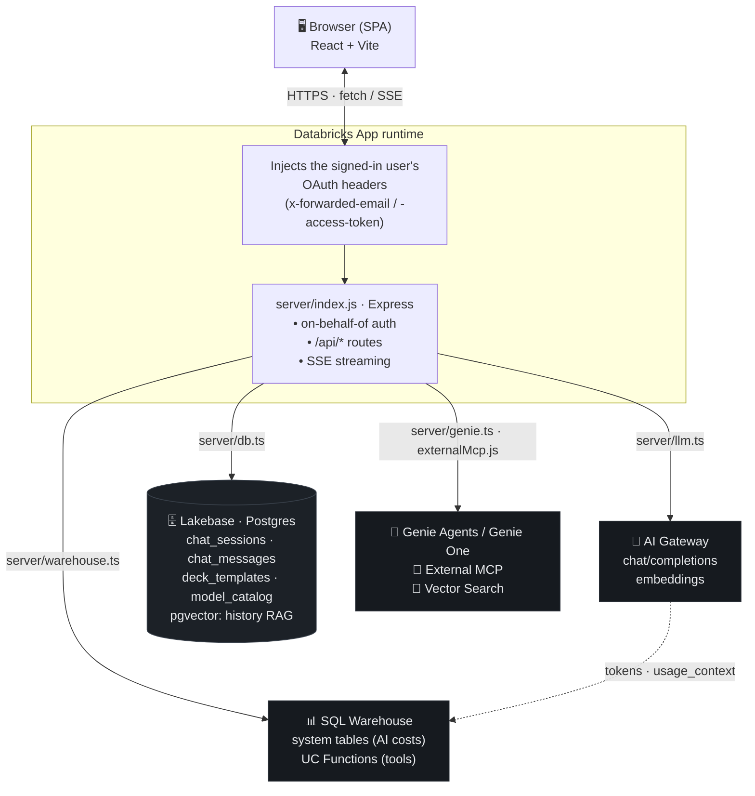

<!-- i18n: source=README.md source-hash=77af9c88d566683adca1cef9b0ef86d48ece2a33 status=current -->
# AI Prism

[English](README.md) · [Português (Brasil)](README.pt-BR.md) · **Español**

> Esta traducción fue hecha con ayuda de IA y espera revisión nativa. En caso de duda, la [versión en inglés](README.md) es la referencia.

[](LICENSE)
[](.nvmrc)
[](docs/es/CONTRIBUTING.md)

Un entorno de chat multimodelo construido como **Databricks App**. Ofrece una sola interfaz para conversar con varios LLM (Anthropic, OpenAI, Google, Meta, Alibaba, Zhipu) servidos por el **Databricks AI Gateway**. El historial del chat se guarda en **Lakebase (Postgres)**, y la app autentica al usuario del workspace que inició sesión mediante on-behalf-of. Además del chat, genera artefactos reales y editables: presentaciones `.pptx`, hojas de cálculo `.xlsx`, documentos de texto (DOCX/MD/PDF), imágenes y gráficos interactivos. Acepta imágenes como entrada (pégalas o adjúntalas para visión y edición) y usa las herramientas nativas del workspace (Genie, Python, búsqueda y lectura web, Vector Search, UC Functions, MCP externo).

## Descripción general

- **Frontend**: SPA hecha con React 18 + Vite + Tailwind CSS.
- **Backend**: servidor Express (Node 22.18+) que actúa como proxy autenticado hacia el AI Gateway y guarda sesiones y mensajes en Postgres.
- **Modelos**: se accede a ellos mediante los endpoints compatibles con OpenAI del AI Gateway (`/serving-endpoints/chat/completions` y `/serving-endpoints/embeddings`). No hay SDK de proveedores, solo `fetch`.
- **Persistencia**: Lakebase Postgres. La app se conecta como su **service principal**. Un solo rol de Postgres sirve a todos los usuarios, y el aislamiento es a nivel de app mediante cláusulas `WHERE user_email`.
- **Despliegue**: se ejecuta como Databricks App (`app.yaml`) y sirve el build de producción del frontend (`client/`) desde el propio proceso Express.

## Arquitectura

El servidor Express es el único punto de entrada. Llama al AI Gateway, a Genie, a Vector Search y a las UC Functions *on-behalf-of* del usuario que inició sesión, usando el token OAuth de ese usuario. Lakebase es la excepción: la app se conecta como su **service principal**, con aislamiento a nivel de app mediante `WHERE user_email` (ver abajo).



> El diagrama de arriba usa [Mermaid](https://mermaid.js.org/), que GitHub renderiza de forma nativa. La flecha punteada del AI Gateway al SQL Warehouse indica que el uso de tokens de cada llamada al gateway se escribe en las *system tables*. El **dashboard de costos AI/BI** (ver [`dashboards/`](dashboards/)) lee desde ahí el costo facturado real (DBUs × precio) por usuario. Se ejecuta fuera de la app, así que ninguna consulta pesada al warehouse puede frenar la interfaz.

### Autenticación (on-behalf-of + service principal)

En producción, el runtime de la Databricks App inyecta los encabezados `x-forwarded-email` y `x-forwarded-access-token` en cada solicitud, que identifican al usuario autenticado del workspace. El servidor usa el token de ese usuario (*on-behalf-of*) para todo lo que debe respetar los permisos del usuario: **AI Gateway**, **Genie**, **Vector Search**, **UC Functions** y **MCP externo** (`Authorization: Bearer <token>`).

**Lakebase es la excepción.** La app se conecta como su **service principal** (el runtime inyecta `DATABRICKS_CLIENT_ID` y `DATABRICKS_CLIENT_SECRET`; ver `server/db.ts`). Un solo rol de Postgres sirve a todos los usuarios, y el aislamiento por usuario es **a nivel de app** (cláusulas `WHERE user_email` en cada consulta). Así la app es multiusuario sin necesidad de un rol de Postgres por persona. Como el token del service principal sobrevive a la rotación, las conexiones se reutilizan en un **pool** (`spPool`). Solo la primera operación con un pool frío paga el handshake. El rol de Postgres del service principal lo crea el job de auto-configuración durante el despliegue (`databricks_create_role`). Conectarse con el token OAuth del usuario como contraseña existe solo como respaldo y para desarrollo local.

En tiempo de ejecución, el servidor verifica que el correo del encabezado pertenezca al dueño del token (`SCIM /Me`, caché de 5 minutos) y rechaza las escrituras que vengan de otro sitio. Ver [SECURITY.md](docs/es/SECURITY.md#vínculo-entre-correo-y-token-serveridentitybindingts).

En desarrollo local, cuando faltan los encabezados, el servidor usa como respaldo `DATABRICKS_USER_EMAIL` / `DATABRICKS_USER_TOKEN`. Para Lakebase, usa `PGHOST` + `PGPASSWORD` (una credencial de base de datos dedicada). En ese modo, escucha solo en `127.0.0.1`.

### Flujo de un mensaje de chat

1. El frontend envía `multipart/form-data` a `POST /api/chat` (el prompt más los adjuntos opcionales).
2. El servidor extrae el texto de cada adjunto (`server/files.ts`) y arma el historial de la sesión desde Postgres.
3. La respuesta se transmite como **Server-Sent Events** (`text/event-stream`), token por token. El streaming del AI Gateway llega directamente al navegador.
4. Al final se guarda el mensaje del asistente (con sus conteos de tokens), se recalcula el embedding de búsqueda semántica de la sesión y, en el primer intercambio, un modelo rápido genera un título (un emoji y unas pocas palabras).

## Estructura del proyecto

```
ai-prism/
├── app.yaml                # Manifiesto de la Databricks App (comando, env, alcance OAuth)
├── server/
│   ├── index.js             # Rutas Express, SSE, autenticación on-behalf-of, bucle de herramientas
│   ├── llm.js                # catálogo de modelos + cliente del AI Gateway (chat/embeddings)
│   ├── db.js                 # esquema y consultas de Lakebase (sesiones/mensajes/decks/hojas de cálculo)
│   ├── usage.js              # taxímetro de uso: registro de costos por llamada (precio, alcance, mes)
│   ├── files.js              # extracción de texto de los adjuntos (pdf/docx/xlsx/pptx/texto)
│   ├── analysis.js           # análisis determinista de hojas de cálculo + candidatos a gráfico
│   ├── blocks.js             # protocolo de bloques estructurados (bloque prism-blocks)
│   ├── tools.js              # llamadas a herramientas: Python, Genie, Vector Search, UC Functions, MCP
│   ├── genie.js              # Genie Agents + Genie One (MCP administrado)
│   ├── decks.js              # generación/validación de decks y exportación .pptx
│   ├── xlsx-export.js        # render de hojas de cálculo a .xlsx reales
│   └── warehouse.js          # ejecución SQL (Statement Execution) para UC Functions/Python
├── client/
│   ├── src/
│   │   ├── App.tsx             # estado global; orquesta sesiones, streaming, tema
│   │   ├── api.ts               # cliente HTTP + parser del stream SSE
│   │   ├── lib/pptxMining.ts     # extracción del design system desde .pptx (colores, íconos, diagramas)
│   │   ├── components/
│   │   │   ├── Sidebar.tsx        # historial, búsqueda semántica, tema, sesión
│   │   │   ├── Composer.tsx       # entrada, adjuntos (arrastrar y soltar), dictado por voz
│   │   │   ├── Message.tsx        # render de Markdown, bloques, costo/tokens, acciones
│   │   │   ├── ModelPicker.tsx    # selector de modelos del AI Gateway
│   │   │   ├── CostMeter.tsx      # taxímetro en el encabezado (gasto del mes y de la conversación)
│   │   │   ├── SettingsModal.tsx  # personas, system prompt, temperatura
│   │   │   ├── VoiceOverlay.tsx   # modo de conversación por voz (full-duplex)
│   │   │   ├── ToolsPicker.tsx    # activa herramientas nativas por sesión
│   │   │   ├── DeckStudio.tsx     # editor de diapositivas (HTML/DOM editable) + exportación .pptx
│   │   │   ├── SpreadsheetStudio.tsx # editor de hojas de cálculo + exportación .xlsx
│   │   │   ├── Welcome.tsx        # pantalla de inicio con sugerencias de prompts
│   │   │   └── blocks/             # Chart/Table/Insight/Deck/Spreadsheet + BlockRenderer
│   │   └── lib/speech.ts         # wrappers de la Web Speech API (STT/TTS)
│   └── dist/                 # build de producción (servido por Express)
└── server-dist/index.cjs   # bundle CJS del servidor (generado por esbuild)
```

## Funcionalidades integradas

### Chat multimodelo
- Catálogo de modelos curado a través del AI Gateway (`server/llm.ts`). La lista predeterminada, habilitada en una instalación nueva, es la generación actual: Claude Sonnet 5.5 (predeterminado para chats nuevos), Opus 5.5, Fable 5.1 y Haiku 5.5; GPT-6.1 Sol y Terra, GPT-6 Luna y Astra; Gemini 4 Argon y 3.8 Flash; Kimi K3; GLM-5.3 y GLM-5.3 Flash; Llama 4 Maverick y Qwen3.5 122B. Cada modelo incluye su proveedor, el soporte de visión y de herramientas, y el precio de lista del proveedor (que se usa para la estimación de costo en la interfaz).
- La generación anterior (Sonnet, Opus y Fable 5; GPT-5.6; Gemini 3.6 Flash; GLM-5.2) permanece en el catálogo, pero desactivada. Basta un clic en el botón *Añadir modelo* de la pestaña de administración, con el precio ya cargado. Las organizaciones que ya tenían el catálogo inicializado ven los modelos nuevos en la franja *Modelos recomendados* de la misma pestaña.
- Los precios curados no quedan congelados en el catálogo de la organización. Hasta que un administrador ingrese un precio propio, se aplica el precio de lista de la app, y las correcciones llegan con la actualización.
- Puedes cambiar de modelo en cada sesión en cualquier momento (`ModelPicker`). La preferencia se recuerda en `localStorage`.
- Manejo por modelo de particularidades del AI Gateway: modelos que rechazan una `temperature` personalizada (`noTemperature`), modelos que aceptan `stream_options.include_usage` (`streamUsage`) y un techo de `max_tokens` por modelo (`maxOut`). Algunos se configuran a mano, y otros se verificaron en vivo en el gateway.

### Respuestas en streaming
- Las respuestas se transmiten por SSE, token por token, con un cursor de escritura en la interfaz y la opción de **detener la generación** en cualquier momento.
- Las métricas de uso (tokens de entrada y de salida) y el costo estimado aparecen por mensaje cuando están disponibles.

### Taxímetro de costos
- El encabezado muestra cuánto ha **gastado este mes** el usuario y cuánto ha costado hasta ahora la **conversación abierta** (`CostMeter`). Al hacer clic se muestra el desglose de la conversación por tipo de llamada (respuestas, ediciones con IA en los estudios, imágenes, audio y video, el enrutador de intención, título, búsqueda y memoria) y la fecha en que se renueva el mes.
- Fuente: la tabla `usage_ledger` en Lakebase, con **una fila por llamada al AI Gateway**. El servidor la escribe (`server/usage.ts`) sin bloquear el turno. Cada fila se valora en el momento de la llamada, usando el mismo catálogo que el selector (primero el override del administrador, luego el precio curado y después la lista de precios de la familia del modelo). Borrar una conversación no devuelve el gasto del mes.
- El total cubre lo que informa el gateway: los tokens de razonamiento que Gemini (y el endpoint de imágenes) reportan fuera de `completion_tokens`, las lecturas de caché a 0.1× y las escrituras de caché a 1.25× (Claude), y las lecturas de caché a 0.1× (GPT). Si un endpoint no devuelve uso, los tokens se estiman a partir de la longitud del texto, y el taxímetro marca el valor con «≈».
- Es una **estimación a precio de lista**. El monto facturado queda en el dashboard de AI Costs (system tables). En el primer despliegue, el historial que ya existe en `chat_messages` (respuestas, enrutador y medios) se copia una sola vez al registro de uso, para que el mes en curso no empiece en cero. Los títulos, los embeddings y las ediciones hechas antes de que existiera ese registro nunca se registraron, así que no forman parte de esa copia.

### Límites de gasto
- La app **no** aplica presupuestos. Usa los **presupuestos nativos de Databricks** del workspace (ver [docs/es/costs-and-positioning.md](docs/es/costs-and-positioning.md)). El taxímetro sigue mostrando el gasto del mes y de la conversación a precio de lista. El mes cambia a medianoche UTC, o en la zona horaria configurada en `USAGE_TIMEZONE` (por ejemplo, `America/Sao_Paulo`).

### Sesiones e historial
- Las sesiones se guardan en Lakebase y se agrupan en la barra lateral por periodo (Hoy, Ayer, Últimos 7 días, Últimos 30 días, Más antiguos).
- Un título automático (un emoji y unas pocas palabras, en el idioma del usuario), generado por el propio modelo de la conversación con el primer mensaje de cada sesión.
- Renombra y borra sesiones directamente en la lista.
- Regenera la última respuesta del asistente, con **versiones navegables**. Cada regeneración se convierte en una variante que puedes recorrer (un carrusel de versiones) en lugar de sobrescribir la anterior.
- Edita un prompt que ya enviaste y regenera la respuesta a partir de la nueva redacción.
- **Recuperación de un turno interrumpido**: si el servidor se cae o el token expira en medio de una generación, la conversación queda con un mensaje del usuario sin respuesta. La interfaz ofrece el botón **Generar respuesta** (`POST /api/sessions/:id/continue`), que completa el turno sin perder el contexto.

### Búsqueda semántica en el historial
- Un campo de búsqueda en la barra lateral (`/api/search`) genera el embedding de la consulta con un modelo multilingüe (`databricks-qwen3-embedding-0-6b`, con un prompt de instrucción asimétrico). Ordena las sesiones por similitud coseno frente a los embeddings del contenido del usuario.
- Los embeddings se calculan y se guardan de forma incremental (backfill perezoso) a medida que se usan o buscan las sesiones.

### Adjuntos de documentos e imágenes
- Varias cargas (hasta 10 archivos, de 25 MB cada uno), con el texto extraído dentro del contexto del modelo: PDF, DOCX, PPTX, XLSX/XLS y formatos de texto plano (txt, md, csv, json, log, tsv, xml, html, yaml).
- Las **imágenes** (PNG, JPG y otras) se adjuntan como entrada de **visión**, no como texto extraído. El modelo puede verlas para describirlas o analizarlas, y puede editarlas (img2img). Ver «Generación y edición de imágenes» más abajo.
- Admite **arrastrar y soltar** y **pegar (Ctrl/Cmd+V)** en el campo de mensaje. Las imágenes muestran una miniatura en la etiqueta del adjunto.
- El contenido de los documentos se trunca a 50 000 caracteres por archivo para que no desborde el contexto.

### Adjuntos de audio y video (transcripción)
- El campo de mensaje acepta **audio y video** (mp3, wav, m4a, mp4, mov, webm y otros) cuando el workspace tiene la transcripción habilitada. Un archivo de medios se **transcribe a texto** en `server/transcribe.ts`, y la transcripción pasa por el **mismo pipeline de adjuntos** que un documento. El **prompt del usuario** decide qué hacer con ella: resumir una reunión, extraer hallazgos, listar pendientes, redactar un seguimiento, etc. Nada está fijo en «resumen».
- La transcripción es **intercambiable** mediante variables de entorno. El valor predeterminado es un endpoint compatible con la API `audio/transcriptions` de OpenAI, por ejemplo de la familia Whisper.
  - `TRANSCRIBE_ENDPOINT`: nombre del endpoint de servicio ASR (predeterminado `whisper`).
  - `TRANSCRIBE_URL`: URL completa que reemplaza la calculada, para gateways que no siguen la convención `/serving-endpoints/<name>/audio/transcriptions`.
  - `TRANSCRIBE_MODEL`: el campo `model` del cuerpo multipart (predeterminado: el nombre del endpoint).
  - `TRANSCRIBE_DISABLED`: `1` o `true` desactiva los medios (el selector deja de ofrecerlos).
- **Degradación controlada**: sin un endpoint configurado, o cuando ocurre un error, la carga se convierte en una nota de adjunto (`[Não foi possível transcrever …]`, el texto literal que emite la app), y el turno continúa con el prompt y los demás adjuntos. La app nunca se rompe.

### Mensajes estructurados y gráficos interactivos
Además de Markdown, una respuesta del asistente puede incluir **bloques estructurados** (`chart`, `table`, `insight`). Se muestran en línea en el chat, se guardan con el mensaje (`chat_messages.blocks`, JSONB) y se restauran al reabrir la sesión.

- Cuando adjuntas una **hoja de cálculo (XLSX, XLS o CSV)**, `server/analysis.ts` la analiza y calcula, **de forma determinista** (nunca a través del LLM, así no se inventan números): el tipo de cada columna (numérica, categórica o fecha), estadísticas básicas y una lista de *candidatos a gráfico* (agregaciones reales: categoría × métrica se convierte en un gráfico de barras o de torta, fecha × métrica en un gráfico de líneas).
- El modelo recibe solo una descripción compacta de esos candidatos (`describeCandidates`). Si le resultan útiles, selecciona o narra algunos, y termina la respuesta con un bloque cercado interno (` ```prism-blocks `, nunca se muestra al usuario; `server/blocks.ts` lo extrae y lo valida). El backend resuelve las referencias contra los datos reales y envía un evento SSE `{ type: 'blocks', blocks }` cuando termina el streaming del texto.
- El frontend renderiza cada bloque en `client/src/components/blocks/`: `ChartBlock` (gráficos de barras, líneas, áreas y torta, dibujados con Recharts), `TableBlock` e `InsightCard`. Si no hay datos suficientes para un gráfico confiable, no se fuerza ningún bloque y la respuesta queda solo en texto.
- Además del modo de referencia (`candidate_N`), el bloque `chart` acepta una **serie en línea** que aporta el propio modelo (`chartType` + `series→data→{label,value}`). Es la vía para datos que vienen de una herramienta (Genie o Python) y no de un adjunto. Aplica la regla de honestidad: los puntos solo pueden ser números reales ya presentes en la conversación, nunca inventados.
- Los documentos (PDF y DOCX) hoy producen una síntesis y hallazgos como texto. Extraer datos estructurados de esos formatos es un siguiente paso inmediato.

### Herramientas nativas del workspace (tool calling)
- Cada sesión puede activar herramientas (`ToolsPicker`). Se ejecutan con el token on-behalf-of del usuario que inició sesión, así que todo respeta los permisos reales del usuario, sin un sandbox propio: **Python** (una UC Function aprovisionada bajo demanda, que se ejecuta en el sandbox serverless gobernado de Databricks), **Genie** (Genie Agents específicos), **Genie One** (MCP administrado, para todo el workspace), **Vector Search**, **UC Functions** independientes y **MCP externo** mediante MCP Services en Unity AI Gateway, desde un catálogo que administra el administrador de la app.
- Los resultados tabulares de Genie y Genie One se convierten en **candidatos a gráfico deterministas**. La tabla markdown de Genie One se vuelve a convertir en filas, reutilizando el mismo pipeline confiable que los adjuntos de hojas de cálculo.
- El modelo **narra antes de cada llamada** (qué está haciendo y por qué). La interfaz muestra una etiqueta por cada llamada a herramienta, intercalada en el punto exacto de la narración, más un indicador de «pensando» entre rondas, para que el trabajo nunca parezca detenido.
- El bucle de herramientas tiene un límite alto (un respaldo contra bucles descontrolados) y **detecta llamadas idénticas repetidas** como una protección real contra bucles. Al terminar el bucle, una ronda de síntesis sin herramientas garantiza que siempre se escriba la respuesta o el artefacto final, con una advertencia honesta si se cortó antes.

### Hojas de cálculo (.xlsx)
- Las solicitudes explícitas de hojas de cálculo generan un bloque `spreadsheet` (el equivalente tabular de `deck`): hojas con bloques ordenados (título, nota, sección, tabla) más gráficos nativos. Obtienes una vista previa en vivo en el chat y exportas a un `.xlsx` **real**, con fórmulas que se recalculan, formato, listas desplegables y gráficos nativos (`server/xlsx-export.ts`).
- Las fórmulas se escriben con **tokens** que la app resuelve a la referencia A1 exacta (`[@Column]`, `[Sheet!Column]`, `[#cell]`) en lugar de coordenadas fijas. Los títulos y los rangos nunca desplazan los cálculos. Los colores de celda vienen del design system activo por **rol semántico** (entrada, fórmula, clave), nunca de un color concreto elegido por el modelo.

### Presentaciones (Estudio de Diapositivas)
- Las solicitudes explícitas de presentación siguen un flujo de dos pasos. Primero, el modelo hace preguntas de contexto dirigidas (audiencia, idioma, extensión, tono). Cada pregunta siempre tiene una opción de texto libre «Otros» y una opción «Decidir por mí». Luego, el modelo genera un bloque `deck-html`. Cada diapositiva es una `<section>` de HTML/CSS que **fluye** dentro del design system activo (un motor de HTML puro). La diapositiva se edita en el Estudio de Diapositivas, donde el DOM es el modelo editable, y se exporta a un `.pptx` real hecho de objetos nativos (`server/decks.ts`).
- **Design systems por usuario** (*Configuración → Design system*): importa uno o varios archivos a la vez, incluidos archivos `.pptx` de marca, archivos `.json` exportados, logotipos e íconos sueltos. El extractor (`client/src/lib/pptxMining.ts`) obtiene colores (siempre editables en HEX), fuentes, logotipo, íconos, ilustraciones y motivos, fotos, placas de portada y de separador, y tipografía. Todo es opcional. Cuantos más assets aportes, más se parecerá el resultado a la marca.
- Los assets reales del design system entran en las diapositivas HTML mediante `` (`` para el logotipo). El ID simbólico se mantiene en el HTML guardado y se resuelve al arte en línea de la marca en la vista previa, en el editor y en la exportación. El comportamiento predeterminado es usar el ícono o motivo ORIGINAL del design system. La creación libre solo ocurre por solicitud explícita.
- Los medios que se repiten en casi todas las diapositivas del archivo original se clasifican como **marca de agua** y nunca entran en un deck generado, ni como ícono ni como imagen. Las imágenes del deck nunca llevan marca de agua.
- El etiquetado semántico opcional de los assets con un modelo de visión («Etiquetar con IA») mejora la elección de íconos, ilustraciones e imágenes por parte del modelo.
- QA determinista del pipeline: `scripts/mine-pptx-qa.mjs` extrae de un .pptx sintético y valida el comportamiento de marca de agua, diagramas y render. `scripts/render-deck-preview.mjs` y `scripts/pptx-to-png.sh` ejecutan QA visual sobre los fixtures de `scripts/fixtures/`.

### Documentos de texto (Estudio de Documentos)
- Las solicitudes explícitas de un documento, informe, artículo o carta generan un bloque `document` cuyo cuerpo es **Markdown**. El Estudio de Documentos lo renderiza como texto enriquecido (react-markdown), permite editar el Markdown a mano, **ajustarlo con IA** (contenido y estilo) y exportarlo a **DOCX** (OOXML armado a mano con JSZip, sin ninguna librería nueva), **Markdown** y **PDF** (impresión del navegador, con una hoja de estilos de impresión propia). Es el tercer estudio de artefactos, siguiendo el mismo patrón que las presentaciones y las hojas de cálculo (`chat_documents`, `DocumentStudio`).

### Generación y edición de imágenes
- Las solicitudes explícitas de imagen («genera o dibuja una imagen, ilustración, logotipo…») llaman a la herramienta integrada `generate_image`, servida por el mismo endpoint `chat/completions` del AI Gateway. Entre los endpoints de imagen está **Nano Banana 2** (Gemini 3.1 Flash Image). La imagen generada aparece en línea en el chat (bloque `image`), con acciones siempre visibles: **descargar**, **copiar** (al portapapeles) y **abrir** a tamaño completo.
- **Imagen como entrada**: puedes **pegar** (Ctrl/Cmd+V) o adjuntar imágenes en el campo de mensaje. Llegan al modelo como entrada de **visión**, así que el modelo puede verlas y describirlas. Con una solicitud de transformación («hazla en blanco y negro», «agrégale un sombrero»), se convierten en una **edición img2img**, y la imagen adjunta se envía de vuelta al modelo de imágenes automáticamente.
- Los bytes de las imágenes viven en un **UC Volume dedicado** (no mezclado con otros assets). El service principal de la app los escribe y los lee, así que no dependen del scope OAuth `files` de cada usuario. El aislamiento por usuario es a nivel de app (`WHERE user_email`), igual que para todos los artefactos. La ruta se configura con `IMAGE_VOLUME_CATALOG`, `_SCHEMA` y `_NAME` (predeterminado `ai_prism.default.ai_prism_images`). Se aprovisiona durante el despliegue y se concede al service principal.
- El **modelo de imagen predeterminado es Nano Banana 2**, preseleccionado en *Configuración → Preferencias → Modelo de generación de imágenes*. El usuario puede elegir otro modelo habilitado.

### Voz
- **Dictado** (voz a texto) en el campo de mensaje, mediante la Web Speech API.
- **Modo de voz** (full-duplex, `VoiceOverlay`): escucha al usuario, envía la voz al modelo, lee la respuesta en voz alta y vuelve a escuchar automáticamente. Es un bucle de conversación manos libres en pt-BR.
- Texto a voz (TTS) bajo demanda para cualquier respuesta del asistente, con el Markdown saneado antes de leerse en voz alta.

### Personalización
- Personas integradas (Default, Concise, Executive, Engineer, Data analyst, Teacher) que completan el system prompt con un clic.
- System prompt y temperatura, configurables por sesión.
- Tema claro y oscuro, guardado en `localStorage`.

### Interfaz
- Diseño adaptable, con una barra lateral que se contrae en el móvil.
- Render de Markdown con GFM y resaltado de código (`react-markdown`, `rehype-highlight`, `remark-gfm`).
- Pantalla de bienvenida con sugerencias de prompts para empezar rápido.

## Ejecución local

### Entorno aislado, sin tokens de Lakebase

El modo recomendado usa PostgreSQL 17 + pgvector, instalados de forma nativa con Homebrew. No hay contenedor. No necesitas Lakebase ni OAuth para persistir o editar fixtures.

```bash
npm install
cp .env.local.example .env.local
npm run local:up       # inicializa e inicia el Postgres privado en .local/postgres
npm run dev:local      # Vite :5173 + Express :8000
```

En otra terminal, con la app ya abierta:

```bash
npm run local:seed     # crea un documento y una diapositiva propios para probar los estudios
```

La conversación **Ambiente local de demonstração** (el título tal como lo crea el seed) te permite probar la vista previa de texto enriquecido, el guardado de documentos y el zoom de diapositivas. El chat, y las herramientas que llaman al AI Gateway, Genie, UC o Vector Search, siguen necesitando credenciales reales. Opcionalmente puedes completarlas en `.env.local` para probar la integración híbrida.

```bash
npm run local:down     # detiene la base de datos y conserva los datos
npm run local:status   # muestra si la base de datos está en ejecución
npm run local:reset    # archiva la base actual; local:up crea una nueva vacía
```

Postgres solo escucha en `127.0.0.1:55432`. Los datos y los logs viven en `.local/`, que Git ignora. El esquema usa `vector(1024)` y un índice HNSW, como Lakebase. Vite mantiene el proxy de `/api` hacia `http://localhost:8000`.

Las dependencias locales son `brew install postgresql@17 pgvector`. No necesitas iniciar un servicio global de Homebrew, porque `local:up` usa directamente los binarios versionados. Generar embeddings sigue requiriendo `DATABRICKS_HOST` y un token válido del workspace.

Para desarrollar directamente contra recursos de Databricks, el flujo anterior sigue disponible con `.env.example` + `npm run dev`.

## Compilación y despliegue

```bash
npm run bundle      # compila el frontend (Vite) y el servidor (esbuild -> server-dist/index.cjs)
npm start           # ejecuta el bundle de producción (node server-dist/index.cjs)
```

El despliegue usa un **Databricks Asset Bundle** (`databricks.yml`), en tres comandos:

```bash
databricks bundle deploy -p <PROFILE> -t dev                 # aprovisiona la infraestructura
databricks apps deploy ai-prism --source-code-path <SRC> -p <PROFILE>  # publica el código de la App
databricks bundle run ai_prism_auto_config -p <PROFILE> -t dev  # rol de Postgres del SP + UDF + volume + admin
```

`bundle deploy` aprovisiona **toda la infraestructura**: Lakebase serverless (el producto *Autoscaling*: 0.5–16 CU, suspensión automática tras 30 min), un SQL Warehouse serverless, la propia App (con Lakebase y el warehouse conectados como recursos) y el dashboard de costos. `apps deploy` publica el código, porque `bundle deploy` por sí solo no vuelve a publicar el proceso en ejecución. `bundle run ai_prism_auto_config` crea el **rol de Postgres del service principal de la app**, aprovisiona la UDF de Python y el Volume de imágenes (en el catálogo `ai_prism`) y **registra a quien despliega como administrador inicial** (tabla `app_admins`). No hace falta ningún paso manual de infraestructura. El host del workspace viene de `-p <PROFILE>`, así que el mismo bundle funciona en AWS, Azure y GCP.

> **Importante:** la App ejecuta los artefactos ya compilados (`client/dist` + `server-dist/index.cjs`), no el código fuente. **Ejecuta siempre `npm run bundle` antes de `bundle deploy` / `apps deploy`.**

**Atajo:** `./deploy.sh <PROFILE>` (Linux/macOS) o `.\deploy.ps1 <PROFILE>` (Windows) ejecuta los tres comandos de arriba en el orden correcto, con `--tag`, `--lakebase-suspend-minutes` y `--usage-policy-id` (ver [docs/es/tags.md](docs/es/tags.md)). Sin terminal, el notebook `Install AI Prism.py` hace lo mismo.

La guía completa paso a paso (requisitos previos, primer acceso, personalización, invitación al equipo y resolución de problemas) está en **[docs/es/onboarding-deployment.md](docs/es/onboarding-deployment.md)**.

### QA

El pipeline de presentaciones y hojas de cálculo tiene verificaciones deterministas. Se ejecutan sin conexión, sin necesidad de workspace:

```bash
npm run qa   # QA de deck-elements + deck-composition + mine-pptx + hojas de cálculo
```

## Documentación

- [Índice de documentación](docs/es/README.md): toda la documentación, en inglés, portugués y español.
- [Onboarding y despliegue](docs/es/onboarding-deployment.md): desde un workspace vacío hasta una App en ejecución, en unos pocos comandos (`bundle deploy` + `apps deploy` + `bundle run`).
- [Política de seguridad](docs/es/SECURITY.md): cómo reportar vulnerabilidades de forma privada.

> **Nota.** AI Prism no es un producto oficial de Databricks y no tiene SLA. Es un acelerador de solución de código abierto que despliegas y personalizas en tu propio workspace. Tus datos permanecen en tu cuenta y no se usan para entrenar modelos.

## Contribuir

¡Las contribuciones son bienvenidas! Consulta **[CONTRIBUTING.md](docs/es/CONTRIBUTING.md)** para el flujo de desarrollo, las convenciones de commits y el QA. Al participar, aceptas el [Código de Conducta](CODE_OF_CONDUCT.md). Reporta las vulnerabilidades de forma privada. Consulta la [política de seguridad](docs/es/SECURITY.md). El historial de cambios está en [CHANGELOG.md](CHANGELOG.md).

## Licencia

Distribuido bajo la licencia **[Apache 2.0](LICENSE)**.
