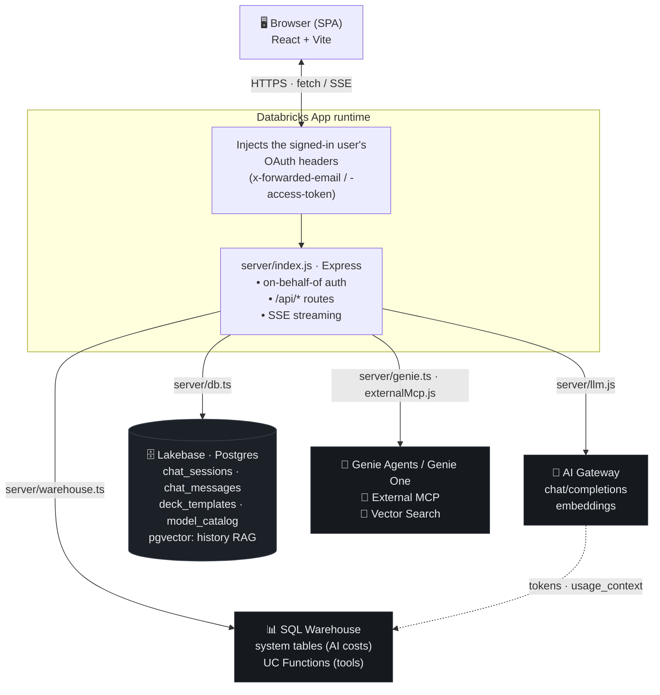

# AI Prism

**English** · [Português (Brasil)](README.pt-BR.md) · [Español](README.es.md)

[](LICENSE)
[](.nvmrc)
[](CONTRIBUTING.md)

A multi-model chat environment built as a **Databricks App**. It gives you one interface to talk
with several LLMs (Anthropic, OpenAI, Google, Meta, Alibaba, Zhipu) served by the
**Databricks AI Gateway**. Chat history is stored in **Lakebase (Postgres)**, and the app
authenticates the signed-in workspace user on-behalf-of. Besides chat, it generates real,
editable artifacts: `.pptx` presentations, `.xlsx` spreadsheets, text documents (DOCX/MD/PDF),
images, and interactive charts. It accepts images as input (paste or attach them for vision and
editing) and calls the workspace's native tools (Genie, Python, web search and reading, Vector
Search, UC Functions, external MCP).

## Overview

- **Frontend**: SPA built with React 18 + Vite + Tailwind CSS.
- **Backend**: Express server (Node 22.18+) that proxies authenticated requests to the AI Gateway and
  stores sessions and messages in Postgres.
- **Models**: accessed through the AI Gateway's OpenAI-compatible endpoints
  (`/serving-endpoints/chat/completions` and `/serving-endpoints/embeddings`). There are no
  provider SDKs, only `fetch`.
- **Persistence**: Lakebase Postgres. The app connects as its **service principal**. One Postgres
  role serves all users, and isolation is app-level through `WHERE user_email` clauses.
- **Deploy**: runs as a Databricks App (`app.yaml`), serving the client's production build from the
  Express process itself.

## Architecture

The Express server is the single entry point. It calls the AI Gateway, Genie, Vector Search, and
UC Functions *on-behalf-of* the signed-in user, using that user's OAuth token. Lakebase is the
exception: the app connects as its **service principal**, with app-level isolation through
`WHERE user_email` (see below).



> The diagram above uses [Mermaid](https://mermaid.js.org/), which GitHub renders natively. The
> dotted arrow from the AI Gateway to the SQL Warehouse means that each gateway call's token usage
> is written to the *system tables*. The **AI/BI cost dashboard** (see [`dashboards/`](dashboards/))
> reads the actual billed cost (DBUs × price) per user from there. It runs outside the app, so no
> heavy warehouse query can slow down the UI.

### Authentication (on-behalf-of + service principal)

In production, the Databricks App runtime injects the `x-forwarded-email` and
`x-forwarded-access-token` headers into every request, identifying the authenticated workspace
user. The server uses that user's token (*on-behalf-of*) for everything that must respect the
user's permissions: **AI Gateway**, **Genie**, **Vector Search**, **UC Functions**, and
**external MCP** (`Authorization: Bearer <token>`).

**Lakebase is the exception.** The app connects as its **service principal** (the runtime injects
`DATABRICKS_CLIENT_ID` and `DATABRICKS_CLIENT_SECRET`; see `server/db.ts`). One Postgres role
serves all users, and per-user isolation is **app-level** (`WHERE user_email` clauses in every
query). That is what makes the app multi-user without a Postgres role per person. Because the
service principal's token survives rotation, connections are **pooled** (`spPool`). Only the first
operation on a cold pool pays the handshake. The service principal's Postgres role is created at
deploy time by the auto-config job (`databricks_create_role`). Connecting with the user's OAuth
token as the password exists only as a fallback and for local development.

At runtime, the server checks that the email in the header belongs to the token's owner
(`SCIM /Me`, 5-minute cache) and refuses writes that come from another site. See
[SECURITY.md](SECURITY.md#email-to-token-binding-serveridentitybindingts).

For local development, when the headers are missing, the server falls back to
`DATABRICKS_USER_EMAIL` / `DATABRICKS_USER_TOKEN`. For Lakebase, use `PGHOST` + `PGPASSWORD` (a
dedicated database credential). In that mode, it listens only on `127.0.0.1`.

### Chat message flow

1. The client sends `multipart/form-data` to `POST /api/chat` (the prompt plus optional attachments).
2. The server extracts text from any attachment (`server/files.ts`) and builds the session history
   from Postgres.
3. The reply streams as **Server-Sent Events** (`text/event-stream`), token by token. The AI
   Gateway's streaming goes straight through to the browser.
4. At the end, the assistant message (with its token counts) is saved, the session's semantic
   search embedding is recalculated, and, on the first exchange, a fast model generates a title
   (an emoji and a few words).

## Project structure

```
ai-prism/
├── app.yaml                # Databricks App manifest (command, env, OAuth scope)
├── server/
│   ├── index.js             # Express routes, SSE, on-behalf-of auth, tool loop
│   ├── llm.js                # model catalog + AI Gateway client (chat/embeddings)
│   ├── db.js                 # Lakebase schema and queries (sessions/messages/decks/spreadsheets)
│   ├── usage.js              # usage meter: per-call cost ledger (price, scope, month)
│   ├── files.js              # text extraction from attachments (pdf/docx/xlsx/pptx/text)
│   ├── analysis.js           # deterministic spreadsheet parsing + chart candidates
│   ├── blocks.js             # structured block protocol (prism-blocks fence)
│   ├── tools.js              # tool calling: Python, Genie, Vector Search, UC Functions, MCP
│   ├── genie.js              # Genie Agents + Genie One (managed MCP)
│   ├── decks.js              # deck generation/validation and .pptx export
│   ├── xlsx-export.js        # rendering spreadsheets to real .xlsx
│   └── warehouse.js          # SQL execution (Statement Execution) for UC Functions/Python
├── client/
│   ├── src/
│   │   ├── App.jsx             # global state; orchestrates sessions, streaming, theme
│   │   ├── api.js               # HTTP client + SSE stream parser
│   │   ├── lib/pptxMining.js     # design system mining from .pptx (colors, icons, diagrams)
│   │   ├── components/
│   │   │   ├── Sidebar.jsx        # history, semantic search, theme, session
│   │   │   ├── Composer.jsx       # input, attachments (drag & drop), voice dictation
│   │   │   ├── Message.jsx        # Markdown rendering, blocks, cost/tokens, actions
│   │   │   ├── ModelPicker.jsx    # AI Gateway model selector
│   │   │   ├── CostMeter.jsx      # header usage meter (month and conversation spend)
│   │   │   ├── SettingsModal.jsx  # personas, system prompt, temperature
│   │   │   ├── VoiceOverlay.jsx   # voice conversation mode (full-duplex)
│   │   │   ├── ToolsPicker.jsx    # enables native tools per session
│   │   │   ├── DeckStudio.jsx     # slide editor (editable HTML/DOM) + .pptx export
│   │   │   ├── SpreadsheetStudio.jsx # spreadsheet editor + .xlsx export
│   │   │   ├── Welcome.jsx        # start screen with prompt suggestions
│   │   │   └── blocks/             # Chart/Table/Insight/Deck/Spreadsheet + BlockRenderer
│   │   └── lib/speech.js         # Web Speech API wrappers (STT/TTS)
│   └── dist/                 # production build (served by Express)
└── server-dist/index.cjs   # server CJS bundle (generated by esbuild)
```

## Built-in features

### Multi-model chat
- Curated model catalog through the AI Gateway (`server/llm.js`). The default list, enabled on a
  new install, is the current generation: Claude Sonnet 5.5 (default for new chats), Opus 5.5,
  Fable 5.1, and Haiku 5.5; GPT-6.1 Sol and Terra, GPT-6 Luna and Astra; Gemini 4 Argon and 3.8
  Flash; Kimi K3; GLM-5.3 and GLM-5.3 Flash; Llama 4 Maverick and Qwen3.5 122B. Each model comes
  with its provider, vision and tool support, and the vendor's list price (used for the cost
  estimate in the UI).
- The previous generation (Sonnet, Opus, and Fable 5; Haiku 4.5; GPT-5.6; Gemini 3.6 Flash; GLM-5.2)
  stays in the catalog but is turned off. It is one click away in the *Add model* button on the
  admin tab, with the price already filled in. Organizations that already had the catalog seeded
  see the new models in the *Recommended models* strip on the same tab.
- Curated prices are not frozen in the organization's catalog. Until an admin enters a custom
  price, the app's list price applies, and corrections arrive with the update.
- You can switch models for each session at any time (`ModelPicker`). The preference is remembered
  in `localStorage`.
- Per-model handling of AI Gateway quirks: models that reject a custom `temperature`
  (`noTemperature`), models that accept `stream_options.include_usage` (`streamUsage`), and a
  per-model `max_tokens` ceiling (`maxOut`). Some of these are set by hand, and others were probed
  live on the gateway.

### Streaming responses
- Responses stream over SSE, token by token, with a typing cursor in the UI and the option to
  **stop generation** at any time.
- Usage metrics (input and output tokens) and the estimated cost appear per message when available.

### Cost meter
- The header shows how much the user has **spent this month** and how much the **open
  conversation** has cost so far (`CostMeter`). Clicking it shows the conversation's breakdown by
  call type (replies, AI edits in the studios, images, audio and video, the intent router, title,
  search, and memory) and the date when the month renews.
- Source: the `usage_ledger` table in Lakebase, with **one row per AI Gateway call**. The server
  writes it (`server/usage.ts`) without blocking the turn. Each row is priced at the moment of the
  call, using the same catalog as the picker (admin override, then curated price, then the model
  family's price book). Deleting a conversation does not refund the month's spend.
- The total covers what the gateway reports: reasoning tokens that Gemini (and the image endpoint)
  report outside `completion_tokens`, cache reads at 0.1× and cache writes at 1.25× (Claude), and
  cache reads at 0.1× (GPT). If an endpoint returns no usage, the tokens are estimated from the
  text length, and the meter marks the value with "≈".
- It is an **estimate at list price**. The billed amount stays in the AI Costs dashboard (system
  tables). On the first deploy, the history already in `chat_messages` (replies, router, and media)
  is copied once to the ledger, so the current month does not start at zero. Titles, embeddings,
  and edits made before the ledger existed were never recorded, so they are not part of that copy.

### Spend limits
- The app does **not** enforce budgets. Use the **native Databricks budgets** in the workspace
  (see [docs/costs-and-positioning.md](docs/costs-and-positioning.md)). The meter keeps showing the
  month's and the conversation's spend at list price. The month rolls over at midnight UTC, or in
  the time zone set by `USAGE_TIMEZONE` (for example, `America/Sao_Paulo`).

### Sessions and history
- Sessions are saved in Lakebase and grouped in the sidebar by period (Today, Yesterday, Last 7 days,
  Last 30 days, Older).
- An automatic title (an emoji and a few words, in the user's language), generated by a fast model
  (Claude Haiku 4.5) on the first message of each session.
- Rename and delete sessions inline.
- Regenerate the last assistant reply, with **browsable versions**. Each regeneration becomes a
  variant you can browse (a version carousel) instead of overwriting the previous one.
- Edit a prompt you already sent and regenerate the reply from the new wording.
- **Recovery from an interrupted turn**: if the server goes down or the token expires in the middle
  of a generation, the conversation is left with a user message that has no reply. The UI offers a
  **Generate answer** button (`POST /api/sessions/:id/continue`) that completes the turn without
  losing context.

### Semantic search in history
- A search field in the sidebar (`/api/search`) embeds the query with a multilingual model
  (`databricks-qwen3-embedding-0-6b`, with an asymmetric instruction prompt). It ranks sessions by
  cosine similarity against the embeddings of the user's content.
- Embeddings are computed and stored incrementally (lazy backfill) as sessions are used or searched.

### Document and image attachments
- Multiple uploads (up to 10 files, 25 MB each), with text extracted into the model's context: PDF,
  DOCX, PPTX, XLSX/XLS, and plain text formats (txt, md, csv, json, log, tsv, xml, html, yaml).
- **Images** (PNG, JPG, and others) attach as **vision** input, not as extracted text. The model
  can see them to describe or analyze them, and it can edit them (img2img). See "Image generation
  and editing" below.
- Supports **drag and drop** and **paste (Ctrl/Cmd+V)** in the composer. Images show a thumbnail in
  the attachment chip.
- Document content is truncated at 50k characters per file so it doesn't overflow the context.

### Audio and video attachments (transcription)
- The composer accepts **audio and video** (mp3, wav, m4a, mp4, mov, webm, and others) when the
  workspace has transcription enabled. A media file is **transcribed to text** in
  `server/transcribe.ts`, and the transcript goes through the **same attachment pipeline** as a
  document. The **user's prompt** decides what to do with it: summarize a meeting, extract insights,
  list to-dos, draft a follow-up, and so on. Nothing is fixed to "summary".
- Transcription is **pluggable** through environment variables. The default is an endpoint compatible
  with the OpenAI `audio/transcriptions` API, for example the Whisper family.
  - `TRANSCRIBE_ENDPOINT`: name of the ASR serving endpoint (default `whisper`).
  - `TRANSCRIBE_URL`: full URL override, for gateways that don't follow the
    `/serving-endpoints/<name>/audio/transcriptions` convention.
  - `TRANSCRIBE_MODEL`: the `model` field of the multipart body (default: the endpoint name).
  - `TRANSCRIBE_DISABLED`: `1` or `true` disables media (the picker stops offering it).
- **Graceful degradation**: without a configured endpoint, or when an error occurs, the upload
  becomes an attachment note (`[Não foi possível transcrever …]`, the literal text the app emits),
  and the turn continues with the prompt and the other attachments. The app never breaks.

### Structured messages and interactive charts
Besides Markdown, an assistant reply can carry **structured blocks** (`chart`, `table`, `insight`).
They render inline in the chat, are saved with the message (`chat_messages.blocks`, JSONB), and are
restored when you reopen the session.

- When you attach a **spreadsheet (XLSX, XLS, or CSV)**, `server/analysis.js` parses it and computes,
  **deterministically** (never through the LLM, so no numbers are made up): the type of each column
  (numeric, categorical, or date), basic statistics, and a list of *chart candidates* (real
  aggregations: category × metric becomes a bar or pie chart, date × metric becomes a line chart).
- The model receives only a compact description of those candidates (`describeCandidates`). If it
  finds them useful, it selects or narrates some of them, ending the reply with an internal fenced
  block (` ```prism-blocks `, never shown to the user; `server/blocks.js` extracts and validates it).
  The backend resolves the references against the real data and sends an SSE event
  `{ type: 'blocks', blocks }` after the text finishes streaming.
- The frontend renders each block in `client/src/components/blocks/`: `ChartBlock` (bar, line, area,
  and pie charts, drawn with Recharts), `TableBlock`, and `InsightCard`. If there isn't enough data
  for a reliable chart, no block is forced, and the reply stays text only.
- Besides the reference mode (`candidate_N`), the `chart` block accepts an **inline series** supplied
  by the model itself (`chartType` + `series→data→{label,value}`). This is the path for data that
  came from a tool (Genie or Python) rather than from an attachment. The honesty rule applies: the
  points can only be real numbers already present in the conversation, never invented.
- Documents (PDF and DOCX) currently produce a synthesis and insights as text. Extracting structured
  data from those formats is a fast follow-up.

### Native workspace tools (tool calling)
- Each session can enable tools (`ToolsPicker`). They run with the signed-in user's on-behalf-of
  token, so everything respects the user's real permissions, with no sandbox of their own:
  **Python** (a UC Function provisioned on demand, executed in Databricks' governed serverless
  sandbox), **Genie** (specific Genie Agents), and **Genie One** (managed MCP, workspace-wide),
  **Vector Search**, standalone **UC Functions**, and **external MCP** through MCP Services in
  Unity AI Gateway, from a catalog managed by the app's admin.
- Tabular results from Genie and Genie One become **deterministic chart candidates**. The Genie One
  markdown table is parsed back into rows, reusing the same reliable pipeline as spreadsheet
  attachments.
- The model **narrates before each call** (what it's doing and why). The UI shows a chip for each
  tool call, interleaved at the exact point in the narrative, plus a "thinking" indicator between
  rounds, so the work never looks stuck.
- The tool loop has a high ceiling (a backstop against runaway loops) and **detects repeated
  identical calls** as a real anti-loop guard. When the loop ends, a synthesis round without tools
  makes sure the final reply or artifact is always written, with an honest warning if it was cut
  short.

### Spreadsheets (.xlsx)
- Explicit spreadsheet requests produce a `spreadsheet` block (the tabular sibling of `deck`): sheets
  with ordered blocks (title, note, section, table) plus native charts. You get a live preview in
  the chat and export to a **real** `.xlsx`, with formulas that recalculate, formatting, dropdowns,
  and native charts (`server/xlsx-export.ts`).
- Formulas are written with **tokens** that the app resolves to the exact A1 reference (`[@Column]`,
  `[Sheet!Column]`, `[#cell]`) instead of fixed coordinates. Titles and ranges never shift the
  calculations. Cell colors come from the active design system by **semantic role** (input, formula,
  key), never from a concrete color chosen by the model.

### Decks (Slide Studio)
- Explicit presentation requests go through a two-step flow. First, the model asks targeted context
  questions (audience, language, length, tone). Each question always has an "Other" free-text option
  and a "Decide for me" option. Then the model generates a `deck-html` block. Each slide is a
  `<section>` of HTML/CSS that **flows** against the active design system (a pure HTML engine). The
  slide is editable in the Slide Studio, where the DOM is the editable model, and exportable to a
  real `.pptx` made of native objects (`server/decks.ts`).
- **Per-user design systems** (Settings → Design system): import one or several files at once,
  including brand `.pptx` files, exported `.json` files, logos, and standalone icons. The miner
  (`client/src/lib/pptxMining.js`) extracts colors (always editable as HEX), fonts, logo, icons,
  illustrations and motifs, photos, cover and divider plates, and typography. All of it is
  optional. The more assets you provide, the closer the result matches the brand.
- Real design system assets enter the HTML slides through ``
  (`` for the logo). The symbolic ID stays in the saved HTML and is resolved to the
  brand's inline artwork in the preview, in the editor, and at export. The default behavior is to
  use the design system's ORIGINAL icon or motif. Free-form creation happens only on explicit request.
- Media reused on nearly every slide of the original file is classified as a **watermark** and never
  enters a generated deck, either as an icon or as an image. Deck images never carry a watermark.
- Optional semantic labeling of assets with a vision model ("Label with AI") improves the model's
  choice of icons, illustrations, and images.
- Deterministic pipeline QA: `scripts/mine-pptx-qa.mjs` mines a synthetic .pptx and validates
  watermark, diagram, and render behavior. `scripts/render-deck-preview.mjs` and
  `scripts/pptx-to-png.sh` run visual QA on the fixtures in `scripts/fixtures/`.

### Text documents (Document Studio)
- Explicit requests for a document, report, article, or letter produce a `document` block whose body
  is **Markdown**. The Document Studio renders it as rich text (react-markdown), lets you edit the
  Markdown by hand, **adjust it with AI** (content and style), and export it to **DOCX** (OOXML
  assembled by hand with JSZip, no new library), **Markdown**, and **PDF** (browser print, with a
  dedicated print stylesheet). It is the third artifact studio, following the same pattern as decks
  and spreadsheets (`chat_documents`, `DocumentStudio`).

### Image generation and editing
- Explicit image requests ("generate or draw an image, illustration, logo…") call the built-in
  `generate_image` tool, served by the same AI Gateway `chat/completions` endpoint. Image endpoints
  include **Nano Banana 2** (Gemini 3.1 Flash Image). The generated image appears inline in the chat
  (`image` block), with actions always visible: **download**, **copy** (to the clipboard), and **open**
  at full size.
- **Image as input**: you can **paste** (Ctrl/Cmd+V) or attach images in the composer. They reach the
  model as **vision** input, so the model can see and describe them. With a transformation request
  ("make it black and white", "add a hat"), they become an **img2img edit**, and the attached image is
  sent back to the image model automatically.
- Image bytes live in a **dedicated UC Volume** (not mixed with other assets). The app's service
  principal writes and reads them, so they don't depend on each user's `files` OAuth scope. User
  isolation is app-level (`WHERE user_email`), as it is for every artifact. The path is configurable
  through `IMAGE_VOLUME_CATALOG`, `_SCHEMA`, and `_NAME` (default `ai_prism.default.ai_prism_images`).
  It is provisioned at deploy time and granted to the service principal.
- The **default image model is Nano Banana 2**, preselected under *Settings → Preferences → Image
  generation model*. The user can choose another enabled model.

### Voice
- **Dictation** (speech to text) in the message field, via the Web Speech API.
- **Voice mode** (full-duplex, `VoiceOverlay`): it listens to the user, sends the speech to the model,
  reads the reply aloud, and listens again automatically. It is a hands-free conversation loop in pt-BR.
- Text-to-speech (TTS) on demand for any assistant reply, with the Markdown sanitized before it is spoken.

### Personalization
- Built-in personas (Default, Concise, Executive, Engineer, Data analyst, Teacher) that fill in the
  system prompt with one click.
- System prompt and temperature, configurable per session.
- Light and dark theme, saved in `localStorage`.

### Interface
- Responsive layout, with a sidebar that collapses on mobile.
- Markdown rendering with GFM and code highlighting (`react-markdown`, `rehype-highlight`,
  `remark-gfm`).
- Welcome screen with prompt suggestions to help you start quickly.

## Running locally

### Isolated environment, no Lakebase tokens

The recommended mode uses PostgreSQL 17 + pgvector, installed natively with Homebrew. There is no
container. You don't need Lakebase or OAuth to persist or edit fixtures.

```bash
npm install
cp .env.local.example .env.local
npm run local:up       # initializes and starts the private Postgres in .local/postgres
npm run dev:local      # Vite :5173 + Express :8000
```

In another terminal, with the app already open:

```bash
npm run local:seed     # creates a document and a slide of your own to test the Studios
```

The conversation **Ambiente local de demonstração** lets you test the rich text preview, document
saving, and slide zoom. The chat, and the tools that call AI Gateway, Genie, UC, or Vector Search,
still require real credentials. You can optionally fill them in `.env.local` to test the hybrid
integration.

```bash
npm run local:down     # stops the database and keeps the data
npm run local:status   # shows whether the database is running
npm run local:reset    # archives the current database; local:up creates a new empty one
```

Postgres only listens on `127.0.0.1:55432`. Data and logs live in `.local/`, which Git ignores. The
schema uses `vector(1024)` and an HNSW index, as Lakebase does. Vite keeps the `/api` proxy to
`http://localhost:8000`.

The local dependencies are `brew install postgresql@17 pgvector`. You don't need to start a global
Homebrew service, because `local:up` uses the versioned binaries directly. Generating embeddings
still requires `DATABRICKS_HOST` and a valid workspace token.

To develop directly against Databricks resources, the previous flow is still available through
`.env.example` + `npm run dev`.

## Build and deploy

```bash
npm run bundle      # build:client (Vite) + build:server (esbuild -> server-dist/index.cjs)
npm start           # runs the production bundle (node server-dist/index.cjs)
```

The deploy uses a **Databricks Asset Bundle** (`databricks.yml`), in three commands:

```bash
databricks bundle deploy -p <PROFILE> -t dev                 # provisions the infrastructure
databricks apps deploy ai-prism --source-code-path <SRC> -p <PROFILE>  # publishes the App's code
databricks bundle run ai_prism_auto_config -p <PROFILE> -t dev  # SP Postgres role + UDF + volume + admin
```

`bundle deploy` provisions **all of the infrastructure**: serverless Lakebase (the *Autoscaling*
product: 0.5–16 CU, auto-stop after 30 min), a serverless SQL Warehouse, the App itself (with
Lakebase and the warehouse attached as resources), and the cost dashboard. `apps deploy` publishes
the code, because `bundle deploy` alone does not republish the running process. `bundle run
ai_prism_auto_config` creates the **Postgres role of the app's service principal**, provisions the
Python UDF and the image Volume (in the `ai_prism` catalog), and **seeds the deployer as the bootstrap
admin** (`app_admins` table). No manual infrastructure step is needed. The workspace host comes from
`-p <PROFILE>`, so the same bundle runs on AWS, Azure, and GCP.

> **Important:** the App runs the pre-built artifacts (`client/dist` + `server-dist/index.cjs`), not
> the source code. **Always run `npm run bundle` before `bundle deploy` / `apps deploy`.**

**Shortcut:** `./deploy.sh <PROFILE>` (Linux/macOS) or `.\deploy.ps1 <PROFILE>` (Windows) runs the three
commands above in the right order, with `--tag`, `--lakebase-suspend-minutes`, and `--usage-policy-id`
(see [docs/tags.md](docs/tags.md)). Without a terminal, the `Install AI Prism.py` notebook does the same.

The full step-by-step guide (prerequisites, first access, customization, inviting your team, and
troubleshooting) is in **[docs/onboarding-deployment.md](docs/onboarding-deployment.md)**.

### QA

The decks and spreadsheets pipeline has deterministic checks. They run offline, with no workspace:

```bash
npm run qa   # deck-elements + deck-composition + mine-pptx + spreadsheet QA
```

## Documentation

- [Documentation index](docs/README.md): all documentation, in English, Português, and Español.
- [Onboarding and deployment](docs/onboarding-deployment.md): from an empty workspace to a running App, in a few commands (`bundle deploy` + `apps deploy` + `bundle run`).
- [Security policy](SECURITY.md): how to report vulnerabilities privately.

> **Note.** AI Prism is not an official Databricks product and has no SLA. It is an open-source
> solution accelerator that you deploy and customize in your own workspace. Your data stays in your
> account and is not used to train models.

## Contributing

Contributions are welcome! See **[CONTRIBUTING.md](CONTRIBUTING.md)** for the development flow, commit
conventions, and QA. By taking part, you agree to the [Code of Conduct](CODE_OF_CONDUCT.md). Report
vulnerabilities privately. See the [security policy](SECURITY.md). The change history is in
[CHANGELOG.md](CHANGELOG.md).

## License

Distributed under the **[Apache 2.0](LICENSE)** license.
