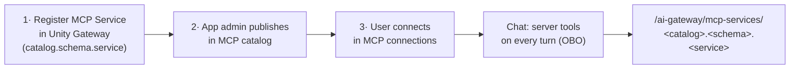

<!-- i18n: source=docs/mcp-connections.md source-hash=0ad9e54ae502506ad2873752abd641c60011a1fc status=machine -->
# Conectar MCPs a AI Prism

[English](../mcp-connections.md) · [Português (Brasil)](../pt-BR/mcp-connections.md) · **Español**

> Esta traducción fue hecha con ayuda de IA y espera revisión nativa. En caso de duda, la [versión en inglés](../mcp-connections.md) es la referencia.

Esta guía muestra, de principio a fin, cómo dar a AI Prism acceso a herramientas
externas mediante **MCP (Model Context Protocol)**, desde Slack y GitHub hasta la
búsqueda web (p. ej., Firecrawl) o un servidor propio. Son **tres pasos**:

1. **En Unity Gateway (Databricks)**: alguien con permiso registra el servidor como un
   **MCP Service** de Unity Catalog, una vez por workspace.
2. **En AI Prism (administrador)**: un administrador de la app **publica** ese MCP Service
   en el *Catálogo MCP*, para que aparezca a los usuarios.
3. **En AI Prism (cada usuario)**: el usuario **conecta** el MCP en *Conexiones MCP*.
   A partir de ahí queda activado en el chat.

> **¿Por qué a través de Unity AI Gateway?** AI Prism nunca pide al usuario que pegue
> una URL arbitraria con un secreto. Cada MCP es un **MCP Service** gobernado por Unity
> Catalog e invocado a través de **Unity AI Gateway**, que se encarga de la autenticación
> con el servicio de terceros (incluido el consentimiento OAuth por usuario, cuando
> corresponda). AI Prism llama al gateway **en nombre del usuario que inició sesión**: el
> bearer es siempre el token OAuth de esa persona, y ninguna credencial se guarda en la app.

---

## Vista general del flujo

Los MCP **gestionados por Databricks** (`system.ai.*`: búsqueda web, Slack, Gmail,
GitHub, Google Drive/Calendar, Microsoft 365, Atlassian, Databricks SQL, Sandbox)
ya vienen en el catálogo de la app, sin necesidad de los pasos 1 ni 2. El administrador
puede ocultarlos si no quiere ofrecerlos.

---

## Paso 1: registrar el MCP Service en Unity Gateway

Se hace en la interfaz de Databricks (ver
[Register an MCP service](https://docs.databricks.com/aws/en/ai-gateway/register-mcp-service)):

1. Abre **Unity Gateway → MCPs → + MCP** y elige **Connect an existing MCP server**.
2. Elige el **catálogo** y el **schema**, y dale un nombre al MCP. El nombre completo
   queda como `<catalog>.<schema>.<service>`, por ejemplo
   `lojinha_do_tio_pedro_catalog.default.firecrawl_mcp`.
3. Selecciona una conexión HTTP existente o crea una (URL del servidor MCP y método de
   autenticación). Haz clic en **Create & load tools**.
4. En **Tools**, autentícate si se te pide y **selecciona solo las tools que tenga sentido
   exponer**. Cada tool expuesta se envía al modelo en cada turno; un servidor con decenas
   de tools cuesta miles de tokens por mensaje (ver *Costo* más abajo).
5. Haz clic en **Create MCP Service**.

Para registrarlo, la documentación de Databricks pide: el entitlement **Workspace
access**; `USE CATALOG` y `USE SCHEMA` en el catálogo y el schema padre; `CREATE SERVICE`
en el schema; y `CREATE CONNECTION` en el schema, o `USE CONNECTION` en una conexión
existente.

**Acceso de los usuarios.** Quien vaya a usar el MCP en AI Prism necesita permiso para
**invocar** el MCP Service, además de `USE CATALOG` y `USE SCHEMA` en su catálogo y schema.
Concédelo desde Unity Catalog (Catalog Explorer → el MCP Service → *Permissions*). Sin ese
acceso, el gateway responde *"Not authorized to invoke MCP service"* y AI Prism muestra el
estado **Sin permiso**.

---

## Paso 2: publicar en AI Prism (administrador de la app)

1. Abre **Configuración (⚙) → Catálogo MCP**. La pestaña es solo para administradores y
   tiene el ícono de escudo.
2. En **Añadir MCP Service**, pega cualquiera de estos formatos y haz clic en **Verificar**:
   - `catalog.schema.service`
   - `mcp-services/catalog.schema.service`
   - la URL del gateway: `https://<workspace>/ai-gateway/mcp-services/catalog.schema.service`
3. AI Prism prueba el servicio **con tu cuenta** y muestra las tools expuestas y el estado:
   - **Conectado**: tools listadas; puedes publicar.
   - **Requiere inicio de sesión**: el servicio pide consentimiento OAuth por usuario.
     Puedes publicar; cada usuario inicia sesión una vez, en su primera conexión.
   - **Sin permiso**: el servicio no existe o tu cuenta no puede invocarlo. Revisa el nombre
     y los permisos (paso 1). La publicación queda bloqueada.
   - **No disponible**: otro error (servidor caído, conexión mal configurada). La publicación
     queda bloqueada.
4. Ajusta el **nombre visible** y la **descripción**, y haz clic en **Publicar para usuarios**.
   Escribe la descripción pensando en el modelo: se convierte en el "para qué sirve" que el
   modelo lee en cada turno (p. ej., *"Búsqueda web en vivo y lectura de páginas."*).

En **Catálogo publicado**, el administrador también puede:

- **ocultar o mostrar** cualquier entrada, incluidas las curadas `system.ai.*`. Un MCP oculto
  desaparece de la lista de los usuarios y queda **bloqueado en el servidor**: no llega al
  modelo, ni siquiera a quien ya lo había conectado, y no puede conectarse escribiendo su nombre;
- **editar** nombre y descripción, **quitar** un MCP publicado o **restaurar** una entrada
  curada a su valor predeterminado.

**Sugerencias del workspace** (sección plegable) muestra, en el mejor esfuerzo posible, los
MCP Services que ve el *service principal de la app*. Puede que no sea la lista completa,
pero cualquier otro servicio funciona si pegas su nombre.

> Los datos del catálogo se guardan en la tabla `app_mcp_catalog` del Lakebase de la app,
> que se crea automáticamente en el primer acceso después del despliegue.

---

## Paso 3: conectar en AI Prism (cada usuario)

1. Abre **Configuración (⚙) → Conexiones MCP**. La pestaña lista el catálogo visible (los
   curados más los publicados por el administrador). Usa la **búsqueda** semántica por
   intención, p. ej., "búsqueda web", "correo y calendario", "código".
2. Haz clic en **Conectar**. AI Prism prueba el acceso **en tu nombre** y muestra el estado
   (los mismos que en el paso 2). En **Requiere inicio de sesión**, un botón abre el flujo del
   proveedor en una pestaña nueva; completa el consentimiento y haz clic en **Verificar**.
3. Listo: el MCP conectado queda **activado en todos los chats**, incluido el primer turno de
   un chat nuevo. Para desactivarlo en una conversación específica, usa el interruptor del
   **selector de herramientas** del campo de mensaje. La elección vale solo para ese chat.

### Regla de la credencial al conectar (incluso por nombre)

Cada MCP que un usuario conecta, ya sea del catálogo o escrito por su nombre completo
(`catalog.schema.service`), debe llamar al servidor que está detrás con una credencial
**propia del usuario**: OAuth por usuario, o la identidad Databricks de quien hace la
llamada. AI Prism lee la configuración del servicio en Unity Catalog (solo metadatos, nunca
el valor de un secreto) y **rechaza** el servicio cuando:

- usa **una credencial compartida**, la misma para todos los usuarios (p. ej., un bearer
  token u OAuth M2M); conectarlo daría a todos la identidad de esa credencial;
- no es posible **confirmar** el tipo de credencial (metadatos ilegibles, app sin service
  principal, o verificación fallida). La regla falla **cerrada**.

La comprobación se ejecuta al **conectar**, al **verificar** una conexión guardada (que queda
marcada como *sin permiso*) y en la **búsqueda**: un nombre rechazado aparece con el motivo y
nunca se ofrece en el selector de herramientas. Las entradas del catálogo cuya clase ya está
confirmada (los `system.ai.*` curados y lo que el administrador verificó al publicar) no se
reclasifican. Los mensajes de error nunca incluyen la credencial. Límite actual: una conexión
guardada antes de esta regla sigue disponible en el chat hasta que se **elimine** (verificarla
solo la marca como rechazada).

---

## Cómo usa el modelo las tools

En cada turno, AI Prism lista las tools de cada MCP conectado y se las ofrece al modelo como
function calling, junto con las herramientas nativas (Genie, Python, UC Functions, Vector Search):

- **Nombres legibles**: `mcp_<servicio>__<tool>`, por ejemplo `mcp_firecrawl_mcp__firecrawl_search`.
- **Contexto en cada tool**: la descripción empieza con el servidor y su finalidad, p. ej.,
  `[Firecrawl — MCP: Búsqueda web en vivo.]`.
- **Guía del turno**: una instrucción de sistema lista los servidores MCP conectados, para qué
  sirve cada uno (la descripción del catálogo) y las **instrucciones que el propio servidor
  publica** en el MCP. También indica al modelo que revise las tools antes de decir que "no
  tiene acceso" a algo, como noticias, eventos recientes o páginas web.
- **Listado rápido**: listar las tools a través del gateway puede tardar algunos segundos
  (Firecrawl tarda 2,6–4,4 s). La lista se guarda en caché por usuario y se renueva en segundo
  plano. La caché se precarga al conectar o verificar y al abrir el selector. Un turno sin caché
  espera hasta 8 s; si pasa de ese tiempo, ese MCP se convierte en una tool de "estado" con el
  motivo, y el listado termina en segundo plano para el siguiente turno.

### Costo

Cada tool expuesta lleva su schema en **cada** turno. Las 28 tools de Firecrawl, por ejemplo,
suman unos 14 mil tokens por mensaje. Para reducirlo, expón en el MCP Service solo las tools
que importan (paso 1, paso 4).

---

## Solución de problemas

| Síntoma | Causa probable | Qué hacer |
| --- | --- | --- |
| El MCP no aparece en *Conexiones MCP* | No se publicó, o un administrador lo ocultó | Administrador: publicarlo o mostrarlo en *Catálogo MCP* |
| Estado **Sin permiso** | El servicio no existe o el usuario no puede invocarlo | Revisar el nombre; conceder acceso al MCP Service + `USE CATALOG`/`USE SCHEMA` |
| Estado **Requiere inicio de sesión** que no desaparece | Consentimiento OAuth por usuario pendiente | Hacer clic en **Iniciar sesión**, completarlo con el proveedor y luego **Verificar** |
| Estado **No disponible** | Servidor caído, o conexión HTTP mal configurada | Revisar la conexión del MCP Service en Unity Gateway |
| El modelo dice que no tiene la herramienta | El MCP se desactivó en este chat, o falló el listado | Revisar el interruptor en el selector; la narración del turno muestra "· no disponible" cuando falla el listado |
| Respuestas caras o lentas | Demasiadas tools expuestas por el servidor | Exponer menos tools en el MCP Service |

---

## Ver también

- **[mcp-microsoft-graph.md](../mcp-microsoft-graph.md)**: cómo conectar correo, calendario y
  archivos de Microsoft **sin licencia de Copilot Studio Pro**, construyendo un servidor MCP
  desde cero sobre Microsoft Graph.
- `server/externalMcp.ts`: catálogo (curados + `app_mcp_catalog`), normalización de nombres,
  sondeo y sugerencias.
- `server/mcpClient.ts`: cliente Streamable HTTP (listar y llamar tools, caché).
- `server/tools.js`: tools MCP para el modelo (nombres, contexto, guía del turno).
- `client/src/components/McpCatalogAdminTab.jsx` y `McpConnectionsTab.jsx`: las pestañas.
