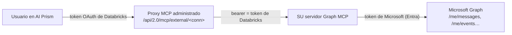

<!-- i18n: source=docs/mcp-microsoft-graph.md source-hash=904e27998a6c6c695fadb93fa505d7ddfd552db1 status=current -->
# AI Prism + Microsoft 365 (correo, calendario, archivos) sin Copilot Studio Pro

[English](../mcp-microsoft-graph.md) · [Português (Brasil)](../pt-BR/mcp-microsoft-graph.md) · **Español**

> Esta traducción fue hecha con ayuda de IA y espera revisión nativa. En caso de duda, la [versión en inglés](../mcp-microsoft-graph.md) es la referencia.

**La pregunta que responde este documento:** una organización que **no tiene
licencia de Copilot Studio Pro** quiere que AI Prism lea y escriba el **correo y
el calendario** (Outlook/Exchange Online) de sus usuarios y, opcionalmente,
OneDrive/Teams. Sin el conector administrado de Copilot Studio, la forma correcta
y soportada es **construir un servidor MCP propio sobre Microsoft Graph** y
registrarlo como una conexión MCP externa (ver **[mcp-connections.md](./mcp-connections.md)**).

Esta guía ofrece la **arquitectura recomendada**, los compromisos de autenticación
(la parte donde más se falla), un esqueleto de implementación y el paso a paso de
la integración con AI Prism.

> **¿Por qué MCP y no una herramienta nativa dentro de AI Prism?** MCP es la
> frontera de integración de AI Prism (`server/mcpClient.ts` habla Streamable
> HTTP). Un servidor Graph MCP es reutilizable (cualquier cliente MCP lo consume),
> queda **fuera** del ciclo de despliegue de la app, y la gobernanza (quién puede
> usarlo) vive en Unity Catalog. Nada de Graph entra en el código de AI Prism.

---

## 1. La sutileza que lo define todo: dónde ocurre la autenticación de Microsoft

Entienda el camino del token **antes** de elegir el diseño:

<!-- i18n: code-translated en=6120d78025da -->


AI Prism **siempre** llama al proxy de Databricks con el **token de Databricks del
usuario con sesión iniciada** (es el modelo on-behalf-of de la app:
`server/mcpClient.ts` envía `Authorization: Bearer <token-databricks>`). Ese token
**no** es un token de Microsoft Graph. Por lo tanto:

> **Su servidor Graph MCP es responsable de obtener por sí solo el token de
> Microsoft Graph.** Es una **app registrada en Microsoft Entra ID** (Azure AD) y
> se autentica por su cuenta contra Microsoft. Lo que le llega a través de
> Databricks es solo **quién** es el usuario (identidad), no una credencial de
> Microsoft.

Eso deja **dos** decisiones independientes:

- **(A) Cómo el proxy de Databricks se autentica en su MCP** (la "puerta
  delantera"): bearer estático u OAuth por usuario, configurado en las *options*
  de la conexión de Unity Catalog.
- **(B) Cómo su MCP se autentica en Microsoft Graph** (la "puerta trasera"):
  **app-only** (client credentials) o **delegado por usuario**. Aquí vive la
  decisión de arquitectura.

---

## 2. Elegir el modelo de autenticación para Graph (decisión B)

| | **App-only (client credentials)** | **Delegado por usuario (OAuth/OBO)** |
| --- | --- | --- |
| Quién actúa | Una identidad de servicio (la app) | El usuario final, con sus propios permisos |
| Consentimiento | Un **admin** consiente una vez (permisos *Application*) | Cada usuario consiente una vez (permisos *Delegated*) |
| Aislamiento | La app puede leer **cualquier** buzón → **usted** debe restringirlo | Limitado naturalmente al buzón del propio usuario |
| Endpoints de Graph | `/users/{upn}/messages`, `/users/{upn}/events` | `/me/messages`, `/me/events` |
| Complejidad | Menor (un solo flujo de token) | Mayor (inicio de sesión + refresh por usuario) |
| Mejor para | Piloto / un solo tenant, automatizaciones, cuentas de servicio | Producción multiusuario, trazabilidad de auditoría por persona |

### Recomendación

- **Piloto / prueba de valor (el valor por defecto recomendado para empezar):**
  **app-only** con una **Application Access Policy** de Exchange que **restrinja
  los buzones** a un grupo de seguridad. Arranca rápido (un solo flujo de token),
  y AI Prism asigna la identidad del usuario al buzón correcto.
- **Producción multiusuario:** **delegado por usuario**. Cada persona solo alcanza
  su propio correo y calendario por construcción, con auditoría por usuario.
  Encaja con el flujo **"Requiere inicio de sesión → Verificar"** que AI Prism ya
  muestra en la pestaña de MCPs (el servidor devuelve un error de consentimiento
  con el enlace de inicio de sesión; el usuario consiente una vez).

> **Mínimo privilegio.** Pida solo los scopes necesarios: `Mail.Read`/`Mail.Send`,
> `Calendars.Read`/`Calendars.ReadWrite`, `Files.Read`, de preferencia delegados.
> **Nunca** pida `Mail.ReadWrite` a nivel de todo el tenant sin necesidad. En
> app-only, **siempre** limite con `New-ApplicationAccessPolicy`.

---

## 3. Identidad: vincular al usuario de Databricks con el buzón de Microsoft

El punto crítico del modo **app-only**: su MCP necesita saber **de quién** es el
correo que debe acceder. Como AI Prism llama en nombre del usuario de Databricks,
extraiga esa identidad en el servidor MCP:

- El bearer que llega es el **token OAuth de Databricks** del usuario: valídelo y
  lea su **UPN/correo** (el endpoint SCIM `Me` de Databricks, o los claims del
  token). **Valide siempre** (firma + audiencia); nunca confíe en un header de
  identidad arbitrario.
- Asigne ese correo → el UPN de Microsoft 365 (lo más común es que sean **iguales**:
  mismo IdP corporativo). Mantenga un mapa explícito si difieren.
- Haga las llamadas a Graph con `/users/{upn}/…` (app-only) o `/me/…` (delegado).

En el modo **delegado**, el propio consentimiento OAuth por usuario ya ata la
identidad: `/me` resuelve a la persona que consintió y no necesita un mapa.

---

## 4. Herramientas (tools) que el MCP debe exponer

Modele **verbos claros y de bajo riesgo**, no un pase libre a Graph. El modelo de
AI Prism llama a estas tools mediante function calling; buenos nombres y
descripciones mejoran el enrutamiento. El usuario de AI Prism decide qué hacer con
el resultado (resumir, extraer pendientes, redactar una respuesta): las tools solo
entregan datos y acciones.

| Tool | Hace | Scope de Graph |
| --- | --- | --- |
| `list_recent_emails` | últimos N mensajes (asunto, remitente, extracto, fecha) | `Mail.Read` |
| `get_email` | cuerpo completo + adjuntos de un mensaje por id | `Mail.Read` |
| `search_emails` | búsqueda por remitente/asunto/período/texto (`$search`/`$filter`) | `Mail.Read` |
| `list_calendar_events` | eventos en una ventana de fechas | `Calendars.Read` |
| `create_calendar_event` | crea un evento/invitación | `Calendars.ReadWrite` |
| `send_email` | envía (o deja en borrador) un correo | `Mail.Send` |
| `list_recent_files` | archivos recientes de OneDrive (opcional) | `Files.Read` |

**Pautas:**
- **Escrituras detrás de confirmación.** Haga que `send_email`/`create_calendar_event`
  creen un **borrador** por defecto y solo envíen con un parámetro explícito
  `confirm: true`: los modelos tienden a actuar demasiado pronto.
- **Pagine y limite** (`$top`, `$select`) para no volcar buzones enteros en el
  contexto del modelo.
- **`$delta` + change notifications** si necesita sincronización eficiente (evita
  volver a descargar todo en cada llamada).
- **Descripciones ricas** en cada tool (AI Prism se las pasa al modelo como el
  function schema).

---

## 5. Esqueleto de implementación (Node + MCP SDK + MSAL)

Stack recomendado (la misma familia que AI Prism): **Node.js**,
`@modelcontextprotocol/sdk` (el transporte **Streamable HTTP**, lo que espera
`server/mcpClient.ts`), `@azure/msal-node` para los tokens y los **SDK de
Microsoft Graph**. Un esquema app-only:

```js
// server.js — Graph MCP (app-only, abridged)
import express from 'express'
import { McpServer } from '@modelcontextprotocol/sdk/server/mcp.js'
import { StreamableHTTPServerTransport } from '@modelcontextprotocol/sdk/server/streamableHttp.js'
import { ConfidentialClientApplication } from '@azure/msal-node'
import { Client } from '@microsoft/microsoft-graph-client'

// --- back door: Microsoft Graph token (app-only) ---
const msal = new ConfidentialClientApplication({
  auth: {
    clientId: process.env.MS_CLIENT_ID,
    authority: `https://login.microsoftonline.com/${process.env.MS_TENANT_ID}`,
    // PREFER a certificate (clientCertificate) over clientSecret in production
    clientSecret: process.env.MS_CLIENT_SECRET,
  },
})
async function graphForUser(upn) {
  const { accessToken } = await msal.acquireTokenByClientCredential({
    scopes: ['https://graph.microsoft.com/.default'],
  })
  const client = Client.init({ authProvider: (done) => done(null, accessToken) })
  // app-only → always scoped to ONE mailbox: /users/{upn}
  return { client, base: `/users/${encodeURIComponent(upn)}` }
}

// --- front door: validate the Databricks token and extract the user ---
async function resolveUser(req) {
  const token = (req.headers.authorization || '').replace(/^Bearer\s+/i, '')
  const upn = await verifyDatabricksTokenAndGetUpn(token) // validate signature+audience!
  if (!upn) { const e = new Error('not authenticated'); e.status = 401; throw e }
  return upn
}

const mcp = new McpServer({ name: 'ms-graph', version: '1.0.0' })

mcp.tool(
  'list_recent_emails',
  "Lists the user's most recent emails (subject, sender, date, preview).",
  { top: { type: 'number', default: 15 } },
  async ({ top }, { req }) => {
    const upn = await resolveUser(req)
    const { client, base } = await graphForUser(upn)
    const r = await client
      .api(`${base}/messages`)
      .top(Math.min(top ?? 15, 50))
      .select('subject,from,receivedDateTime,bodyPreview')
      .orderby('receivedDateTime DESC')
      .get()
    return { content: [{ type: 'text', text: JSON.stringify(r.value, null, 2) }] }
  }
)

mcp.tool(
  'send_email',
  'Sends an email. Creates a draft by default; only sends with confirm=true.',
  { to: {}, subject: {}, body: {}, confirm: { type: 'boolean', default: false } },
  async ({ to, subject, body, confirm }, { req }) => {
    const upn = await resolveUser(req)
    const { client, base } = await graphForUser(upn)
    const message = { subject, body: { contentType: 'HTML', content: body },
      toRecipients: [{ emailAddress: { address: to } }] }
    if (!confirm) {
      const draft = await client.api(`${base}/messages`).post(message)
      return { content: [{ type: 'text', text: `Draft created (${draft.id}). Call again with confirm=true to send it.` }] }
    }
    await client.api(`${base}/sendMail`).post({ message })
    return { content: [{ type: 'text', text: 'Email sent.' }] }
  }
)

// ... list_calendar_events / create_calendar_event / search_emails are analogous ...

const app = express()
app.post('/mcp', async (req, res) => {
  const transport = new StreamableHTTPServerTransport({ /* sessionId etc. */ })
  await mcp.connect(transport)
  await transport.handleRequest(req, res)
})
app.listen(process.env.PORT || 8080)
```

Para el modo **delegado**, cambie `acquireTokenByClientCredential` por el flujo
**OBO** (`acquireTokenOnBehalfOf`) o por un **auth code + refresh token** por
usuario, y devuelva un **error de consentimiento con una URL de inicio de sesión**
cuando el usuario aún no ha consentido: es exactamente lo que AI Prism convierte en
el estado **"Requiere inicio de sesión"** con el botón que abre el flujo (ver §7).

### Dónde alojarlo

- Una **Databricks App** propia (misma cuenta, sin salir de Databricks), **Azure
  Container Apps / App Service** (más cerca de Entra/Graph), o cualquier host con
  HTTPS público al que llegue el proxy de Databricks. Necesita **TLS** y ser
  accesible desde la red del workspace.

---

## 6. Registro de la app en Microsoft Entra ID (una vez)

1. **Entra ID → App registrations → New registration** (single- o multi-tenant,
   según requiera su organización).
2. **Certificates & secrets:** prefiera un **certificado** (X.509) a un client
   secret; guárdelo en Key Vault. Considere **Workload Identity Federation** para
   eliminar secretos de larga duración.
3. **API permissions → Microsoft Graph:**
   - App-only: permisos **Application** (`Mail.Read`, `Mail.Send`,
     `Calendars.ReadWrite`, …) → **Grant admin consent**.
   - Delegado: permisos **Delegated** (mismos nombres) → consentimiento por
     usuario en el primer uso.
4. **Restrinja el alcance (app-only):** cree un grupo de seguridad con los buzones
   permitidos y aplique una **Application Access Policy** en Exchange Online:
   ```powershell
   New-ApplicationAccessPolicy -AppId <MS_CLIENT_ID> `
     -PolicyScopeGroupId ai-prism-mailboxes@contoso.com `
     -AccessRight RestrictAccess `
     -Description "AI Prism Graph MCP — pilot mailboxes only"
   ```
5. Anote el **Tenant ID**, el **Client ID** y la **ruta de la credencial** para el
   despliegue del MCP.

---

## 7. Integración con AI Prism

Con el MCP en línea (HTTPS), siga **[mcp-connections.md](./mcp-connections.md)**:
AI Prism no distingue un "Graph MCP" de cualquier otro MCP externo.

1. **Un admin registra la conexión HTTP en Unity Catalog** apuntando a su MCP:

   ```sql
   -- Front door con bearer estático (el MCP valida por su cuenta):
   CREATE CONNECTION IF NOT EXISTS microsoft_graph_mcp
     TYPE HTTP
     OPTIONS (
       host 'https://graph-mcp.yourcompany.com',
       port '443',
       base_path '/mcp',
       is_mcp_connection 'true',
       bearer_token '<FRONT_DOOR_TOKEN>'   -- opcional; ver la nota
     )
     COMMENT 'Microsoft 365 — email and calendar via Microsoft Graph';

   GRANT USE CONNECTION ON CONNECTION microsoft_graph_mcp TO `ai-prism-users`;
   ```

   > **Nota sobre la puerta delantera vs. la trasera.** El `bearer_token` de
   > arriba autentica el salto **proxy de Databricks → su MCP**. Es **distinto**
   > del token de Microsoft (que el MCP obtiene por sí solo). En el modo
   > **delegado**, deje que las *options* de OAuth de la conexión disparen el
   > **inicio de sesión por usuario**: así el consentimiento de Microsoft ocurre a
   > través del flujo "Requiere inicio de sesión" de AI Prism.

2. **Cada usuario se conecta** en **Configuración → MCPs** y hace clic en
   **Conectar**.
   - App-only bien configurado → estado **Conectado** de inmediato.
   - Delegado → estado **Requiere inicio de sesión**; el usuario hace clic en
     **iniciar sesión**, consiente en la pantalla de Microsoft y luego en
     **Verificar**.
3. **Actívelo en el selector de herramientas** del chat (viene activado por
   defecto tras conectar).
4. **Úselo**: ahora el usuario guía a AI Prism con libertad:
   > *"Resume mis correos no leídos de hoy y lista los pendientes que aparecen."*
   > *"¿Qué reuniones tengo mañana? Prepara una agenda para la de las 14 h."*
   > *"Redacta una respuesta al último correo del proveedor confirmando la
   > reunión del viernes."*

   El modelo llama a las tools MCP, AI Prism las ejecuta en nombre del usuario y
   el modelo compone la respuesta; es combinable con el resto de las funciones de
   la app (generar una presentación con la agenda, una hoja de cálculo con los
   pendientes, etc.).

---

## 8. Seguridad, cumplimiento y operación (checklist)

- [ ] **Valide el token de Databricks** en el MCP (firma + audiencia); nunca
      confíe en un header de identidad suelto.
- [ ] **Mínimo privilegio** en los scopes de Graph; **delegado** siempre que sea
      posible.
- [ ] App-only **siempre** con una **Application Access Policy** que limite los
      buzones.
- [ ] **Certificado / credenciales federadas** en lugar de un client secret;
      secretos en Key Vault; rotación y monitoreo.
- [ ] **Escrituras** (`send_email`, `create_event`) detrás de `confirm=true`
      (borrador por defecto).
- [ ] **Paginación / `$select` / `$delta`** por eficiencia y para no desbordar el
      contexto del modelo.
- [ ] **Throttling de Graph:** backoff exponencial con jitter + `Retry-After`; use
      los SDK (reintento integrado).
- [ ] **Auditoría:** registre las llamadas a tools, los consentimientos y el uso
      del service principal en su SIEM; revise los permisos periódicamente.
- [ ] **Residencia de datos:** el contenido de correo y calendario viaja Microsoft
      → su MCP → AI Prism → modelo. Confirme que es aceptable para su
      organización (AI Prism corre en su propio workspace; los modelos son los de
      su propio AI Gateway).

---

## 9. Alternativas consideradas

- **Copilot Studio Pro / conector administrado**: el camino "sin código", pero
  exige la licencia que este escenario supone que usted **no tiene**. Esta guía es
  la alternativa.
- **Una tool nativa en AI Prism** (una UC Function/Python que llame a Graph):
  posible, pero acopla credenciales de Microsoft a la app y a su despliegue, pierde
  la gobernanza de Unity Catalog y no es reutilizable fuera de AI Prism. **MCP es
  preferible.**
- **Logic Apps / Power Automate como fachada HTTP**: viable para unos pocos flujos
  fijos, pero no expone MCP de forma nativa y es menos flexible que un servidor MCP
  con tools bien modeladas.

---

## Referencias

- On-Behalf-Of (OBO) flow — Microsoft identity platform.
- App-only access primer — Microsoft identity platform.
- Delta query & change notifications (Outlook).
- `New-ApplicationAccessPolicy` — restringir el acceso a buzones (Exchange Online).
- Credenciales: certificados y Workload Identity Federation.
- Microsoft Graph throttling & retry.
- **[mcp-connections.md](./mcp-connections.md)**: cómo registrar la conexión en
  UC y conectarla en AI Prism (el paso genérico que esta guía especializa).
