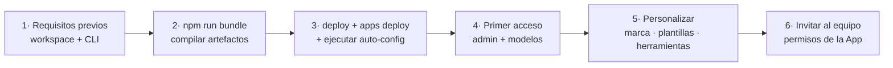

<!-- i18n: source=docs/onboarding-deployment.md source-hash=694a98f8598409a571a88e7734881412d3e1e73a status=machine -->
# Onboarding: tu propio "ChatGPT" en Databricks en unos 20 minutos

[English](../onboarding-deployment.md) · [Português (Brasil)](../pt-BR/onboarding-deployment.md) · **Español**

> Esta traducción fue hecha con ayuda de IA y espera revisión nativa. En caso de duda, la [versión en inglés](../onboarding-deployment.md) es la referencia.

> **Aviso.** AI Prism no es un producto oficial de Databricks y no tiene SLA. Es un
> acelerador de código abierto que **despliegas en tu propio workspace** y
> personalizas como quieras. Tus datos se quedan en tu cuenta de Databricks y no se
> usan para entrenar modelos de terceros.

Esta guía te lleva de un "workspace vacío" a una "app funcionando para el equipo" con
**un solo comando**. Toda la infraestructura (Lakebase, SQL Warehouse, App,
dashboard, UDF) la aprovisiona un **Databricks Asset Bundle**. No creas recursos a mano.

---

## Visión general del flujo

<!-- i18n: code-translated -->


El paso 3 son tres comandos (detallados abajo). **`bundle deploy`** aprovisiona la
infraestructura: **Lakebase serverless** (producto *Autoscaling*: 0.5–16 CU,
apagado automático a los 30 min), un **SQL Warehouse serverless**, la **App** (con
Lakebase y el Warehouse conectados como recursos, que inyectan `PGHOST` y
`SQL_WAREHOUSE_ID` en el runtime) y el **dashboard de costos**. **`apps deploy`**
publica el código. **`bundle run ai_prism_auto_config`** crea el rol de Postgres para el
service principal, aprovisiona la UDF de Python y el Volume de imágenes, y registra a
quien hizo el despliegue como **bootstrap de admin**.

---

## 1. Requisitos previos (5 min)

- Un **workspace de Databricks** (AWS, Azure o GCP) con Unity Catalog habilitado.
- **AI Gateway / Foundation Model APIs** disponibles en tu región (endpoints
  `databricks-claude-*`, `databricks-gpt-*`, etc.).
- Un **Databricks CLI reciente (≥ ~1.x; idealmente ≥ 1.8)**, autenticado con un perfil
  para el workspace. Las CLI antiguas (por ejemplo, 0.29x) fallan al descargar el
  Terraform interno con `openpgp: key expired` durante `bundle deploy`. La CLI ≥ 1.8
  guarda la credencial en el llavero del sistema. Si un token antiguo en caché estorba,
  vuelve a ejecutar `databricks auth login` o exporta `DATABRICKS_AUTH_STORAGE=plaintext`.
  ```bash
  # Azure: usa el host de tu workspace (adb-<id>.<n>.azuredatabricks.net)
  databricks auth login --host https://<seu-workspace> -p <PROFILE>
  ```
- Permiso para crear una **Databricks App**, un **SQL Warehouse**, **Lakebase** y **Jobs**
  (el bundle crea todos). Para la UDF de Python y el Volume de imágenes, tienes que poder
  crear el catálogo `ai_prism` (o ya tenerlo). Si no tienes `CREATE CATALOG` en el
  metastore, apunta a un catálogo existente con
  `--var tools_catalog=<cat> --var image_volume_catalog=<cat>`.
- **Node.js 22.18+** y **npm** para el build local (`engines` de `package.json`; los tests
  end-to-end necesitan 22.19+).

**Verificación:** `databricks current-user me -p <PROFILE>` devuelve tu correo electrónico.

> **Nota (agnóstico de nube):** `databricks.yml` **no** fija un host del workspace.
> El destino del despliegue viene por completo del perfil en `-p <PROFILE>`. El mismo
> bundle se despliega en AWS, Azure o GCP sin editar ningún archivo. Si tu CLI ≥ 1.8
> se queja de una credencial en caché de una versión anterior, exporta
> `DATABRICKS_AUTH_STORAGE=plaintext` o vuelve a ejecutar `databricks auth login`.

---

## 2. Generar los artefactos (2 min)

La App ejecuta artefactos ya compilados (`client/dist` + `server-dist/index.cjs`), no el
código fuente. Por eso, **siempre** vuelve a compilar antes de desplegar:

```bash
npm ci --include=dev   # solo la primera vez (ver la nota de devDeps más abajo)
npm run bundle         # client/dist + server-dist/index.cjs
```

> **Nota (devDeps):** en este proyecto, un `npm install <pkg>` sin más puede eliminar las
> devDependencies que necesita el build. Usa `npm ci --include=dev` o
> `npm install --include=dev`.

---

## 3. Desplegar la pila completa (5 min)

### Opción A: un solo comando (recomendada)

`deploy.sh` (Linux/macOS) y `deploy.ps1` (Windows) hacen todo lo siguiente en el orden
correcto. Reciben el perfil de la CLI como argumento (no se fija ningún host) y son
idempotentes:

```bash
./deploy.sh <PROFILE> [CATALOGO]                 # valor por defecto de CATALOGO: ai_prism
./deploy.sh --tag cost_center=1234 --tag area=Finanças <PROFILE>
./deploy.sh --lakebase-suspend-minutes 30 --usage-policy-id <id> <PROFILE>
```

```powershell
.\deploy.ps1 <PERFIL> [CATALOGO] -Tag 'cost_center=1234','area=Finanças' -LakebaseSuspendMinutes 30 -UsagePolicyId <id>
```

Opciones: `--tag key=value` (repetible, hasta 24; ver [docs/tags.md](../tags.md)),
`--lakebase-suspend-minutes N` (minutos sin uso antes de que Lakebase entre en reposo,
de 1 a 10080), `--usage-policy-id ID` (una política de uso serverless que un administrador
ya creó en la cuenta) y `--classic-cluster-id ID` (para un workspace sin serverless: el ID
de un cluster clásico de usuario único, Dedicated o Single. El warehouse pasa a ser Pro
clásico y el auto-config se ejecuta en ese cluster). Cada opción tiene una variable de
entorno equivalente (`TAGS`, `LAKEBASE_SUSPEND_MINUTES`, `SERVERLESS_USAGE_POLICY_ID`,
`CLASSIC_CLUSTER_ID`). Consulta `./deploy.sh --help`.

El script ejecuta estos pasos, en este orden:

1. Revisa si el proyecto de Lakebase `ai-prism` quedó **soft-deleted** por un
   `bundle destroy` anterior (ver *Solución de problemas comunes*). Si es así, el script
   se detiene antes de cambiar nada y muestra los comandos para restaurarlo o purgarlo.
   Nunca purga por su cuenta.
2. Escribe el catálogo y las etiquetas en `app.yaml` (`AI_PRISM_RESOURCE_TAGS`) y en
   `.databricks/bundle/<destino>/variable-overrides.json`.
3. Ejecuta `bundle deploy`, inicia la app y publica el código (`apps deploy`).
4. Ejecuta el job de auto-config (rol del SP, UDF, volume, etiquetas y admin bootstrap).

El notebook **`Instalar AI Prism.py`** (en la raíz del proyecto, generado por
`scripts/build-installer-notebook.py`) hace lo mismo desde dentro del workspace, sin
terminal. Sus campos reflejan las opciones de arriba (catálogo, serverless, minutos de
Lakebase, política de uso y etiquetas). Empieza con `acao = verificar`, que no crea nada.

### Opción B: comandos manuales

Tres comandos aprovisionan la infraestructura, publican el código de la App y configuran
la App:

```bash
# valida la configuración del bundle (no crea nada)
databricks bundle validate -p <PROFILE> -t dev

# 1) aprovisiona Lakebase + Warehouse + App + dashboard + job
databricks bundle deploy -p <PROFILE> -t dev

# 2) publica el CÓDIGO de la App (bundle deploy por sí solo NO republica el proceso en ejecución).
#    <SRC> es la ruta que imprime el resumen de deploy / bundle,
#    normalmente /Workspace/Users/<você>/.bundle/ai-prism/dev/files
databricks apps deploy ai-prism --source-code-path <SRC> -p <PROFILE>

# 3) ejecuta el job de auto-config: crea el rol PG del SP, aprovisiona la UDF de Python
#    y el Volume de imágenes (catálogo ai_prism), y registra el bootstrap de admin
databricks bundle run ai_prism_auto_config -p <PROFILE> -t dev
```

El bundle (`databricks.yml`) gestiona estos recursos:

| Recurso | Configuración |
|---|---|
| **Lakebase** (`postgres_projects` + `postgres_endpoints`) | serverless, autoscaling **0.5–16 CU**, **apagado automático a los 30 min** |
| **SQL Warehouse** (`sql_warehouses`) | Serverless, 2X-Small, Photon, apagado automático a los 10 min |
| **App** (`apps`) | Lakebase y SQL Warehouse conectados como **recursos de la App** (el runtime inyecta `PGHOST` / `SQL_WAREHOUSE_ID`); variables estáticas en `app.yaml` |
| **Dashboard de costos** (`dashboards`) | Dashboard de auditoría de costos de Lakeview (tablas del sistema) |
| **Job de auto-config** (`jobs`) | crea el **rol de Postgres del SP de la app** en Lakebase (`databricks_create_role`), la UDF `ai_prism_python_exec` y el Volume de imágenes (todo en el catálogo `ai_prism`), y **registra el bootstrap de admin** (quien hizo el despliegue) en la tabla `app_admins` |

> **Etiquetas de recursos y opciones avanzadas** (`--tag`, política de uso, minutos de
> Lakebase) existen solo en `deploy.sh`, `deploy.ps1` y el notebook. Con los comandos
> manuales, las etiquetas se aplican a los recursos del bundle. La app las usa en AI
> Gateway y en SQL solo después de actualizar `AI_PRISM_RESOURCE_TAGS` en `app.yaml`.
> Ver [docs/tags.md](../tags.md), "Caminho nativo do bundle".
>
> **Destinos:** `dev` (por defecto; antepone tu nombre de usuario a los nombres de los
> recursos, lo que sirve para pruebas) y `prod` (nombres limpios, para el despliegue
> oficial). Cambia `-t dev` por `-t prod` cuando pases a producción. Ningún destino fija
> un host. El workspace viene de `-p <PROFILE>`, así que no necesitas editar
> `databricks.yml`.

> **Sobre la conexión a Lakebase:** el runtime de la App inyecta `PGHOST` automáticamente
> desde el recurso `lakebase`. No está fijado en ningún lugar del código, por eso el mismo
> bundle funciona en cualquier nube. La app se conecta con **su propio service principal**
> (el job crea el rol de Postgres de ese SP). El aislamiento entre usuarios es a nivel de
> app (`WHERE user_email`).

Al terminar, `databricks bundle summary -p <PROFILE> -t dev` muestra la URL pública de la
App (detrás de OAuth del workspace).

### Acerca de la UDF de Python (`execute_python`)

AI Prism trae su propia UDF (`ai_prism_python_exec`) en lugar de usar
`system.ai.python_exec`. La nuestra respeta una variable `result`, captura `stdout`
**y** maneja las excepciones devolviendo `"ERROR: ..."` sin fallar la consulta. La función
de la plataforma hace fallar toda la sentencia ante cualquier error. La definición vive en
`shared/pythonUdf.js` (la única fuente de verdad). El job de despliegue usa la versión
generada en `bundle/python_udf_ddl.py` (con `node scripts/gen-python-udf-ddl.mjs`), y la
app también la aprovisiona en tiempo de ejecución. Las dos son idénticas, byte por byte.

`TOOLS_CATALOG` y `TOOLS_SCHEMA` definen **solo dónde se crea esta UDF**. No limitan qué
UC Functions puede adjuntar un usuario como herramienta. El descubrimiento de UC Functions
recorre todos los catálogos y esquemas que el usuario puede ver (mediante
`system.information_schema.routines`, excepto `system`). Siempre se limita a los permisos
reales del usuario en Unity Catalog.

### Acerca del Volume de imágenes generadas

Las imágenes generadas o editadas en el chat son archivos binarios reales, así que van a un
**Volume de UC dedicado**. Se mantiene separado del catálogo de herramientas para que los
archivos no se mezclen con otros archivos. Puedes configurar la ruta con
`IMAGE_VOLUME_CATALOG` / `IMAGE_VOLUME_SCHEMA` / `IMAGE_VOLUME_NAME` (por defecto
`ai_prism.default.ai_prism_images`). El job de auto-config crea el catálogo, el esquema y el
volume, y concede `READ/WRITE VOLUME` al **service principal de la app**. La app lee y
escribe imágenes como el SP, no con el token OAuth del usuario. Así no depende de que el
scope `files` se vuelva a consentir en el navegador. El aislamiento entre usuarios sigue
siendo **a nivel de app** (`WHERE user_email` en `chat_images`), como cualquier artefacto.
El **modelo de imagen por defecto es Nano Banana 2**.

---

## 4. Primer acceso y configuración de modelos (5 min)

1. Abre la URL de la App e inicia sesión con tu cuenta del workspace.
2. Como quien hizo el despliegue, el job de auto-config ya te registró como **admin**
   (en la tabla `app_admins`). Así verás las pestañas de administración en *Configuración*.
3. **Modelos (LLM)**: habilita los endpoints de serving que debe usar tu equipo y define
   sus etiquetas y su orden. Los usuarios comunes solo ven los modelos habilitados.
4. **Costos de IA**: la auditoría de costos vive en el **dashboard de AI/BI** que aprovisiona
   el bundle. No está en una pestaña de la app. Ábrelo en el workspace y **publícalo** para
   los demás admins. Los detalles están en [`dashboards/README.md`](../../dashboards/README.md).
5. **Límites de gasto (opcional)**: define presupuestos y alertas con las funciones nativas
   de Databricks para el workspace (ver [costs-and-positioning.md](costs-and-positioning.md)).
   Cada usuario ve su propio consumo en el taxímetro del encabezado. Para que el reinicio
   mensual use tu zona horaria local, define `USAGE_TIMEZONE` (por ejemplo,
   `America/Sao_Paulo`; por defecto es UTC).

---

## 5. Personalización (opcional)

- **Marca / design system**: en *Configuración → Design system*, importa el design system de
  tu empresa (colores, tipografías, logo, íconos), desde un `.pptx` de marca o desde un
  bundle. Así, las presentaciones y las hojas de cálculo salen con tu identidad visual.
- **Herramientas**: conecta **Genie Agents**, **UC Functions** y **Vector Search** como
  herramientas del chat. Agrega **conexiones MCP externas** si las necesitas.
- **Interfaz y funciones**: el código es tuyo. Cambia textos, tema y comportamiento, ejecuta
  `npm run bundle` y luego publica el código con `databricks apps deploy` (ver la sección 3).

---

## 6. Invita al equipo (2 min)

- Otorga a la App el permiso **CAN_USE** a los usuarios o grupos que deban acceder (desde la
  interfaz de permisos de la App o desde la API).
- Para agregar otros **administradores**, usa *Configuración → Administradores* dentro de la
  app. El autocompletado sugiere personas que ya tienen acceso.
- Cada usuario trabaja con **su propia identidad**. Las conversaciones, los permisos de datos
  y el costo se atribuyen a ese usuario.

---

## Solución de problemas comunes

| Síntoma | Causa probable | Acción |
|---|---|---|
| `bundle deploy` falla en Lakebase / endpoint | el recurso de Postgres serverless no está disponible en la región o en la cuenta | confirma la disponibilidad de Lakebase serverless; ajusta `databricks.yml` |
| El despliegue se detiene con "projeto Lakebase ... está soft-deleted" (o el error de la API menciona `delete ... purge`) | un `databricks bundle destroy` anterior eliminó el proyecto `ai-prism` de forma **reversible**, y todavía ocupa el nombre | `deploy.sh`, `deploy.ps1` y el notebook muestran los dos comandos. Para **recuperar los datos**: `databricks postgres undelete-project projects/ai-prism -p <PROFILE>`. Para **borrarlo definitivamente** (destructivo, se pierden los datos): `databricks postgres delete-project projects/ai-prism -p <PROFILE> --purge`. Ningún script purga por su cuenta |
| Costo sin la etiqueta que pasaste | la etiqueta no llegó al runtime de la app, o fue rechazada | revisa el log de auto-config (`AVISO`) y [docs/tags.md](../tags.md). Verifica `AI_PRISM_RESOURCE_TAGS` en `app.yaml` y luego vuelve a ejecutar `apps deploy` |
| El chat falla con **"External authorization failed"** / 0 tablas en Lakebase | el login del SP en Lakebase fue rechazado (SQLSTATE 28000): no se creó el rol del SP, o `PGHOST` apunta a otro Lakebase (¡nunca escribas el host en `app.yaml`!) | ejecuta `databricks bundle run ai_prism_auto_config` (crea el rol del SP). Confirma que el recurso `lakebase` está conectado a la App |
| Falta la herramienta `execute_python` | la UDF no está aprovisionada | ejecuta `databricks bundle run ai_prism_auto_config` (o la app la crea en el primer uso) |
| No aparecen los modelos | ningún endpoint habilitado en el catálogo | Admin → *Modelos (LLM)* → habilitar |
| Faltan las pestañas de administración | el bootstrap de admin no se registró | ejecuta `databricks bundle run ai_prism_auto_config` (registra a quien hizo el despliegue en `app_admins`) |
| Un cambio en el código no tiene efecto | `bundle deploy` no vuelve a publicar el código de la App | ejecuta `npm run bundle` y luego `databricks apps deploy ai-prism --source-code-path <SRC>` |

---

*Flujo pensado para la empresa que despliega y opera AI Prism en su propio workspace. El
host **nunca** se edita en `databricks.yml`. Viene de `-p <PROFILE>`, así que el mismo
bundle corre en AWS, Azure o GCP. Ajusta solo los destinos y los nombres de los recursos si
lo deseas.*
