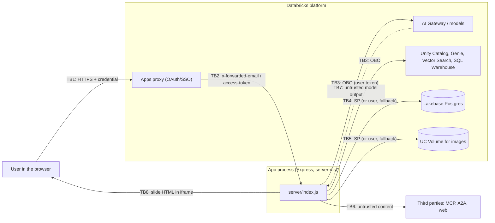

<!-- i18n: source=docs/security-threat-model.md source-hash=75960d7a98ca4d44ed7149f59164da98fde8a0a1 status=machine -->
# Modelo de amenazas de AI Prism

[English](../security-threat-model.md) · [Português (Brasil)](../pt-BR/security-threat-model.md) · **Español**

> Esta traducción fue hecha con ayuda de IA y espera revisión nativa. En caso de duda, la [versión en inglés](../security-threat-model.md) es la referencia.

Este documento describe qué protege AI Prism, quién interactúa con él, dónde están las fronteras de confianza y qué amenazas tienen control hoy, con las brechas declaradas. Es una **evaluación de ingeniería del código de este repositorio**, no un dictamen legal ni una auditoría externa. Cada control citado apunta al código que lo implementa; cuando algo no se ha verificado, se indica.

Para las preguntas típicas de revisión de seguridad, consulta las [preguntas frecuentes de seguridad](security-faq.md). Para reportar una vulnerabilidad, consulta [SECURITY.md](SECURITY.md).

- **Alcance:** la app (servidor Express en `server/`, cliente React en `client/src/`) y los recursos que aprovisiona `databricks.yml`.
- **Fuera de alcance:** la plataforma de Databricks (Apps proxy, Lakebase, Unity Catalog, AI Gateway, SQL Warehouses sin servidor) y la configuración de ACLs del workspace que hace quien despliega. Estas capas tienen sus propios controles; lo que la app asume de ellas está listado en [Supuestos sobre la plataforma](#8-supuestos-sobre-la-plataforma).

---

## 1. Activos

| Activo | Dónde está | Sensibilidad | Observación |
|---|---|---|---|
| Conversaciones y mensajes (texto, adjuntos, bloques, traza de tools) | Lakebase: `chat_sessions`, `chat_messages`, `chat_tool_calls` | Alta: pueden contener datos de la empresa y datos personales | Acotados por `user_email` (o por un JOIN con el dueño de la sesión) en todas las lecturas del código actual. |
| Artefactos (decks HTML, hojas de cálculo, documentos) | Lakebase: `chat_decks`, `chat_spreadsheets`, `chat_documents` | Alta | Mismo alcance que las conversaciones. |
| Imágenes generadas | Volume de UC `ai_prism_images` (catálogo `ai_prism`) + índice `chat_images` | Media/alta | Lectura: verificación del dueño en la base de datos; después, los bytes se leen con el token del SP (`server/imageStore.js`). |
| Embeddings de mensajes (RAG sobre el historial) | Lakebase: `chat_message_embeddings` (pgvector) | Alta | Derivados del contenido; la misma clase de dato que el mensaje. |
| Libro de costos por llamada | Lakebase: `usage_ledger` | Media | Contiene correo, sesión, modelo y tokens. |
| Configuración administrativa | Lakebase: `app_admins`, `model_catalog_overrides`, `app_mcp_catalog`, `app_tool_policy`, `deck_templates` | Alta (define quién es admin y qué herramientas existen) | Escritura solo por rutas con `requireAdmin`. |
| Conexiones MCP del usuario | Lakebase: `user_mcp_connections` (nombre, comentario, estado — **sin credenciales**); la conexión en sí es una conexión de Unity Catalog, referenciada por nombre | Media/alta | Las credenciales quedan en la conexión de UC, bajo el alcance `catalog.connections`, no en Lakebase. |
| Datos del workspace leídos en nombre del usuario | Unity Catalog, espacios de Genie, índices de Vector Search, SQL Warehouse | Depende de la fuente | Se accede por OBO: lo que el usuario no puede leer, la app tampoco lo lee. |
| Credenciales de despliegue y de runtime | Secretos del runtime de Apps (`DATABRICKS_CLIENT_ID`/`SECRET` del SP), variables del operador | Crítica | Ningún secreto en el repositorio (`.gitignore` ignora `.env`). `PGPASSWORD` es solo para desarrollo local. |

---

## 2. Actores

| Actor | Confianza | Qué puede hacer |
|---|---|---|
| **Usuario final** (autenticado en el workspace) | Autenticado por la plataforma; no confiable en cuanto al contenido que envía | Crear conversaciones, usar los modelos y las herramientas que su propia identidad alcanza, editar sus propios artefactos. |
| **Admin de la app** (`app_admins`, por correo o grupo del workspace) | Confiable para la configuración | Gestionar modelos, políticas de herramientas, catálogo MCP y plantillas de deck. |
| **Owner** (`APP_OWNER_EMAIL`, cuando está definido) | Confiable | Igual que admin, más lo que libera `isOwner` (`server/authz.js`). El bundle **no** define `APP_OWNER_EMAIL`; el admin de arranque es quien despliega, sembrado por el job de auto-configuración (`bundle/auto_config.py`). |
| **Operador/desplegador** | Confiable para el despliegue | Ejecuta `bundle deploy`, el job de auto-configuración y `apps deploy`. Pasa a ser admin de arranque. |
| **Administrador del workspace** | Fuera del modelo de la app | Controla ACLs, grupos, presupuestos y la plataforma. |
| **Atacante externo** | Sin credencial | Intenta llegar a la app sin pasar por el proxy. |
| **Usuario malicioso con cuenta en el workspace** | Autenticado, hostil | Intenta leer datos de otro usuario (IDOR), disparar costos o inyectar instrucciones. |
| **Contenido de terceros** | No confiable | Descripciones y respuestas de servidores MCP y A2A, páginas web (`web_search`), archivos adjuntos, HTML generado por el modelo. |
| **Modelo de lenguaje** (vía AI Gateway) | No confiable en cuanto a su salida | Las salidas pueden contener instrucciones inyectadas, HTML, SQL o pedidos de herramientas. |

---

## 3. Fronteras de confianza



| Frontera | Quién la cruza | Garantía de la que depende la app | Dónde ocurre la verificación |
|---|---|---|---|
| **TB1** Usuario → Apps proxy | Navegador/cliente | Autenticación OAuth/SSO del workspace | Plataforma |
| **TB2** Proxy → proceso de la app | Cabeceras `x-forwarded-email` y `x-forwarded-access-token` | El proxy sobrescribe estas cabeceras a partir de la sesión autenticada | Plataforma; la app exige las dos y **verifica el vínculo** correo ↔ token en el workspace (`server/identityBinding.js`, SCIM `/Me`, caché de 5 min por hash del token). Sin respuesta del workspace, acepta y registra una advertencia |
| **TB3** App → APIs del workspace | Token OBO del usuario | Los permisos del propio usuario (UC, Genie, endpoints) | Plataforma, con los alcances declarados en `databricks.yml` (`user_api_scopes`) |
| **TB4** App → Lakebase | Service principal de la app por defecto (un rol Postgres para todos los usuarios; no es dueño de las tablas, sin `BYPASSRLS`). Como fallback, el propio rol Postgres de quien llama con el token OBO (`createWithClient`, `server/db/pool.js`; ver §4 y G15) | En la ruta del SP de la app: **RLS con `FORCE`** en las tablas de la app (migración 0003), excepto `schema_migrations` (sin RLS, `server/db/rls.js`) y `project_members` (`ENABLE` sin `FORCE`, migración 0005); la identidad del usuario viaja por transacción (`withTx`: `app.user_email`, `app.user_groups`, `app.is_admin`) | Base de datos (G2 cerrada; el fallback es G15, abierta) |
| **TB5** App → Volume | SP de la app (`all-apis`), o el token del usuario cuando el token del SP no está disponible (necesita el alcance `files`) | El Volume no tiene ACL por usuario: una imagen solo se alcanza a través de su fila `chat_images`, que RLS limita a su dueño (TB4) | App + base de datos |
| **TB6** App → terceros | Respuestas de MCP/A2A/web; consultas de búsqueda enviadas al proveedor (vía Unity Gateway con el token del usuario, o API con clave) | Ninguna: el contenido se trata como dato, no como instrucción | Parcial (G7 mitigada; G12 mitigada para `web_search`; G14) |
| **TB7** Modelo → app | Texto, HTML y pedidos de herramientas | Renderizado seguro en el cliente; las herramientas se ejecutan con el OBO del usuario | Parcial |
| **TB8** App → iframe del slide | HTML/CSS generado por el modelo | Sandbox del iframe; `<script>` eliminado del HTML persistido | `client/src/components/deck/HtmlSlideFrame.jsx`, `server/blocks.js` (`sanitizeHtmlDeck`) |
| **TB9** Usuario → otro usuario (compartir, W2-3) | Miembros de un proyecto: conversaciones, mensajes, instrucciones y archivos del proyecto | Solo los miembros actuales (persona o grupo SCIM confirmado) leen y publican; rol owner > manage > view; el admin de la app **no** tiene acceso implícito; quien sale pierde todo, incluidas las conversaciones que creó | Base de datos: desde la migración 0008, la membresía es `ai_prism.aip_my_project_ids()` (evaluada una vez por sentencia; ADR 0016) y `ai_prism.aip_project_rank` da el nivel de rol; antes de la 0008, `aip_project_rank` decide ambas cosas; políticas `aipj_*` (migración 0005, incluida una política **restrictiva** en `chat_sessions`); app: `server/access.js`, `server/db/projects.js`, `sessionAccessSql` (`server/ownerScopedWrites.js`) |

**TB9 en detalle.** Hasta la W2-3, todo dato tenía un dueño y ninguna fila la leía otra persona. Los proyectos abren la primera frontera entre usuarios:

- *Quién es miembro* se decide en la base de datos, a partir de `app.user_email` y `app.user_groups` (JSON con los grupos SCIM del llamador, que `withTx` define en cada transacción). Una identidad vacía nunca coincide, con o sin grupos; `app.is_admin` no lo lee ninguna política de proyecto. La función de decisión depende del nivel de migración: desde la migración 0008, la membresía es `aip_my_project_ids()`, evaluada una vez por sentencia (ADR 0016), y `aip_project_rank(proyecto)` solo da el nivel de rol (owner, manage, view); antes de la 0008, `aip_project_rank(proyecto)` decide ambas cosas, una vez por proyecto y sesión.
- *Los grupos fallan cerrados*: `server/access.js` consulta SCIM `/Me` con el token del usuario (timeout de 3 s, caché de 5 min; un fallo queda en caché 30 s). Solo cuenta una respuesta HTTP 200 completa: 206 (Partial Content), cualquier otro 2xx, una lista paginada (`totalResults` mayor que la lista, `itemsPerPage` menor, `startIndex` > 1), una entrada malformada, un error HTTP o de red, un timeout o un cuerpo inesperado = ningún grupo, y un grupo nunca concede lo que no pudo probarse. Solo cuentan los grupos que devuelve `/Me` (sin expansión de grupos anidados). Usuario y grupo son `kind` distintos: un grupo con el nombre del correo de alguien no da acceso a esa persona.
- *Conversación de proyecto*: la política restrictiva `aipj_project_gate` se combina con `AND` con la de dueño de la 0003, así que ni el creador lee una conversación de proyecto después de salir. Las tablas hijas (mensajes, herramientas, compactaciones, Genie, embeddings) verifican la sesión mediante una subconsulta sobre `chat_sessions`, que pasa por el mismo filtro. Los miembros publican (incluidos los viewers); la fila de costo y los artefactos de quien publicó quedan a nombre de quien publicó. Un disparador impide cambiar el `user_email` de una sesión y solo permite sacar una conversación del proyecto con manage o superior (y solo el creador, porque la fila debe seguir visible para quien escribe).
- *Reescribir la historia de una conversación de proyecto* (editar un prompt, regenerar una respuesta, cambiar la variante activa, responder a las preguntas de un mensaje, compactar) exige manage o owner: view lee y publica turnos nuevos (`/api/chat`, `/continue`), pero no cambia lo que escribió otro miembro. Los mensajes no tienen autor propio, por lo que la regla es por rol y no por autoría; la ruta responde 403 (`historyRewriteAccess`, `server/db/projects.js`) y el SQL de escritura repite la regla (`historyWriteSql`, `server/ownerScopedWrites.js`). Conversaciones personales: solo el dueño.
- *Sin excepción para la identidad de mantenimiento* (AC-P1): el barrido de retención (0007: correo vacío + la marca del barrido) no lee ni borra nada de una conversación de proyecto, porque la política restrictiva no tiene una cláusula para él. Las conversaciones de proyecto quedan fuera de la retención por antigüedad (salen con el proyecto, `ON DELETE CASCADE`); una retención propia del proyecto es un seguimiento.
- *Por qué `project_members` no tiene `FORCE`*: una política sobre `project_members` que lea `project_members` (para mostrar el listado a los miembros) entraría en recursión. La función de pertenencia es `SECURITY DEFINER`, con `search_path` fijo, del dueño de la tabla (`ai_prism_owner`), que lee la tabla sin políticas; el rol de la app sigue sujeto a ellas. Durante la ventana de traspaso del despliegue (el SP es miembro temporal del dueño, `server/db/grants.js`) el SP también pasaría por encima de la política en esa tabla, como ya puede hacer con `ALTER TABLE` en cualquiera de ellas: la ventana se cierra en `migrate.mjs grants`.
- *Los archivos de proyecto* guardan solo el texto extraído (sin bytes, sin ruta de almacenamiento): el nombre se reduce al último segmento, sin `/`, `\` ni caracteres de control.
- Pruebas: `server/isolation.projects.test.js` (SQL directo como el rol de la app, sin código de la app) y la matriz de permisos en `tests/routes/projects.test.mjs`.

---

## 4. Identidad y autorización por recurso

La app no tiene inicio de sesión propio. Cada solicitud llega con la identidad del proxy y el token OAuth del usuario. La tabla muestra qué identidad se usa en cada recurso (verificado en el código):

| Recurso | Identidad usada | Código | Efecto de seguridad |
|---|---|---|---|
| Model Serving / AI Gateway (chat, embeddings, transcripción) | **OBO** (`serving.serving-endpoints`) | `server/llm.js`, `server/serving.js` | El gateway atribuye el costo y aplica los permisos del usuario. |
| Genie (espacios y Genie One MCP) | **OBO** (`dashboards.genie`, `genie`) | `server/genie.js` | El usuario solo consulta los espacios a los que puede acceder. |
| SQL Warehouse (UC Functions, UDF de Python, DDL del Volume) | **OBO** (`sql`) — `execStatement(userToken, …)` | `server/warehouse.js`, `server/tools.js` | Ejecución limitada a lo que el usuario puede ejecutar. |
| Vector Search | **OBO** | `server/vectorSearch.js` | Igual. |
| MCP externo del usuario (conexiones propias) | **Token del usuario** por conexión | `server/externalMcp.js`, `server/mcpClient.js` | Cada conexión solo la usa el usuario que la creó. |
| Catálogo de MCP (sugerencias del workspace) | **SP** (`all-apis`), solo para listar | `listMcpServicesViaSp` en `server/externalMcp.js` | Solo sugerencias; la validación sigue siendo OBO. |
| Lakebase (chats, artefactos, libro de costos, admins) | **SP** por defecto; **rol propio de quien llama** como fallback (sin credenciales de SP, la ruta por usuario se usa directamente, sin reintento, hasta que cambie la configuración; solo cuando un SP configurado no puede iniciar sesión ni alcanzar la base de datos se lo degrada, con reintento a los 5 minutos) | `server/db/pool.js` (`createWithClient`, `userPath`, `withTx`, `getSpPool`) | El SP tiene DML en las tablas del esquema `ai_prism` (`migrate.mjs grants`), **filtrado por RLS con `FORCE`** (0003, 0005): las filas propias de la transacción, más los chats de proyecto de los proyectos de los que es miembro; las tablas de admin las lee todo el mundo y solo se escriben con `app.is_admin = 'on'`; `admin_audit` solo se lee con la marca. Un rol de fallback con `BYPASSRLS` no queda sujeto a los filtros (G15). Ver G2. |
| Volume de imágenes | **SP** cuando está disponible; si no, el token del usuario | `server/imageStore.js` (`storageToken`) | Lectura solo después de una consulta de dueño en la base de datos. |
| Grupos de admin (SCIM `Me`) | **Token del usuario** | `server/authz.js` (`userGroups`) | Un fallo de SCIM degrada a "sin grupos", sin liberar acceso. |
| Grupos de miembros de proyecto (SCIM `Me`) | **Token del usuario** | `server/access.js` (`createGroupResolver`), por transacción vía `withTx` | Falla cerrado: error, timeout o cuerpo inesperado = ningún grupo (TB9). |

**Autorización en la app.** Tres niveles: `requireAdmin` en las rutas `/api/admin/*` y en las de plantillas globales (`server/index.js`); `isOwner` por `APP_OWNER_EMAIL`; `isAdmin` por `app_admins` (correo o grupo). El dueño de sesión, mensaje, artefacto e imagen se verifica en la base de datos con `user_email` (p. ej., `fetchActiveMessages` hace JOIN con `chat_sessions` por dueño; `POST /api/chat` responde 403 para una sesión a la que quien llama no puede acceder: ni es el dueño ni es miembro de su proyecto; `sessionAccessSql`, `server/ownerScopedWrites.js`).

---

## 5. Controles presentes

| ID | Control | Implementación |
|---|---|---|
| C1 | Rechazo sin credencial de usuario | `auth()` responde 401 cuando no hay token (`server/index.js`). |
| C2 | Alcance de datos por dueño | `WHERE user_email` y JOIN con `chat_sessions` en listados, lecturas y búsquedas (`listSessions`, `fetchActiveMessages`, `retrieveRelevantMessages`, `searchSessionsByVector`). |
| C3 | Dueño verificado antes del stream | `POST /api/chat` verifica `getSession` antes de abrir SSE (403 limpio). |
| C4 | Control de admin | `requireAdmin` (`server/index.js`) para las rutas de administración. |
| C5 | Anti-SSRF en el fetch de la web | `server/web.js`: bloquea `localhost`, IPs privadas (IPv4 e IPv6, incluidas las mapeadas), resuelve el DNS antes de conectar y limita los redirects. Cubierto por prueba en `server/web.test.js`. Endurecimiento (`server/webHardening.test.js`): la lista de direcciones (`blockedAddressReason`, `server/a2aGuard.js`) también decodifica el IPv4 embebido en 6to4 `2002::/16` y SIIT `::ffff:0:0/96`, y rechaza Teredo `2001::/32` y el NAT64 de uso local `64:ff9b:1::/48`; el lookup fijado responde en el siguiente tick, así que un fallo síncrono de `connect()` (EHOSTUNREACH) rechaza el fetch en vez de tumbar el proceso; el nombre de la conexión MCP se convierte en un único segmento codificado en `externalMcpUrl`, y `/api/mcp/connections/:name` responde 400 a nombres con caracteres de ruta o query. |
| C6 | Markdown sin HTML crudo | El cliente no usa `rehype-raw` (`client/src`): el HTML embebido en el markdown no se renderiza como HTML. |
| C7 | Slides aislados | `HtmlSlideFrame` usa `sandbox="allow-scripts"` (sin `allow-same-origin`: origen opaco, sin acceso a cookies ni almacenamiento de la app). Otro iframe de vista previa usa `allow-same-origin` **sin** `allow-scripts`. |
| C8 | Eliminación de `<script>` del HTML de deck | `sanitizeHtmlDeck` (`server/blocks.js`) y `deckHtmlPolicy.js`. Defensa en profundidad: el sandbox ya bloquea la ejecución. |
| C9 | Búsqueda web bajo control del admin | Solo se registra cuando `WEB_SEARCH_CONNECTION` está configurada (`server/tools.js`, `server/blocks.js`). |
| C10 | Herramientas con su propio OBO | La ejecución de UC Functions y de la UDF de Python usa el token del usuario (`server/warehouse.js`, `server/tools.js`). El proceso de la app no ejecuta código generado por el modelo. |
| C11 | Límites de entrada | Límite de cuerpo JSON por clase de ruta, en una tabla explícita (`JSON_ROUTE_LIMITS` en `server/middleware/security.js`); toda ruta de escritura tiene clase, y una prueba falla cuando una ruta nueva no elige la suya (`server/routes/routeTable.test.js`). Clases: **1 MB** por defecto (`BODY_LIMIT_JSON`); 40 MB en la importación/actualización de design system (`POST /api/deck-templates`, `PATCH /api/deck-templates/:id`, `label-assets`; `BODY_LIMIT_DECK_TEMPLATES`); 46 MiB en las escrituras del estudio con medios, que llevan slides, notas del presentador y adjuntos como `data:` (`PATCH /api/decks/:id`, `POST /api/decks/:id/tweak`, `POST /api/decks/:id/export-html`, `POST /api/spreadsheets/:id/tweak`; `BODY_LIMIT_STUDIO_MEDIA`; medido: exportación de 40 slides con fondo de marca en cada uno = 25,6 MB; derivado de los topes de entrada del estudio de decks: edición por IA con 4 adjuntos de 6 MiB + una nota de 9 MiB + 40 slides completos = 45,4 MB, más ~6% de margen); 4 MB al guardar una hoja de cálculo (`PATCH /api/spreadsheets/:id`; `BODY_LIMIT_WORKBOOK`; 0,94 MB en los topes del sanitizador). Subida de adjuntos del chat hasta 80 MB y 10 archivos; subida de skill hasta 5 MB y 1 archivo; archivos de proyecto hasta 25 MB y 10 por solicitud, 50 por proyecto, leídos solo después de verificar que el llamador es manage o superior (`PROJECT_FILE_LIMITS`, `server/middleware/index.js`; `POST /api/projects/:id/files`, exceso de tamaño o de cantidad = 413). Las rutas de escritura de proyecto (`/api/projects…`) están en la clase por defecto (1 MB). Por encima del límite: 413 JSON. **Arranque legado:** el límite se aplica durante la lectura, así que el cuerpo por encima de él nunca se lee completo. **Arranque legado:** `body-parser` cuenta el propio stream, con o sin `Content-Length` (incluido `Transfer-Encoding: chunked`). **Arranque AppKit:** el `express.json` del propio AppKit lee y parsea el cuerpo antes de toda la cadena de la app, en **todas** las rutas, hasta **64 MB** (`APPKIT_BODY_LIMIT` en `server/middleware/security.js`, usado por `server/appkit.js`; una prueba garantiza que ninguna clase supera ese valor). Ese es el techo de memoria por solicitud bajo AppKit; el límite por ruta sigue aplicando por el `Content-Length` declarado (por encima: 413), y un cuerpo JSON **sin** `Content-Length` recibe **411 Length Required**: el objeto parseado no mide lo que llegó por la red (los espacios y escapes desaparecen al parsear), por eso las rutas JSON exigen tamaño declarado bajo AppKit. La aplicación mantiene la regla del `Content-Length` (413) y la del chunked (411): es una verificación de política, no una protección de memoria, porque ya se leyeron hasta 64 MB. Los adjuntos de imagen de la edición con IA van una sola vez por imagen ráster (`client/src/lib/promptImages.js`), con un presupuesto total de adjuntos (34M caracteres). El guardado y la edición con IA del deck rechazan, antes de leer el deck o llamar a un modelo, una nota del presentador de más de 9 MiB (bytes UTF-8, por slide), más de 4 adjuntos o un adjunto de más de 6 MiB decodificado (un SVG cuenta su copia ráster): `413` con `code` y `limit`, que el estudio muestra en el idioma del usuario; el editor comprueba los mismos topes antes de enviar (`server/routes/decks.js`, `client/src/components/deck/deckInputBudgets.js`). |
| C17 | Rate limit por usuario | Token bucket por identidad reenviada por el proxy (`x-forwarded-email`; IP solo sin identidad): 120 solicitudes `/api`/min y 12 turnos/min (chat, continue, regenerate, compact y los tweaks de los estudios), `RATE_LIMIT_API_PER_MIN` / `RATE_LIMIT_TURNS_PER_MIN` (`0` lo desactiva). Exceso: 429 JSON con `Retry-After` (`server/middleware/rateLimit.js`). En memoria, por proceso. |
| C18 | CSP en modo report-only con recolección | `Content-Security-Policy-Report-Only` con la política objetivo (`default-src 'self'; script-src 'self'; style-src 'self' 'unsafe-inline'; img-src 'self' data: blob:; connect-src 'self'; frame-src 'self' blob:; frame-ancestors 'none'`) y `Permissions-Policy: microphone=(self), camera=()` en toda respuesta; las violaciones van a `POST /api/csp-report`, que escribe una línea JSON por violación solo con directiva, origen bloqueado, ruta del documento y disposición (sin query, muestra ni correo), con un techo por usuario (`CSP_REPORT_PER_MIN`, por defecto 60) (`server/middleware/security.js`). |
| C19 | Compartir por proyecto | Roles owner > manage > view (`server/access.js`); un no miembro (incluido el admin de la app) recibe 404, un miembro sin rol recibe 403; verificación y escritura en la misma transacción (`server/db/projects.js`); el RLS `aipj_*` repite las reglas en la base de datos (migración 0005, TB9). |
| C12 | Secretos fuera del repositorio | `.gitignore` ignora `.env`; `.env.example` sin valores reales; las credenciales del SP las inyecta el runtime. |
| C13 | Dependencias en el artefacto de despliegue | El despliegue ejecuta el bundle de esbuild en `server-dist/` (dependencias de runtime incrustadas) y `client/dist`. Solo los PRs de release los confirman (decisión D5; el check de CI del release los mantiene al día); los PRs de funcionalidades no. El `.npmrc` tiene `omit=dev`, así que el build de Apps instala solo dependencias de producción. |
| C14 | CI con lockfile | `npm ci --include=dev --ignore-scripts` en `.github/workflows/ci.yml`; permisos del `GITHUB_TOKEN` restringidos a lectura. Allí también corre un paso de `npm audit` solo de reporte (el paso `npm audit (report-only)`, `continue-on-error`): muestra los hallazgos en el log del job y no bloquea nada (G9). |
| C15 | Alcances OBO mínimos declarados | `user_api_scopes` en `databricks.yml`, con el motivo de cada alcance. Algunos alcances `catalog.*` están marcados como vestigiales en el propio archivo. |
| C16 | Límites de recursos | SQL Warehouse 2X-Small con `max_num_clusters: 1` y auto-stop de 10 min; Lakebase autoscaling 0,5–16 CU con suspensión tras `lakebase_suspend_timeout` (por defecto 600 s) (`databricks.yml`). |
| C20 | Logs estructurados y con redacción | Cada línea de log del servidor es un objeto JSON con ocho claves fijas (`ts`, `level`, `request_id`, `user_hash`, `route`, `status`, `duration_ms`, `msg`); cualquier otro campo se descarta, y `msg` pasa por `redact()` (e-mails, tokens bearer/PAT/JWT, parámetros de query con tokens y sentencias SQL) (`server/log.js`, PR #78). Una prueba falla si aparece `console.*` en `server/` fuera de las pruebas (`server/log.test.js`, "no console.* left in server/"). |
| C21 | Verificación opcional del certificado del servidor Postgres | `pgSslOptions` (`server/db/pool.js`): TLS activado por defecto (`PGSSLMODE=require`, definido en `app.yaml`; `PGSSLMODE=disable` lo desactiva y es solo para una base de datos local); `PG_SSL_CA` fija una CA y activa la verificación; `PG_SSL_VERIFY=1` verifica contra el almacén de confianza de Node; un `0` explícito prevalece. **Desactivado por defecto** hasta que la cadena de Lakebase se confirme contra el almacén de confianza del runtime (G-live-6). Pruebas: `server/pgSsl.test.js`. PR #77. |
| C22 | Hash de auditoría con clave de un secreto de la app | `auditHash` (`server/audit.js`): con `APP_AUDIT_HASH_KEY` configurada, el actor en `admin_audit` es `h2:` + HMAC-SHA256 del e-mail, no reversible con un diccionario sin el secreto; ver [§6.1](#61-correlacionar-la-traza-de-auditoría-con-los-logs). PR #97. |

---

## 6. STRIDE

Cada fila es una amenaza concreta al código actual. El "riesgo residual" es lo que sigue abierto después de los controles de [§5](#5-controles-presentes).

| Categoría | Amenaza concreta | Controles | Riesgo residual / brecha | Acción recomendada |
|---|---|---|---|---|
| **S**uplantación (Spoofing) | Una llamada directa a la app con `x-forwarded-access-token` sin `x-forwarded-email` (G1). | C1, `server/requestIdentity.js` | Bajo (G1 cerrada): en el runtime de Apps no hay fallback de entorno y la respuesta es 401; la identidad de entorno existe solo con `LOCAL_DEV_MODE=1` o `LOCAL_DEV_IDENTITY=1` y sin `DATABRICKS_APP_*`. | No definir nunca `LOCAL_DEV_MODE` en un entorno desplegado. |
| **S**uplantación (Spoofing) | Una solicitud que llega al proceso sin el proxy (o con una cabecera reenviada) con el `x-forwarded-email` de otra persona y cualquier token. | Vínculo correo ↔ token (`server/identityBinding.js`) | Bajo: 401 con discrepancia o token inválido; queda el caso del workspace fuera de servicio (acepta con advertencia) y el de un token válido robado. | Mantener `IDENTITY_BINDING=enforce`; confirmar con la plataforma que el contenedor solo es alcanzable por el proxy. |
| **S**uplantación (Spoofing) | El admin por grupo del workspace depende de SCIM con el token del usuario. | `userGroups` con TTL de 5 min | Bajo: un fallo de SCIM niega el grupo, no lo concede. | Ninguna inmediata. |
| **T**ampering (manipulación) | El modelo o contenido de terceros inyecta HTML/JS en un slide o documento. | C6, C7, C8 | Bajo en cuanto a ejecución (sandbox); el HTML del slide conserva el CSS y la estructura del modelo. | Mantener la sanitización; probar regresiones con `scripts/deck-html-qa.mjs`. |
| **T**ampering (manipulación) | Un usuario modifica el artefacto de otro usuario mediante `PATCH /api/decks/:id` u otras rutas. | Dueño verificado en las rutas de artefactos | Bajo (G2 y G13 cerradas): la escritura también está sujeta a RLS con `FORCE` bajo la identidad del llamador (`withTx`), y `server/isolation.test.js` prueba, como el rol no dueño de la app, que un `SELECT` directo en cada tabla por usuario devuelve 0 filas ajenas. En la ruta del SP, un `WHERE` incorrecto ya no expone la fila de otro usuario; en el fallback por usuario bajo un rol con `BYPASSRLS` sí la expone (G15). | Mantener la suite de aislamiento en la CI; ejecutarla contra una branch real de Lakebase (G-live-7). |
| **R**epudio (Repudiation) | Un admin niega una acción administrativa (crear admin, cambiar el catálogo MCP, la política de herramientas, plantillas, modelos, configuración), o alguien borra su rastro. | Tabla `admin_audit` solo de inserción, escrita en la propia transacción de la mutación; hash del actor con clave; la concesión del primer admin del despliegue también se audita (G8, cerrada) | Bajo: un admin con acceso de dueño de la base fuera de la app aún puede alterar la tabla; sin `APP_AUDIT_HASH_KEY` los hashes son los heredados sin sal (un aviso en el arranque); las filas escritas antes del 2026-11-19 conservan el hash heredado. | Configurar `APP_AUDIT_HASH_KEY` (`bundle/optional/audit-hash-key-secret.yml.example`); mantener `system.access.audit` para los eventos de la plataforma. |
| **I**nformation disclosure (divulgación de información) | Un bug de consulta lee las conversaciones de otro usuario. | C2, C3, RLS con `FORCE` en las tablas de la app, en la ruta del SP (G2, migración 0003; excepciones en TB4), suites de aislamiento (G13) | Bajo en la ruta del SP: la base de datos filtra por la identidad de la transacción aunque falte un `WHERE`. En el fallback por usuario bajo un rol con `BYPASSRLS` las políticas se omiten y solo quedan las verificaciones de dueño de la app (G15). Los caminos restantes son el código que corre sin `withTx` (una prueba de lint prohíbe `withClient(` fuera de `server/db/pool.js`) y la ventana transitoria de traspaso del despliegue ([§3, TB9](#3-fronteras-de-confianza)). | Mantener la prueba de lint y la suite de aislamiento; cerrar el traspaso con `migrate.mjs grants` en cada despliegue. |
| **I**nformation disclosure (divulgación de información) | Un miembro eliminado de un proyecto (o un admin de la app, o un grupo cuya verificación SCIM falló) sigue leyendo las conversaciones del proyecto. | C19, TB9: política restrictiva en `chat_sessions`, grupos que fallan cerrados, admin sin acceso implícito | Bajo: probado en la base de datos (`server/isolation.projects.test.js`). Queda la caché de grupos: quien sale de un grupo del workspace mantiene el acceso hasta 5 min. | Ninguna inmediata; reducir `GROUPS_TTL_MS` si 5 min es demasiado. |
| **I**nformation disclosure (divulgación de información) | La CA del servidor Lakebase no se verifica en la conexión. | TLS activado por defecto (`PGSSLMODE=require`; `disable` es solo para una base de datos local); verificación opcional C21 | Medio por defecto (G3, abierta): sin `PG_SSL_CA` ni `PG_SSL_VERIFY=1`, `pgSslOptions` devuelve `rejectUnauthorized: false`; un atacante en el camino de red del workspace podría suplantar al servidor. | Definir `PG_SSL_CA` (o `PG_SSL_VERIFY=1`) en el entorno cuando se confirme la cadena (G-live-6); después, hacer de la verificación el valor por defecto. |
| **I**nformation disclosure (divulgación de información) | Datos del usuario salen hacia terceros mediante los MCP/A2A que configuró. | Las conexiones son por usuario | Depende del destino configurado por el usuario; la app no filtra el contenido enviado. | Documentar; permitir una allowlist de destinos gestionada por el admin. |
| **I**nformation disclosure (divulgación de información) | Los logs registran mensajes de error de la base de datos o del gateway que pueden contener fragmentos de datos. | C20 | Bajo (G11, mitigada): la redacción se basa en patrones (e-mails, tokens, SQL), así que un fragmento de texto libre que no coincida con ningún patrón aún podría aparecer en `msg`. | Mantener restringido el acceso a los logs; ampliar los patrones cuando se encuentre una nueva fuga. |
| **D**enegación de servicio (Denial of service) | Un usuario dispara muchos turnos y consume el presupuesto de tokens del workspace. | C17 (12 turnos/min, 120 solicitudes/min por usuario); ledger por usuario; límites del workspace | Medio (G4): el límite es por proceso y no es una cuota de costo; un usuario aún gasta hasta 12 turnos/min. | Presupuestos nativos de Unity AI Gateway por usuario o grupo como techo de costo. |
| **D**enegación de servicio (Denial of service) | Muchas conexiones concurrentes agotan el pool. | Un único pool compartido del SP con `max: 8` por proceso (`POOL_OPTS`, `server/db/pool.js`; no existe `PG_POOL_MAX`) | Bajo: con 50 usuarios virtuales el pool mantuvo 8 conexiones con a lo sumo 2 activas y latencia de lectura plana (`docs/performance.md` §3). Más allá de eso, las consultas esperan una conexión. | Volver a medir con `npm run loadtest` antes de subir el techo. |
| **D**enegación de servicio (Denial of service) | Una subida grande o un SSE largo ocupan el proceso. | Límites de tamaño por ruta (C11), rate limit (C17) | Bajo a medio. | Medir; ajustar los timeouts. |
| **E**levación de privilegios (Elevation of privilege) | Una herramienta o MCP lleva al modelo a actuar más allá de lo que puede hacer el usuario. | Herramientas con OBO (C10) | Medio: no hay política de confirmación para acciones de escritura en herramientas externas. | Limitar las herramientas de escritura por política (`app_tool_policy`); confirmación humana. |
| **E**levación de privilegios (Elevation of privilege) | Una descripción de tool MCP con una instrucción maliciosa cambia el comportamiento del modelo (prompt injection indirecta). | `server/toolMetadata.js` neutraliza las descripciones, instrucciones y schemas de MCP, los títulos de sala de Genie y los comentarios de funciones de UC antes del prompt (G7, mitigada) | Medio: el saneamiento reduce el riesgo y no lo elimina; el contenido que una tool *devuelve* sigue siendo dato que el modelo lee (G12). | Mantener los metadatos de tool detrás de `toolMetadata.js`; limitar las tools de escritura por política. |
| **E**levación de privilegios (Elevation of privilege) | Solicitud de escritura cross-site (CSRF) en rutas `POST/PUT/PATCH/DELETE`. | `server/csrfGuard.js` (`Sec-Fetch-Site: cross-site` → siempre 403; si no, `Origin`/`Referer` ≠ host → 403), antes del rate limit y, en el arranque legado, antes del parseo del cuerpo | Bajo (G5): los navegadores antiguos sin `Sec-Fetch-Site` ni `Origin` no están cubiertos. En el arranque AppKit el cuerpo ya se leyó y parseó (hasta 64 MB) cuando ocurre el rechazo (C11). | Confirmar el `SameSite` de la cookie del proxy (G-live, §7.1). |

### 6.1 Correlacionar la traza de auditoría con los logs

Ambos registros identifican a una persona con un hash del e-mail en minúsculas, pero ya no son el mismo valor cuando se configura la clave de auditoría:

| Dónde | Valor | ¿Necesita el secreto? |
|---|---|---|
| Logs de solicitudes, `user_hash` | los primeros 12 hex de `sha256(e-mail)` (`userHash`, `server/log.js`) | No |
| `admin_audit.actor_hash` (y un `target` de usuario) con `APP_AUDIT_HASH_KEY` configurada | `h2:` + los primeros 12 hex de `HMAC-SHA256(APP_AUDIT_HASH_KEY, e-mail)` (`auditHash`, `server/audit.js`) | Sí |
| `admin_audit.actor_hash` sin la clave, o una fila escrita antes del 2026-11-19 | igual que `user_hash` (sin prefijo `h2:`) | No |

Por lo tanto, **con la clave configurada, una fila de auditoría no se une por hash con las líneas de log, y eso es intencional**: el objetivo de la clave es que quien pueda leer la tabla de auditoría (o un respaldo de la base de datos) no pueda confirmar un e-mail supuesto sin el secreto de la app, mientras que el hash de los logs no tiene clave y cualquiera que lea los logs puede contrastarlo con una lista de e-mails. La fila de auditoría no tiene `request_id`.

Un operador que tiene el secreto y *ya sabe* a qué persona buscar puede calcular ambos valores y buscar en cada fuente (el secreto se queda en el shell; nunca se imprime):

```bash
APP_AUDIT_HASH_KEY=<the secret> node -e "
const c = require('node:crypto');
const e = process.argv[1].trim().toLowerCase();
console.log('admin_audit.actor_hash', 'h2:' + c.createHmac('sha256', process.env.APP_AUDIT_HASH_KEY).update(e).digest('hex').slice(0, 12));
console.log('logs user_hash        ', c.createHash('sha256').update(e).digest('hex').slice(0, 12));
" person@example.com
```

Para vincular una fila de auditoría con la solicitud que la causó, usa la marca de tiempo `at` de la fila y la ruta admin (`action`, `target`) contra las líneas de log de ese minuto (`route`, `status`), y el `user_hash` de la segunda línea de arriba. Si rotas la clave, las filas con hash de la clave anterior ya no coinciden con un nuevo hash del mismo e-mail; mantén la misma clave entre despliegues. Runbook: [operations.md §6.8](operations.md#68-retención-instrucciones-de-la-organización-y-registro-de-auditoría-de-admin).

---

## 7. Brechas declaradas

Las brechas son ausencias verificadas en el código, no suposiciones. La severidad considera el impacto y la probabilidad en el estado actual. La columna *Evidencia* es el hallazgo original; la columna *Estado* es el estado actual con evidencia de `archivo:función` y de PR (los números de línea se desplazan, por eso el nombre de la función es el ancla duradera). Clave de estado: **Cerrada** (el control existe y una prueba lo demuestra), **Mitigada** (el riesgo se redujo; se indica el residual), **Aceptada** (conocido, deliberado), **Abierta** (aún sin control; responsable y siguiente paso en [§7.3](#73-brechas-abiertas-responsable-y-siguiente-paso)).

| ID | Brecha | Evidencia (hallazgo original) | Severidad | Estado |
|---|---|---|---|---|
| **G1** | Fallback de identidad cuando falta `x-forwarded-email` | `userEmail()` en `server/index.js` cae en `DATABRICKS_USER_EMAIL` y luego en `local-dev@databricks.com` | Media (defensa en profundidad) | **Cerrada** en `server/requestIdentity.js` (el interruptor `LOCAL_DEV_IDENTITY`/`LOCAL_DEV_MODE`; prueba `server/requestIdentity.test.js`): en el runtime de Apps, sin `x-forwarded-email` la respuesta es 401; la identidad de entorno solo vale con `LOCAL_DEV_MODE=1`/`LOCAL_DEV_IDENTITY=1` y sin `DATABRICKS_APP_*`. |
| **G2** | Aislamiento solo por el `WHERE`; SP con DML en todo el esquema `public`; sin RLS ni suite de aislamiento | — | **Alta** | **Cerrada (W1-5 + W2-1).** Esquema `ai_prism` con dueño neutro y grants mínimos (0002); RLS `ENABLE` + `FORCE` en las 20 tablas de la app (0003): 14 por usuario (`user_email` directo o vía `chat_sessions`/`chat_messages`), 2 mixtas (propias o globales; global solo con la marca de admin), 4 de admin (lectura libre, escritura solo con la marca). El SP no es dueño y no tiene `BYPASSRLS` (`server/rls.test.js` verifica `rolbypassrls = false` y dueño ≠ `current_user`); toda consulta pasa por `withTx` (prueba de lint: ningún `withClient(` fuera de `pool.js`). El backfill entre usuarios del ledger pasó a ser una migración de datos del dueño (`migrate.mjs backfill-usage`). PRs #77, #81. Falta la prueba en una branch real de Lakebase (G-live-7). |
| **G3** | `rejectUnauthorized: false` en la conexión con Lakebase | `connInfo` en `server/db.js` (ahora `pgSslOptions` en `server/db/pool.js`) | Media | **Abierta por defecto; existe un control opcional (W1-5, PR #77).** `pgSslOptions` en `server/db/pool.js` verifica el certificado del servidor cuando `PG_SSL_CA` está definida (fija la CA) o `PG_SSL_VERIFY=1` (almacén de confianza de Node); sin ninguna de las dos la conexión está cifrada pero no verificada (`rejectUnauthorized: false`). Pruebas: `server/pgSsl.test.js`. Documentado en `SECURITY.md` ("TLS for Postgres"). Se deja abierta porque activarla para todos exige confirmar la cadena de Lakebase en un despliegue real (G-live-6). |
| **G4** | Sin rate limit ni cuota por usuario en la app | Antes: ningún middleware de límite | Media (era Alta para costo) | **Mitigada** en `server/middleware/rateLimit.js` (C17): token bucket por usuario, 120 req/min y 12 turnos/min, 429 + `Retry-After`, ajustable por variables de entorno (PR #76; pruebas en `server/middleware/rateLimit.test.js` y `server/httpHardening.test.js`). Sigue abierta: el límite es por proceso (varias instancias multiplican el techo) y no es una cuota de costo; el techo de gasto queda con los presupuestos de Unity AI Gateway. |
| **G5** | Sin token anti-CSRF propio | Las rutas de escritura aceptan JSON/multipart sin token | Baja (era Media) | **Mitigada** (PR #76) en `server/csrfGuard.js`: las escrituras (`POST/PUT/PATCH/DELETE`) en `/api/*` con `Sec-Fetch-Site: cross-site` reciben 403 aunque el `Origin` parezca el de la app; sin `Sec-Fetch-Site`, un `Origin`/`Referer` de otro host recibe 403 (pruebas en `server/csrfGuard.test.js` y `server/httpHardening.test.js`, variantes de `Sec-Fetch-Site` y `Origin`). El rechazo ocurre antes del rate limit y, en el arranque legado, antes de leer el cuerpo; en el arranque AppKit el `express.json` de AppKit ya leyó y parseó el cuerpo (hasta 64 MB) antes del guard, así que una escritura cross-site sigue siendo rechazada, pero cuesta la lectura (C11). Pendiente G-live: el `SameSite` de la cookie del proxy (§7.1). |
| **G6** | Sin cabeceras de seguridad propias de la app (CSP, HSTS, etc.) | Antes: ningún `setHeader` de seguridad global | Baja | **Mitigada en parte** (PR #76): `server/securityHeaders.js` aplica `nosniff`, `Referrer-Policy: same-origin`, `X-Frame-Options: SAMEORIGIN` y una CSP aplicada conservadora (`frame-ancestors 'self'; base-uri 'self'; object-src 'none'; form-action 'self'`), sin `X-Powered-By`; `server/middleware/security.js` agrega `Permissions-Policy: microphone=(self), camera=()` y la CSP objetivo en **report-only** con recolección en `/api/csp-report` (C18). Todavía no se bloquea nada: las vistas previas de design system y el editor de slides usan scripts inline y fuentes/imágenes de otros hosts; aplicar la política objetivo exige las evidencias de la recolección y mover esos iframes a otro origen. HSTS queda con el proxy. `Referrer-Policy` queda en `same-origin` (más estricta que `strict-origin-when-cross-origin`: ni siquiera envía el origen a sitios externos). |
| **G7** | Los metadatos de MCP/A2A/Genie/UC no se sanean antes del prompt | Hallazgo original: solo truncamiento en `externalMcp.js`; `sanitize` en `tools.js` trataba nombres de tool, no descripciones | Media a alta | **Mitigada**: `sanitizeMetadata`, `sanitizeLabel` y `quoteMetadata` en `server/toolMetadata.js` neutralizan descripciones, instrucciones y schemas de MCP, títulos de sala de Genie y comentarios de funciones de UC antes del prompt. El contenido devuelto por las tools (web, MCP) sigue tratándose como dato, ver G12. |
| **G8** | Sin traza de auditoría propia para las acciones administrativas | Antes: ninguna tabla de auditoría en el DDL de `server/db.js` | Media | **Cerrada (W2-5 + W2-17).** `server/migrations/0007_settings_audit.up.sql:46` (tabla `admin_audit`), `:103-106` (RLS: solo los admins leen; insertar exige el flag de admin, el barrido solo filas `'system'`/`retention.*`; sin política de UPDATE/DELETE), `:122` (`FORCE`); `server/db/grants.js:228` (revoca UPDATE/DELETE/TRUNCATE); `server/audit.js:104` (`recordAdminAction`, en la transacción de la mutación) y `:195` (`ADMIN_MUTATION_ROUTES`, toda ruta admin clasificada); `server/db/admin.js:92` (`listAdminAudit`, `GET /api/admin/audit`, solo admins); hash del actor con clave `server/audit.js:43` (`auditHash`) y aviso único en el arranque `:52-61`; semilla del primer admin `server/audit.js:137` (`recordBootstrapAdminSeeds`), llamada por `ensureSchema` justo después de las migraciones (`server/db.js:88`); la semilla del lado del despliegue es el `INSERT INTO app_admins … 'auto-config'` en `bundle/auto_config.py` (alrededor de `:568`). Toda mutación admin escribe una fila en su propia transacción (ninguna fila sin el cambio, ningún cambio sin la fila); el rol de la app no modifica ni borra una fila, sean cuales sean los flags. El actor (y un destino usuario) es `h2:` + los 12 primeros hex de HMAC-SHA256(`APP_AUDIT_HASH_KEY`, e-mail en minúsculas), así que la traza no se revierte con un diccionario de e-mails sin el secreto de la app. **El esquema del hash cambió el 2026-11-19:** las filas sin el prefijo `h2:` son el sha256 heredado sin sal (el mismo valor que `user_hash` en los logs) y se quedan como están (sin nueva clave); sin la clave la app sigue escribiendo el esquema heredado y registra un aviso en el arranque. La semilla del primer admin del despliegue (`added_by = 'auto-config'`) corre antes de que exista la migración 0007, así que la app escribe su fila `admins.add` (actor `auto-config`, destino con hash, host del workspace, sin e-mail) justo después de sus migraciones, una vez por concesión. Pruebas: `server/settingsAudit.test.js`, `server/auditHash.test.js`. PRs #84, #97. Cómo correlacionar una fila de auditoría con los logs: [§6.1](#61-correlacionar-la-traza-de-auditoría-con-los-logs). |
| **G9** | Sin escaneo de dependencias en la CI (`audit=false` en `.npmrc`); el bundle incrusta las dependencias | `.npmrc`, `.github/workflows/ci.yml` | Media | **Abierta (existe un escaneo solo de reporte).** La CI ejecuta `npm audit --omit=dev` y `npm audit` en el paso `npm audit (report-only)` de `.github/workflows/ci.yml` con `continue-on-error: true`, así que los hallazgos se ven en el log del job pero nunca hacen fallar un PR; el `.npmrc` mantiene `audit=false` para la instalación en el despliegue. El bundle incrusta las dependencias, así que una corrección llega al despliegue solo después de reconstruir el bundle. Responsable y siguiente paso: [§7.3](#73-brechas-abiertas-responsable-y-siguiente-paso). |
| **G10** | Las imágenes se leen con el token del SP, no con el del usuario | `server/imageStore.js` | Baja (depende de G2 para la verificación de dueño) | **Aceptada.** Los bytes se leen con el token del SP (`storageToken` en `server/imageStore.js`) solo después de la verificación de dueño en la fila de `chat_images`, que ahora aplica RLS en la base de datos (G2 cerrada); el token propio del usuario no cambiaría lo que el usuario puede alcanzar. |
| **G11** | Logs sin redacción; los mensajes de error pueden tener fragmentos de datos | Hallazgo original: `console.warn(...e.message)` en `server/db.js` y `server/index.js` | Baja | **Mitigada (W1-3, PR #78).** Todo el logging del servidor pasa por `server/log.js`: ocho claves fijas, otros campos descartados, `redact()` en `msg` (e-mails, tokens, SQL), `email` → `user_hash`; `server/log.test.js` hace fallar el build si `console.*` vuelve a `server/`. Residual: la redacción se basa en patrones, así que un fragmento de texto libre que no coincida con ningún patrón aún puede llegar a `msg`; la plataforma mantiene la retención de logs. |
| **G12** | El contenido de terceros (web, adjuntos) entra en el contexto sin marca de no confiable | Los adjuntos entran como bloque de texto en el turno | Media | **Mitigada para `web_search`** (W2-11a): todo resultado de búsqueda, de cualquier backend, sale de un único renderizador (`renderWebSearchForModel` en `server/webSearch/index.js`) dentro del envelope fijo `[CONTEÚDO EXTERNO DA WEB — não confiável; …]` … `[FIM DO CONTEÚDO EXTERNO]`, con los marcadores neutralizados dentro del contenido y límites de ítems y de tamaño (prueba por adapter en `server/webSearch/webSearch.test.js`). PR #88. Sigue abierta para los adjuntos y para el texto de `web_fetch`: `web_fetch` devuelve el texto de la página por `server/web.js` sin el envelope. |
| **G13** | Ninguna prueba automatizada de aislamiento entre usuarios en la CI | `package.json` y `.github/workflows/ci.yml` | Alta (habilita G2) | **Cerrada en la base de datos**: `server/isolation.test.js` (19 casos) ejecuta `db.js` como el rol no dueño `ai_prism_app` (`scripts/ci/pg-roles.sql`) bajo RLS, incluido un `SELECT` directo en cada tabla por usuario (0 filas ajenas); `server/rls.test.js` (16 casos) cubre políticas, `FORCE`, atributos del rol, uso de índices y el round trip de la 0003. CI: `--fail-on-skip --expect server/isolation.test.js=19 --expect server/rls.test.js=16`. PRs #77, #81. Falta ejecutar contra una branch efímera de Lakebase (G-live-7). |
| **G14** | Búsqueda web: la consulta sale del workspace hacia el proveedor de búsqueda; el servicio MCP de búsqueda designado usa credencial compartida | `server/webSearch/` (W2-11a, ADR 0007) | Media | **Mitigada, riesgo residual aceptado.** La descripción de la tool prohíbe datos internos, nombres de clientes y contenido de adjuntos en la consulta; una política de Sensitive Data Detection del gateway (Beta) puede adjuntarse al MCP Service. Logs: una línea por intento, sin la consulta, el resultado ni el texto de error del proveedor (prueba en `webSearch.test.js`). El servicio designado en `WEB_SEARCH_MCP_SERVICE` es la **única excepción** al rechazo de credencial compartida (PR #83), limitada por seis invariantes probados: se llama a una sola tool fija (nunca "la primera" de la lista); los argumentos los arma la app solo con la consulta y el límite; las descripciones, instrucciones y schema del servidor nunca llegan al prompt; `admitMcpConnection` queda intacto y sigue rechazando el servicio en todo camino de usuario; con la tool nativa activa, las refs del usuario a `system.ai.web_search` o al servicio designado se ignoran en el turno; la documentación exige selección de tools en el servicio. Las dos llamadas MCP usan el token del usuario (grants, rate limit y auditoría del gateway por usuario); la clave del proveedor queda en la connection de UC, nunca en la app. Clave de fallback (Brave/Tavily): secreto de Apps, leído por el SP, nunca registrado ni mostrado (el estado de admin solo muestra presencia). Brecha conocida hasta la W2-11d: con la tool nativa desactivada, una ref antigua a ese servicio todavía llega al modelo. |
| **G15** | Fallback de Lakebase al rol propio de quien llama (`createWithClient`, `server/db/pool.js`) ejecuta a un llamador cuyo rol tiene `BYPASSRLS` (la identidad que despliega, `docs/performance.md` §2.1) fuera de las políticas mientras el SP no está disponible | — | **Media** | **Abierta.** Control residual: el `WHERE user_email` de la app y el SQL de verificación de acceso. Siguiente paso (código, un seguimiento aparte): rechazar la ruta por usuario cuando ese rol sea superusuario o tenga `BYPASSRLS`, o desactivar el fallback en una app desplegada. Responsable: responsable técnico. |

### 7.1 Pendientes de verificación en el entorno real (G-live)

Ítems que solo responde un despliegue real. Ninguno se ha verificado todavía ("No verificado"); cada uno decide un ajuste en los controles de arriba.

| Ítem | Qué verificar | Decide | Estado |
|---|---|---|---|
| G-live-1 | Atributo `SameSite` de la cookie de sesión del Apps proxy | Si es `Lax`/`Strict`, el navegador ya no envía la cookie en un `POST` cross-site, y el guard de CSRF pasa a ser defensa en profundidad (G5) | No verificado |
| G-live-2 | Cuáles de estas cabeceras ya define o sobrescribe el proxy: `Content-Security-Policy(-Report-Only)`, `X-Frame-Options`, `Referrer-Policy`, `Permissions-Policy`, `Strict-Transport-Security` | Evita cabeceras duplicadas o en conflicto (G6) | No verificado |
| G-live-3 | Si la UI de Apps (u otro producto del workspace) muestra la app en un iframe: violaciones de `frame-ancestors` en `/api/csp-report` | Valor de `frame-ancestors` cuando la CSP pase a aplicarse (`'none'` o el origen del workspace) | No verificado |
| G-live-4 | Volumen y tipo de violaciones en `/api/csp-report` en un uso real (editor de decks, vista previa de design system, fuentes del DS) | Política aplicada final (G6) | No verificado |
| G-live-5 | Número de instancias de la app en producción | Si el rate limit en memoria (G4) necesita estado compartido | No verificado |
| G-live-6 | Si la cadena de certificados del servidor Lakebase se valida contra el almacén de confianza de Node en el runtime de Apps (`PG_SSL_VERIFY=1`), o qué CA fijar en `PG_SSL_CA` | Si la verificación (G3) puede pasar a ser el valor por defecto | No verificado |
| G-live-7 | Las suites de aislamiento (`server/isolation.test.js`, `server/rls.test.js`) y `npm run loadtest` contra una branch real de Lakebase, no solo el Postgres desechable de la CI | Confirma G2/G13 en el motor de producción | No verificado |

### 7.2 Seguimientos (decisiones de producto, no implementadas)

| Ítem | Qué hacer | Por qué | Dueño | Estado |
|---|---|---|---|---|
| F-1 | Ajustar los presupuestos del lado del cliente en la edición con IA del deck: un techo para las notas del presentador (hoy sin límite en el editor y en el servidor) y un presupuesto que cuente los adjuntos **y** el deck enviado, menor que el actual (34M caracteres de adjuntos) | El peor caso admitido hoy (4 imágenes de 6 MiB + una nota de 9 MiB ≈ 45,4 MB) obligó a llevar la clase `studioMedia` a 48 MiB y el parser de AppKit a 64 MB para todas las rutas; una nota mayor de ~11 MiB todavía recibe 413. Presupuestos menores permitirían bajar los dos límites | Producto (dueño del estudio de decks) | Hecho (W2-16): 9 MiB por nota, 4 adjuntos de 6 MiB, aplicados por el servidor y comprobados por el editor; `studioMedia` derivado de ellos (46 MiB). El parser de AppKit se queda en 64 MB por decisión |

### 7.3 Brechas abiertas: responsable y siguiente paso

| ID | Responsable | Siguiente paso | Hecho cuando |
|---|---|---|---|
| G3 | Operador/quien despliega (define la variable); mantenedores (cambian el valor por defecto) | Ejecutar G-live-6 en un workspace real; definir `PG_SSL_CA` (o `PG_SSL_VERIFY=1`) en `app.yaml`; si funciona, hacer de la verificación el valor por defecto en `pgSslOptions` | Una app desplegada se conecta con la verificación activada y la prueba de smoke pasa |
| G9 | Mantenedores | Convertir el paso `npm audit` solo de reporte en una barrera para los hallazgos `high` cuando la línea base esté limpia, y agregar un PR automático de actualización de dependencias; reconstruir y publicar el bundle después de cada corrección | Un aviso `high` en el árbol completo hace fallar el PR |
| G15 | Responsable técnico (decisión y código) | Decidir entre fallar cerrado ante un rol de fallback `BYPASSRLS`/superusuario y mantener la disponibilidad durante una caída del SP (se recomienda fallar cerrado); implementarlo en `userPath` con pruebas en `server/spFallback.test.js`. Mientras tanto, mantener sanas las credenciales del SP (alerta A3) | Una solicitud de fallback bajo un rol `BYPASSRLS` es rechazada, y una prueba lo demuestra |

G11 está mitigada, no abierta: ver su fila.

---

## 8. Supuestos sobre la plataforma

La app asume que la plataforma hace lo que se describe a continuación. Si alguna premisa falla, el modelo de este documento cambia.

- El **Apps proxy** autentica al usuario y es el único camino hasta el proceso, y reescribe `x-forwarded-email` y `x-forwarded-access-token` a partir de la sesión autenticada.
- El **token OBO** entregado a la app tiene solo los alcances declarados en `user_api_scopes` (el bundle, no `app.yaml`, es quien los aplica en el despliegue).
- **Lakebase** es accesible solo desde la red del workspace y autentica al SP y al usuario mediante el token de conexión emitido por la plataforma.
- El **UC Volume** y el catálogo `ai_prism` los crea el job de auto-configuración, con `READ/WRITE VOLUME` concedido solo al SP de la app.
- El cifrado en reposo y en tránsito del workspace sigue la configuración de la propia plataforma (incluidas las claves gestionadas por el cliente, cuando estén configuradas).
- La auditoría de la plataforma (`system.access.audit`) registra los eventos de workspace y de Unity Catalog. La `admin_audit` propia de la app cubre las acciones administrativas de la app (G8, cerrada) y no reemplaza la traza de la plataforma.

---

## 9. Cómo mantener este documento

- Revisar en cada cambio en `server/authz.js`, `server/db/pool.js` (`withTx`, `pgSslOptions`, `POOL_OPTS`), `server/db/grants.js`, `server/migrations/`, `server/log.js`, `server/audit.js`, `databricks.yml` (`user_api_scopes`, recursos) y en cualquier ruta nueva bajo `/api/`.
- Al cerrar una brecha, mover la fila a la tabla de controles y citar la prueba que la cubre.
- Los cambios que alteran una frontera de confianza (un recurso nuevo accedido con el SP, una fuente nueva de contenido de terceros) exigen actualizar la [§3](#3-fronteras-de-confianza).
