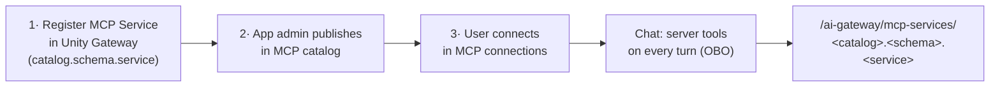

# Connecting MCPs to AI Prism

**English** · [Português (Brasil)](pt-BR/mcp-connections.md) · [Español](es/mcp-connections.md)

This guide shows, end to end, how to give AI Prism access to external tools
through **MCP (Model Context Protocol)**, from Slack and GitHub to web search
(e.g., Firecrawl) or a server of your own. It has **three steps**:

1. **In Unity Gateway (Databricks)**: someone with permission registers the server
   as a Unity Catalog **MCP Service**, once per workspace.
2. **In AI Prism (admin)**: an app admin **publishes** that MCP Service in the
   *MCP catalog*, so that it appears to users.
3. **In AI Prism (each user)**: the user **connects** the MCP in *MCP connections*.
   From then on it stays on in chat.

> **Why go through Unity AI Gateway?** AI Prism never asks the user to paste an
> arbitrary URL with a secret. Every MCP is an **MCP Service** governed by Unity
> Catalog and invoked through **Unity AI Gateway**, which handles authentication
> with the third-party service (including per-user OAuth consent, when applicable).
> AI Prism calls the gateway **on behalf of the logged-in user**: the bearer is
> always that user's OAuth token, and no credential is stored in the app.

---

## Flow overview

<!-- i18n: code-translated -->

The **Databricks-managed** MCPs (`system.ai.*`: web search, Slack, Gmail,
GitHub, Google Drive/Calendar, Microsoft 365, Atlassian, Databricks SQL, Sandbox)
already come in the app's catalog, with no need for step 1 or step 2. The admin
can hide them if they do not want to offer them.

---

## Step 1: register the MCP Service in Unity Gateway

Done in the Databricks UI (see
[Register an MCP service](https://docs.databricks.com/aws/en/ai-gateway/register-mcp-service)):

1. Open **Unity Gateway → MCPs → + MCP** and choose **Connect an existing MCP server**.
2. Choose the **catalog** and the **schema**, and give the MCP a name. The full name
   is `<catalog>.<schema>.<service>`, for example
   `lojinha_do_tio_pedro_catalog.default.firecrawl_mcp`.
3. Select an existing HTTP connection or create one (MCP server URL and
   authentication method). Click **Create & load tools**.
4. Under **Tools**, authenticate if asked, and **select only the tools that make sense
   to expose**. Every exposed tool goes to the model on every turn; a server with dozens
   of tools costs thousands of tokens per message (see *Cost* below).
5. Click **Create MCP Service**.

To register, the Databricks documentation requires: the **Workspace access**
entitlement; `USE CATALOG` and `USE SCHEMA` on the parent catalog and schema;
`CREATE SERVICE` on the schema; and `CREATE CONNECTION` on the schema, or
`USE CONNECTION` on an existing connection.

**User access.** Anyone who will use the MCP in AI Prism needs permission to **invoke**
the MCP Service, in addition to `USE CATALOG` and `USE SCHEMA` on its catalog and
schema. Grant it through Unity Catalog (Catalog Explorer → the MCP Service →
*Permissions*). Without that access, the gateway responds *"Not authorized to invoke
MCP service"* and AI Prism shows the **No permission** status.

---

## Step 2: publish in AI Prism (app admin)

1. Open **Settings (⚙) → MCP catalog**. The tab is admin-only and has the shield icon.
2. Under **Add MCP Service**, paste any of these formats and click **Verify**:
   - `catalog.schema.service`
   - `mcp-services/catalog.schema.service`
   - the gateway URL: `https://<workspace>/ai-gateway/mcp-services/catalog.schema.service`
3. AI Prism tests the service **with your account** and shows the exposed tools and the status:
   - **Connected**: tools listed; you can publish.
   - **Login required**: the service asks for per-user OAuth consent. You can publish;
     each user logs in once, on their first connection.
   - **No permission**: the service does not exist, or your account cannot invoke it.
     Check the name and the permissions (step 1). Publishing is blocked.
   - **Unavailable**: another error (server down, badly configured connection).
     Publishing is blocked.
4. Adjust the **display name** and the **description**, and click **Publish for users**.
   Write the description with the model in mind: it becomes the "what it is for" that
   the model reads on every turn (e.g., *"Live web search and page reading."*).

In **Published catalog**, the admin can also:

- **hide or show** any entry, including the curated `system.ai.*` ones. A hidden MCP
  disappears from the users' list and is **blocked on the server**: it does not reach
  the model, not even for those who had already connected it, and it cannot be
  connected by typing its name;
- **edit** the name and description, **remove** a published MCP, or **restore** a
  curated entry to its default.

**Workspace suggestions** (collapsible section) lists, on a best-effort basis, the
MCP Services that the *app's service principal* can see. It may not be the full list,
but any other service works if you paste its name.

> Catalog data lives in the `app_mcp_catalog` table in the app's Lakebase, created
> automatically on first access after deploy.

---

## Step 3: connect in AI Prism (each user)

1. Open **Settings (⚙) → MCP connections**. The tab lists the visible catalog (the
   curated entries plus those published by the admin). Use the semantic **search** by
   intent, e.g., "web search", "email and calendar", "code".
2. Click **Connect**. AI Prism tests access **on your behalf** and shows the status
   (the same ones as in step 2). Under **Login required**, a button opens the provider's
   flow in a new tab; complete the consent and click **Verify**.
3. Done: the connected MCP stays **on in every chat**, including the first turn of a new
   chat. To turn it off in a specific conversation, use the toggle in the composer's
   **tool picker**. The choice applies to that chat only.

### Credential rule when connecting (including by name)

Every MCP that a user connects, whether from the catalog or typed by its full name
(`catalog.schema.service`), must call the server behind it with a credential that
belongs to that user: per-user OAuth, or the caller's own Databricks identity. AI Prism
reads the service configuration from Unity Catalog (metadata only, never a secret value)
and **refuses** the service when:

- it uses **one shared credential**, the same for every user (e.g., a bearer token or
  OAuth M2M); connecting it would give everyone the identity of that credential;
- it is not possible to **confirm** the credential type (unreadable metadata, an app
  without the service principal, or a failed check). The rule fails **closed**.

The check runs on **connect**, on **verify** of a saved connection (which is then marked
*no permission*), and on **search**: a refused name is listed with the reason and is
never offered in the tool picker. Catalog entries whose class is already confirmed (the
curated `system.ai.*` ones, and what the admin verified at publish time) are not
reclassified. Error messages never include the credential. Current limit: a connection
saved before this rule stays available in chat until it is **removed** (verifying only
marks it as refused).

---

## How the model uses the tools

On every turn, AI Prism lists the tools of each connected MCP and offers them to the
model as function calling, alongside the native tools (Genie, Python, UC Functions,
Vector Search):

- **Readable names**: `mcp_<service>__<tool>`, for example `mcp_firecrawl_mcp__firecrawl_search`.
- **Context on each tool**: the description starts with the server and its purpose,
  e.g., `[Firecrawl — MCP: Live web search.]`.
- **Turn guide**: a system instruction lists the connected MCP servers, what each one
  is for (the catalog description), and the **instructions the server itself publishes**
  in the MCP. It also tells the model to check the tools before saying it "has no access"
  to something, such as news, recent events or web pages.
- **Fast listing**: listing the tools through the gateway can take a few seconds
  (Firecrawl takes 2.6–4.4s). The list is cached per user and refreshed in the background.
  The cache is warmed on connect or verify, and when the picker opens. A turn without a
  cache waits up to 8s; if it goes past that, that MCP becomes a "status" tool with the
  reason, and the listing finishes in the background for the next turn.

### Cost

Every exposed tool carries its schema on **every** turn. The 28 Firecrawl tools, for
example, add up to about 14 thousand tokens per message. To reduce it, expose only the
tools that matter in the MCP Service (step 1, item 4).

---

## Troubleshooting

| Symptom | Likely cause | What to do |
| --- | --- | --- |
| MCP does not appear in *MCP connections* | It was not published, or an admin hid it | Admin: publish it or show it in *MCP catalog* |
| **No permission** status | The service does not exist, or the user cannot invoke it | Check the name; grant access to the MCP Service + `USE CATALOG`/`USE SCHEMA` |
| **Login required** status that does not go away | Pending per-user OAuth consent | Click **Log in**, complete it with the provider, then **Verify** |
| **Unavailable** status | Server down, or badly configured HTTP connection | Review the MCP Service connection in Unity Gateway |
| The model says it does not have the tool | The MCP was turned off in this chat, or the listing failed | Check the toggle in the picker; the turn narration shows "· unavailable" when the listing fails |
| Expensive or slow responses | Too many tools exposed by the server | Expose fewer tools in the MCP Service |

---

## See also

- **[mcp-microsoft-graph.md](./mcp-microsoft-graph.md)**: how to connect email, calendar
  and files from Microsoft **without a Copilot Studio Pro license**, by building an MCP
  server from scratch on Microsoft Graph.
- `server/externalMcp.js`: catalog (curated + `app_mcp_catalog`), name normalization,
  probe and suggestions.
- `server/mcpClient.js`: Streamable HTTP client (list/call tools, cache).
- `server/tools.js`: MCP tools for the model (names, context, turn guide).
- `client/src/components/McpCatalogAdminTab.jsx` and `McpConnectionsTab.jsx`: the tabs.
