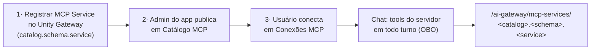

# Conectando MCPs ao AI Prism

Este guia mostra, de ponta a ponta, como dar ao AI Prism acesso a ferramentas
externas via **MCP (Model Context Protocol)**, de Slack e GitHub a busca na web
(ex.: Firecrawl) ou um servidor próprio. São **três etapas**:

1. **No Unity Gateway (Databricks)**: alguém com permissão registra o servidor
   como um **MCP Service** do Unity Catalog, uma vez por workspace.
2. **No AI Prism (admin)**: um admin do app **publica** esse MCP Service no
   *Catálogo MCP*, para ele aparecer para os usuários.
3. **No AI Prism (cada usuário)**: o usuário **conecta** o MCP em *Conexões MCP*.
   A partir daí ele fica ligado no chat.

> **Por que via Unity AI Gateway?** O AI Prism nunca pede que o usuário cole uma
> URL arbitrária com um segredo. Todo MCP é um **MCP Service** governado pelo Unity
> Catalog e invocado pelo **Unity AI Gateway**, que cuida da autenticação com o
> serviço de terceiros (inclusive consentimento OAuth por usuário, quando
> aplicável). O AI Prism chama o gateway **em nome do usuário logado**: o bearer
> é sempre o token OAuth dele, e nenhuma credencial fica guardada no app.

---

## Visão do fluxo

Os MCPs **gerenciados pela Databricks** (`system.ai.*`: web search, Slack, Gmail,
GitHub, Google Drive/Calendar, Microsoft 365, Atlassian, Databricks SQL, Sandbox)
já vêm no catálogo do app, sem precisar da etapa 1 nem da 2. O admin pode
ocultá-los se não quiser oferecê-los.

---

## Etapa 1: registrar o MCP Service no Unity Gateway

Feita na UI da Databricks (ver
[Register an MCP service](https://docs.databricks.com/aws/en/ai-gateway/register-mcp-service)):

1. Abra **Unity Gateway → MCPs → + MCP** e escolha **Connect an existing MCP server**.
2. Escolha o **catálogo** e o **schema** e dê um nome ao MCP. O nome completo
   fica `<catalog>.<schema>.<service>`, por exemplo
   `lojinha_do_tio_pedro_catalog.default.firecrawl_mcp`.
3. Selecione uma conexão HTTP existente ou crie uma (URL do servidor MCP e
   método de autenticação). Clique em **Create & load tools**.
4. Em **Tools**, autentique se for pedido e **selecione só as tools que fazem
   sentido expor**. Cada tool exposta vai para o modelo a cada turno; um servidor
   com dezenas de tools custa milhares de tokens por mensagem (veja *Custo* abaixo).
5. Clique em **Create MCP Service**.

Para registrar, a documentação da Databricks pede: o entitlement **Workspace
access**; `USE CATALOG` e `USE SCHEMA` no catálogo e schema pais; `CREATE SERVICE`
no schema; e `CREATE CONNECTION` no schema ou `USE CONNECTION` numa conexão
existente.

**Acesso dos usuários.** Quem vai usar o MCP no AI Prism precisa ter permissão
para **invocar** o MCP Service, além de `USE CATALOG` e `USE SCHEMA` no catálogo e
schema dele. Conceda pelo Unity Catalog (Catalog Explorer → o MCP Service →
*Permissions*). Sem esse acesso, o gateway responde *"Not authorized to invoke MCP
service"* e o AI Prism mostra o status **Sem permissão**.

---

## Etapa 2: publicar no AI Prism (admin do app)

1. Abra **Configurações (⚙) → Catálogo MCP**. A aba é só de admin e tem o ícone de
   escudo.
2. Em **Adicionar MCP Service**, cole qualquer um destes formatos e clique em
   **Verificar**:
   - `catalog.schema.service`
   - `mcp-services/catalog.schema.service`
   - a URL do gateway: `https://<workspace>/ai-gateway/mcp-services/catalog.schema.service`
3. O AI Prism testa o serviço **com a sua conta** e mostra as tools expostas e o
   status:
   - **Conectado**: tools listadas; pode publicar.
   - **Requer login**: o serviço pede consentimento OAuth por usuário. Pode
     publicar; cada usuário faz o login uma vez, na primeira conexão.
   - **Sem permissão**: o serviço não existe ou a sua conta não pode invocá-lo.
     Confira o nome e as permissões (etapa 1). A publicação é bloqueada.
   - **Indisponível**: outro erro (servidor fora do ar, conexão mal configurada).
     A publicação é bloqueada.
4. Ajuste o **nome exibido** e a **descrição** e clique em **Publicar para
   usuários**. Escreva a descrição pensando no modelo: ela vira o "para que serve"
   que o modelo lê em todo turno (ex.: *"Busca na web ao vivo e leitura de páginas."*).

Em **Catálogo publicado** o admin também:

- **oculta ou mostra** qualquer entrada, inclusive as curadas `system.ai.*`. Um MCP
  oculto some da lista dos usuários e é **bloqueado no servidor**: não chega ao
  modelo nem para quem já tinha conectado, e não pode ser conectado digitando o
  nome;
- **edita** nome e descrição, **remove** um MCP publicado ou **restaura** uma
  entrada curada ao padrão.

**Sugestões do workspace** (seção recolhível) lista, em melhor esforço, os MCP
Services que o *service principal do app* enxerga. Pode não ser a lista completa,
mas qualquer outro serviço funciona colando o nome.

> Os dados do catálogo ficam na tabela `app_mcp_catalog` do Lakebase do app,
> criada automaticamente no primeiro acesso depois do deploy.

---

## Etapa 3: conectar no AI Prism (cada usuário)

1. Abra **Configurações (⚙) → Conexões MCP**. A aba lista o catálogo visível
   (curados mais os publicados pelo admin). Use a **busca** semântica por intenção,
   ex.: "busca na web", "e-mail e calendário", "código".
2. Clique em **Conectar**. O AI Prism testa o acesso **em seu nome** e mostra o
   status (os mesmos da etapa 2). Em **Requer login**, um botão abre o fluxo do
   provedor numa nova aba; conclua o consentimento e clique em **Verificar**.
3. Pronto: o MCP conectado fica **ligado em todo chat**, inclusive no primeiro
   turno de um chat novo. Para desligar numa conversa específica, use o toggle
   no **seletor de ferramentas** do composer. A escolha vale para aquele chat.

---

## Como o modelo usa as tools

A cada turno, o AI Prism lista as tools de cada MCP ligado e as oferece ao modelo
como function-calling, junto das ferramentas nativas (Genie, Python, UC Functions,
Vector Search):

- **Nomes legíveis**: `mcp_<serviço>__<tool>`, por exemplo
  `mcp_firecrawl_mcp__firecrawl_search`.
- **Contexto em cada tool**: a descrição começa com o servidor e a finalidade
  dele, ex.: `[Firecrawl — MCP: Busca na web ao vivo.]`.
- **Guia do turno**: uma instrução de sistema lista os servidores MCP conectados,
  para que cada um serve (a descrição do catálogo) e as **instruções que o próprio
  servidor publica** no MCP. Também orienta o modelo a conferir as ferramentas
  antes de dizer que "não tem acesso" a algo, como notícias, eventos recentes ou
  páginas web.
- **Listagem rápida**: listar as tools pelo gateway pode levar alguns segundos
  (o Firecrawl leva 2,6–4,4s). A lista fica em cache por usuário e é renovada em
  segundo plano. O cache é aquecido ao conectar ou verificar e ao abrir o seletor.
  Um turno sem cache espera até 8s; se passar disso, aquele MCP vira uma tool de
  "status" com o motivo, e a listagem termina em segundo plano para o próximo turno.

### Custo

Cada tool exposta leva o schema dela em **todo** turno. As 28 tools do Firecrawl,
por exemplo, somam cerca de 14 mil tokens por mensagem. Para reduzir, exponha no
MCP Service só as tools que importam (etapa 1, passo 4).

---

## Solução de problemas

| Sintoma | Causa provável | O que fazer |
| --- | --- | --- |
| MCP não aparece em *Conexões MCP* | Não foi publicado, ou um admin o ocultou | Admin: publicar ou mostrar em *Catálogo MCP* |
| Status **Sem permissão** | O serviço não existe ou o usuário não pode invocá-lo | Conferir o nome; conceder acesso ao MCP Service + `USE CATALOG`/`USE SCHEMA` |
| Status **Requer login** que não some | Consentimento OAuth por usuário pendente | Clicar em **Fazer login**, concluir no provedor e depois **Verificar** |
| Status **Indisponível** | Servidor fora do ar ou conexão HTTP mal configurada | Revisar a conexão do MCP Service no Unity Gateway |
| O modelo diz que não tem a ferramenta | O MCP foi desligado neste chat, ou a listagem falhou | Conferir o toggle no seletor; a narração mostra "· indisponível" quando a listagem falha |
| Respostas caras ou lentas | Muitas tools expostas pelo servidor | Expor menos tools no MCP Service |

---

## Ver também

- **[mcp-microsoft-graph.md](./mcp-microsoft-graph.md)**: como conectar e-mail,
  calendário e arquivos da Microsoft **sem licença Copilot Studio Pro**,
  construindo um servidor MCP do zero sobre o Microsoft Graph.
- `server/externalMcp.js`: catálogo (curados + `app_mcp_catalog`), normalização
  de nomes, probe e sugestões.
- `server/mcpClient.js`: cliente Streamable HTTP (list/call tools, cache).
- `server/tools.js`: tools MCP para o modelo (nomes, contexto, guia do turno).
- `client/src/components/McpCatalogAdminTab.jsx` e `McpConnectionsTab.jsx`: as abas.
