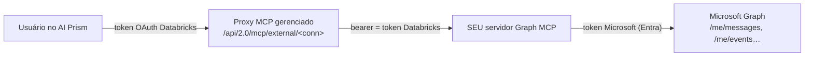

# AI Prism + Microsoft 365 (email, calendar, files) without Copilot Studio Pro

**English** · [Português (Brasil)](pt-BR/mcp-microsoft-graph.md) · [Español](es/mcp-microsoft-graph.md)

**The question this document answers:** an organization that **does not have a
Copilot Studio Pro license** wants AI Prism to read and write its users' **email
and calendar** (Outlook/Exchange Online) and, optionally, OneDrive/Teams. Without
the managed Copilot Studio connector, the correct, supported way is to **build
your own MCP server on top of Microsoft Graph** and register it as an external
MCP connection (see **[mcp-connections.md](./mcp-connections.md)**).

This guide gives the **recommended architecture**, the authentication trade-offs
(the part people get wrong most often), an implementation sketch, and the
step-by-step integration with AI Prism.

> **Why MCP and not a native tool inside AI Prism?** MCP is AI Prism's
> integration boundary (`server/mcpClient.ts` speaks Streamable HTTP). A Graph MCP
> server is reusable (any MCP client can consume it), lives **outside** the app's
> deploy cycle, and governance (who may use it) lives in Unity Catalog. No Graph
> code goes into AI Prism.

---

## 1. The subtlety that shapes everything: where Microsoft authentication happens

Understand the token's path **before** choosing a design:



AI Prism **always** calls the Databricks proxy with the **signed-in user's
Databricks token** (that is the app's on-behalf-of model — `server/mcpClient.ts`
sets `Authorization: Bearer <databricks-token>`). That token is **not** a
Microsoft Graph token. Therefore:

> **Your Graph MCP server is responsible for obtaining the Microsoft Graph token
> on its own.** It is an **app registered in Microsoft Entra ID** (Azure AD) and
> authenticates against Microsoft by itself. What reaches it through Databricks is
> only **who** the user is (identity), not a Microsoft credential.

That leaves **two** independent decisions:

- **(A) How the Databricks proxy authenticates to your MCP** (the "front door"):
  a static bearer, or per-user OAuth, configured in the Unity Catalog connection's
  *options*.
- **(B) How your MCP authenticates to Microsoft Graph** (the "back door"):
  **app-only** (client credentials) or **delegated per user**. This is where the
  architecture decision lives.

---

## 2. Choosing the auth model for Graph (decision B)

| | **App-only (client credentials)** | **Delegated per user (OAuth/OBO)** |
| --- | --- | --- |
| Who acts | A service identity (the app) | The end user, with their own permissions |
| Consent | An **admin** consents once (*Application* permissions) | Each user consents once (*Delegated* permissions) |
| Isolation | The app can read **any** mailbox → **you** must restrict it | Naturally limited to the user's own mailbox |
| Graph endpoints | `/users/{upn}/messages`, `/users/{upn}/events` | `/me/messages`, `/me/events` |
| Complexity | Lower (one token flow) | Higher (per-user login + refresh) |
| Best for | Pilot / single tenant, automations, service accounts | Multi-user production, per-person audit trail |

### Recommendation

- **Pilot / proof of value (the recommended default to start with):** **app-only**
  with an Exchange **Application Access Policy** that **restricts the mailboxes**
  to a security group. It comes up fast (a single token flow), and AI Prism maps
  the user's identity to the right mailbox.
- **Multi-user production:** **delegated per user**. Each person can only reach
  their own email and calendar by construction, with per-user auditing. It fits
  the **"Requires sign-in → Verify"** flow that AI Prism already shows on the MCPs
  tab (the server returns a consent error with the sign-in link; the user
  consents once).

> **Least privilege.** Ask only for the scopes you need: `Mail.Read`/`Mail.Send`,
> `Calendars.Read`/`Calendars.ReadWrite`, `Files.Read` — delegated whenever
> possible. **Never** request tenant-wide `Mail.ReadWrite` without need. In
> app-only, **always** limit it with `New-ApplicationAccessPolicy`.

---

## 3. Identity: linking the Databricks user to the Microsoft mailbox

The critical point of **app-only** mode: your MCP must know **whose** email to
access. Because AI Prism calls on behalf of the Databricks user, extract that
identity in the MCP server:

- The bearer that arrives is the user's **Databricks OAuth token** — validate it
  and read their **UPN/email** (the Databricks SCIM `Me` endpoint, or the token
  claims). **Always validate** (signature + audience); never trust an arbitrary
  identity header.
- Map that email → the Microsoft 365 UPN (most often they are **the same** — same
  corporate IdP). Keep an explicit map if they differ.
- Make Graph calls with `/users/{upn}/…` (app-only) or `/me/…` (delegated).

In **delegated** mode, the per-user OAuth consent already binds the identity —
`/me` resolves to the person who consented, and you need no map.

---

## 4. Tools the MCP should expose

Model **clear, low-risk verbs**, not a free pass to Graph. AI Prism's model calls
these tools through function calling; good names and descriptions improve routing.
The AI Prism user decides what to do with the result (summarize, extract to-dos,
draft a reply) — the tools only deliver data and actions.

| Tool | Does | Graph scope |
| --- | --- | --- |
| `list_recent_emails` | last N messages (subject, sender, snippet, date) | `Mail.Read` |
| `get_email` | full body + attachments of one message by id | `Mail.Read` |
| `search_emails` | search by sender/subject/period/text (`$search`/`$filter`) | `Mail.Read` |
| `list_calendar_events` | events in a date window | `Calendars.Read` |
| `create_calendar_event` | creates an event/invite | `Calendars.ReadWrite` |
| `send_email` | sends (or drafts) an email | `Mail.Send` |
| `list_recent_files` | recent OneDrive files (optional) | `Files.Read` |

**Guidelines:**
- **Writes behind confirmation.** Have `send_email`/`create_calendar_event` create
  a **draft** by default and only send with an explicit `confirm: true`
  parameter — models tend to act too early.
- **Paginate and limit** (`$top`, `$select`) so whole mailboxes are not dumped
  into the model's context.
- **`$delta` + change notifications** if you need efficient sync (avoids
  re-pulling everything on every call).
- **Rich descriptions** on every tool (AI Prism forwards them to the model as the
  function schema).

---

## 5. Implementation sketch (Node + MCP SDK + MSAL)

Recommended stack (the same family as AI Prism): **Node.js**,
`@modelcontextprotocol/sdk` (the **Streamable HTTP** transport — what
`server/mcpClient.ts` expects), `@azure/msal-node` for tokens, and the
**Microsoft Graph SDKs**. An app-only outline:

```js
// server.js — Graph MCP (app-only, abridged)
import express from 'express'
import { McpServer } from '@modelcontextprotocol/sdk/server/mcp.js'
import { StreamableHTTPServerTransport } from '@modelcontextprotocol/sdk/server/streamableHttp.js'
import { ConfidentialClientApplication } from '@azure/msal-node'
import { Client } from '@microsoft/microsoft-graph-client'

// --- back door: Microsoft Graph token (app-only) ---
const msal = new ConfidentialClientApplication({
  auth: {
    clientId: process.env.MS_CLIENT_ID,
    authority: `https://login.microsoftonline.com/${process.env.MS_TENANT_ID}`,
    // PREFER a certificate (clientCertificate) over clientSecret in production
    clientSecret: process.env.MS_CLIENT_SECRET,
  },
})
async function graphForUser(upn) {
  const { accessToken } = await msal.acquireTokenByClientCredential({
    scopes: ['https://graph.microsoft.com/.default'],
  })
  const client = Client.init({ authProvider: (done) => done(null, accessToken) })
  // app-only → always scoped to ONE mailbox: /users/{upn}
  return { client, base: `/users/${encodeURIComponent(upn)}` }
}

// --- front door: validate the Databricks token and extract the user ---
async function resolveUser(req) {
  const token = (req.headers.authorization || '').replace(/^Bearer\s+/i, '')
  const upn = await verifyDatabricksTokenAndGetUpn(token) // validate signature+audience!
  if (!upn) { const e = new Error('not authenticated'); e.status = 401; throw e }
  return upn
}

const mcp = new McpServer({ name: 'ms-graph', version: '1.0.0' })

mcp.tool(
  'list_recent_emails',
  "Lists the user's most recent emails (subject, sender, date, preview).",
  { top: { type: 'number', default: 15 } },
  async ({ top }, { req }) => {
    const upn = await resolveUser(req)
    const { client, base } = await graphForUser(upn)
    const r = await client
      .api(`${base}/messages`)
      .top(Math.min(top ?? 15, 50))
      .select('subject,from,receivedDateTime,bodyPreview')
      .orderby('receivedDateTime DESC')
      .get()
    return { content: [{ type: 'text', text: JSON.stringify(r.value, null, 2) }] }
  }
)

mcp.tool(
  'send_email',
  'Sends an email. Creates a draft by default; only sends with confirm=true.',
  { to: {}, subject: {}, body: {}, confirm: { type: 'boolean', default: false } },
  async ({ to, subject, body, confirm }, { req }) => {
    const upn = await resolveUser(req)
    const { client, base } = await graphForUser(upn)
    const message = { subject, body: { contentType: 'HTML', content: body },
      toRecipients: [{ emailAddress: { address: to } }] }
    if (!confirm) {
      const draft = await client.api(`${base}/messages`).post(message)
      return { content: [{ type: 'text', text: `Draft created (${draft.id}). Call again with confirm=true to send it.` }] }
    }
    await client.api(`${base}/sendMail`).post({ message })
    return { content: [{ type: 'text', text: 'Email sent.' }] }
  }
)

// ... list_calendar_events / create_calendar_event / search_emails are analogous ...

const app = express()
app.post('/mcp', async (req, res) => {
  const transport = new StreamableHTTPServerTransport({ /* sessionId etc. */ })
  await mcp.connect(transport)
  await transport.handleRequest(req, res)
})
app.listen(process.env.PORT || 8080)
```

For **delegated** mode, replace `acquireTokenByClientCredential` with the **OBO**
flow (`acquireTokenOnBehalfOf`) or with a per-user **auth code + refresh token**,
and return a **consent error with a sign-in URL** when the user has not consented
yet — that is exactly what AI Prism turns into the **"Requires sign-in"** status
with the button that opens the flow (see §7).

### Where to host it

- Your own **Databricks App** (same account, never leaving Databricks), **Azure
  Container Apps / App Service** (closer to Entra/Graph), or any host with public
  HTTPS that the Databricks proxy can reach. It needs **TLS** and must be
  reachable from the workspace network.

---

## 6. Registering the app in Microsoft Entra ID (once)

1. **Entra ID → App registrations → New registration** (single- or multi-tenant,
   as your organization requires).
2. **Certificates & secrets:** prefer a **certificate** (X.509) over a client
   secret; keep it in Key Vault. Consider **Workload Identity Federation** to
   eliminate long-lived secrets.
3. **API permissions → Microsoft Graph:**
   - App-only: **Application** permissions (`Mail.Read`, `Mail.Send`,
     `Calendars.ReadWrite`, …) → **Grant admin consent**.
   - Delegated: **Delegated** permissions (same names) → per-user consent on
     first use.
4. **Restrict the reach (app-only):** create a security group with the allowed
   mailboxes and apply an **Application Access Policy** in Exchange Online:
   ```powershell
   New-ApplicationAccessPolicy -AppId <MS_CLIENT_ID> `
     -PolicyScopeGroupId ai-prism-mailboxes@contoso.com `
     -AccessRight RestrictAccess `
     -Description "AI Prism Graph MCP — pilot mailboxes only"
   ```
5. Note the **Tenant ID**, the **Client ID**, and the **credential path** for the
   MCP deployment.

---

## 7. Integrating with AI Prism

Once the MCP is up (HTTPS), follow **[mcp-connections.md](./mcp-connections.md)**
— AI Prism does not tell a "Graph MCP" apart from any other external MCP.

1. **An admin registers the HTTP connection in Unity Catalog**, pointing to your
   MCP:

   ```sql
   -- Front door with a static bearer (the MCP validates on its own):
   CREATE CONNECTION IF NOT EXISTS microsoft_graph_mcp
     TYPE HTTP
     OPTIONS (
       host 'https://graph-mcp.yourcompany.com',
       port '443',
       base_path '/mcp',
       is_mcp_connection 'true',
       bearer_token '<FRONT_DOOR_TOKEN>'   -- optional; see note
     )
     COMMENT 'Microsoft 365 — email and calendar via Microsoft Graph';

   GRANT USE CONNECTION ON CONNECTION microsoft_graph_mcp TO `ai-prism-users`;
   ```

   > **Note on front door vs. back door.** The `bearer_token` above
   > authenticates the **Databricks proxy → your MCP** hop. It is **different**
   > from the Microsoft token (which the MCP obtains on its own). In **delegated**
   > mode, let the connection's OAuth *options* trigger the **per-user sign-in** —
   > that way the Microsoft consent happens through AI Prism's "Requires sign-in"
   > flow.

2. **Each user connects** in **Settings → MCPs** and clicks **Connect**.
   - A well-configured app-only setup → status **Connected** right away.
   - Delegated → status **Requires sign-in**; the user clicks **sign in**,
     consents on the Microsoft screen, then clicks **Verify**.
3. **Turn it on in the chat's tool picker** (it is on by default after
   connecting).
4. **Use it** — now the user can steer AI Prism freely:
   > *"Summarize my unread emails from today and list the to-dos they contain."*
   > *"What meetings do I have tomorrow? Prepare an agenda for the 2 pm one."*
   > *"Draft a reply to the supplier's last email confirming Friday's
   > meeting."*

   The model calls the MCP tools, AI Prism runs them on the user's behalf, and the
   model composes the answer — combinable with the app's other features (generate
   a deck from the agenda, a spreadsheet of the to-dos, and so on).

---

## 8. Security, compliance and operations (checklist)

- [ ] **Validate the Databricks token** in the MCP (signature + audience); never
      trust a loose identity header.
- [ ] **Least privilege** on Graph scopes; **delegated** whenever possible.
- [ ] App-only **always** with an **Application Access Policy** limiting the
      mailboxes.
- [ ] **Certificate / federated credentials** instead of a client secret; secrets
      in Key Vault; rotation and monitoring.
- [ ] **Writes** (`send_email`, `create_event`) behind `confirm=true` (draft by
      default).
- [ ] **Pagination / `$select` / `$delta`** for efficiency and to avoid
      overflowing the model's context.
- [ ] **Graph throttling:** exponential backoff with jitter + `Retry-After`; use
      the SDKs (built-in retry).
- [ ] **Auditing:** log tool calls, consents, and service principal usage in your
      SIEM; review permissions periodically.
- [ ] **Data residency:** email and calendar content travels Microsoft → your MCP
      → AI Prism → model. Confirm that this is acceptable for your organization
      (AI Prism runs in your own workspace; the models are the ones behind your
      own AI Gateway).

---

## 9. Alternatives considered

- **Copilot Studio Pro / managed connector** — the "no code" path, but it needs
  the license that this scenario assumes you **do not have**. This guide is the
  alternative.
- **A native tool in AI Prism** (a UC Function/Python calling Graph) — possible,
  but it couples Microsoft credentials to the app and its deploy, loses Unity
  Catalog governance, and is not reusable outside AI Prism. **MCP is preferable.**
- **Logic Apps / Power Automate as an HTTP facade** — workable for a few fixed
  flows, but it does not expose MCP natively and is less flexible than an MCP
  server with well-modeled tools.

---

## References

- On-Behalf-Of (OBO) flow — Microsoft identity platform.
- App-only access primer — Microsoft identity platform.
- Delta query & change notifications (Outlook).
- `New-ApplicationAccessPolicy` — restricting access to mailboxes (Exchange Online).
- Credentials: certificates & Workload Identity Federation.
- Microsoft Graph throttling & retry.
- **[mcp-connections.md](./mcp-connections.md)** — how to register the connection
  in UC and connect it in AI Prism (the generic step this guide specializes).
