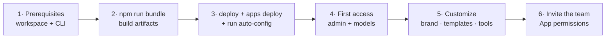

# Onboarding: your own "ChatGPT" on Databricks in about 20 minutes

**English** · [Português (Brasil)](pt-BR/onboarding-deployment.md) · [Español](es/onboarding-deployment.md)

> **Notice.** AI Prism is not an official Databricks product and has no SLA. It
> is an open-source accelerator that **you deploy in your own workspace** and
> customize as you like. Your data stays in your Databricks account and is not
> used to train third-party models.

This guide takes you from "empty workspace" to "app running for the team" with
**a single command**. All the infrastructure (Lakebase, SQL Warehouse, App,
dashboards, UDF) is provisioned by a **Databricks Asset Bundle**. You don't create
resources by hand.

---

## Flow overview

<!-- i18n: code-translated -->


Step 3 is three commands (detailed below). **`bundle deploy`** provisions the
infrastructure: **serverless Lakebase** (*Autoscaling* product: 0.5–16 CU,
auto-stop after 30 min), a **Serverless SQL Warehouse**, the **App** (with
Lakebase and the Warehouse attached as resources, which inject `PGHOST` and
`SQL_WAREHOUSE_ID` into the runtime), and the **cost and operations dashboards**. **`apps deploy`**
publishes the code. **`bundle run ai_prism_auto_config`** creates the Postgres
role for the service principal, provisions the Python UDF and the images Volume,
and seeds the person who deployed as the **bootstrap admin**.

---

## 1. Prerequisites (5 min)

- A **Databricks workspace** (AWS, Azure, or GCP) with Unity Catalog enabled.
- **AI Gateway / Foundation Model APIs** available in your region (endpoints
  `databricks-claude-*`, `databricks-gpt-*`, and so on).
- A **recent Databricks CLI (≥ ~1.x; ideally ≥ 1.8)**, authenticated to a profile
  for the workspace. Old CLIs (for example, 0.29x) fail to download the internal
  Terraform with `openpgp: key expired` during `bundle deploy`. CLI ≥ 1.8 stores
  the credential in the OS keyring. If an old cached token gets in the way, run
  `databricks auth login` again or export `DATABRICKS_AUTH_STORAGE=plaintext`.
  ```bash
  # Azure: use your workspace host (adb-<id>.<n>.azuredatabricks.net)
  databricks auth login --host https://<seu-workspace> -p <PROFILE>
  ```
- Permission to create a **Databricks App**, a **SQL Warehouse**, **Lakebase**,
  and **Jobs** (the bundle creates all of them). For the Python UDF and the images
  Volume, you must be able to create the `ai_prism` catalog (or already have it).
  If you don't have `CREATE CATALOG` on the metastore, point to an existing
  catalog with `--var tools_catalog=<cat> --var image_volume_catalog=<cat>`.
- **Node.js 22.18+** and **npm** (`package.json` `engines`; the end-to-end tests need 22.19+), with
  `npm ci --include=dev` done: `deploy.sh` / `deploy.ps1` build the artifacts before the deploy
  and run the smoke after it (see step 3).

**Check:** `databricks current-user me -p <PROFILE>` returns your e-mail.

> **Note (cloud-agnostic):** `databricks.yml` does **not** pin a workspace host.
> The deploy target comes entirely from the profile in `-p <PROFILE>`. The same
> bundle deploys to AWS, Azure, or GCP without editing any file. If your CLI ≥ 1.8
> complains about a credential cached by an older version, export
> `DATABRICKS_AUTH_STORAGE=plaintext` or run `databricks auth login` again.

---

## 2. Build the artifacts (2 min)

The App runs pre-built artifacts (`client/dist` + `server-dist/index.cjs`), not
the source code. Feature pull requests do not commit those artifacts, so the copy
on disk can be older than the code. `deploy.sh` / `deploy.ps1` (Option A below) run
`npm run bundle` on their own before the deploy and stop if the build fails. With
the manual commands (Option B), **always** rebuild before you deploy:

```bash
npm ci --include=dev   # first time only (see the devDeps note below)
npm run bundle         # client/dist + server-dist/index.cjs
```

> **Note (devDeps):** in this project, a bare `npm install <pkg>` can prune the
> devDependencies the build needs. Use `npm ci --include=dev` or
> `npm install --include=dev`.

---

## 3. Deploy the full stack (5 min)

### Option A: one command (recommended)

`deploy.sh` (Linux/macOS) and `deploy.ps1` (Windows) do everything below in the
right order. They take the CLI profile as an argument (no host is pinned), and
they are idempotent:

```bash
./deploy.sh <PROFILE> [CATALOGO]                 # default for CATALOGO: ai_prism
./deploy.sh --tag cost_center=1234 --tag area=Finanças <PROFILE>
./deploy.sh --lakebase-suspend-minutes 30 --usage-policy-id <id> <PROFILE>
./deploy.sh --skip-build --skip-smoke <PROFILE>   # artifacts as on disk, no smoke
```

```powershell
.\deploy.ps1 <PERFIL> [CATALOGO] -Tag 'cost_center=1234','area=Finanças' -LakebaseSuspendMinutes 30 -UsagePolicyId <id>
.\deploy.ps1 <PERFIL> -SkipBuild -SkipSmoke
```

Options: `--tag key=value` (repeatable, up to 24; see [docs/tags.md](tags.md)),
`--lakebase-suspend-minutes N` (minutes without use before Lakebase sleeps, 1 to
10080), `--usage-policy-id ID` (a serverless usage policy that an admin already
created in the account), and `--classic-cluster-id ID` (for a workspace without
serverless: the ID of a classic Dedicated or Single user cluster. The warehouse
becomes classic Pro, and the auto-config runs on that cluster), `--skip-build`
(does not run `npm run bundle`: deploys `client/dist` + `server-dist` as they are on
disk, for example from a release zip or on a machine without Node), and
`--skip-smoke` (does not run the smoke at the end). In PowerShell they are
`-SkipBuild` and `-SkipSmoke`. Each option has an equivalent environment variable
(`TAGS`, `LAKEBASE_SUSPEND_MINUTES`, `SERVERLESS_USAGE_POLICY_ID`,
`CLASSIC_CLUSTER_ID`, `AI_PRISM_SKIP_BUILD=1`, `AI_PRISM_SKIP_SMOKE=1`). See
`./deploy.sh --help`. The scripts print their messages in English.

The script runs these steps, in this order:

1. It checks whether the Lakebase project `ai-prism` was left **soft-deleted** by
   a previous `bundle destroy` (see *Troubleshooting common problems*). If it
   was, the script stops before changing anything and shows the commands to
   restore or purge it. It never purges on its own.
2. It runs `npm run bundle` (`client/dist` + `server-dist`). If the build fails, it
   stops before deploying anything.
3. It writes the catalog and tags to `app.yaml` (`AI_PRISM_RESOURCE_TAGS`) and to
   `.databricks/bundle/<alvo>/variable-overrides.json`.
4. It runs `bundle deploy` and starts the app.
5. It runs the auto-config job (SP role, your app tables to the owner role in
   Lakebase, UDF, volume, tags, and bootstrap admin). See [About Lakebase roles and grants](#about-lakebase-roles-and-grants).
6. It opens the owner hand-off for the app's SP (`node scripts/migrate.mjs prepare`)
   and publishes the code (`apps deploy`).
7. It runs `npm run smoke` against the app URL with your OAuth token
   (`databricks auth token -p <PROFILE>`; the token only goes to the smoke's
   environment and is never printed). The smoke opens the SPA, checks the identity,
   runs one chat turn, reads it back, generates a document, and deletes the test chat.
8. As you (the database owner), it runs `node scripts/migrate.mjs up --role <app SP>`:
   pending migrations, then the least-privilege grants of the app's service
   principal, which also closes the owner hand-off. The database credential is
   minted with the CLI and never printed. Once the hand-off is open this step runs
   on every exit path (a failed publish or smoke included), and the script only
   succeeds when the hand-off is closed. Without `node` on the PATH the hand-off is
   never opened: the app keeps running on `public` and the script fails at the end.

The script exits non-zero if any step fails, the smoke included. A failed smoke
does **not** roll the deploy back: the new version is already live, so read the
smoke table before you give users access. Without `npm` on the PATH, the script
stops at the start and points to `--skip-build --skip-smoke`.

The notebook **`Instalar AI Prism.py`** (in the project root, generated by
`scripts/build-installer-notebook.py`) does the same from inside the workspace,
without a terminal. Its fields mirror the options above (catalog, serverless,
Lakebase minutes, usage policy, and tags). Start with `acao = verificar`, which
creates nothing. It runs the same `deploy.sh` on a cluster, which usually has no
Node: there the deploy uses the pre-built artifacts from the release zip and needs
`AI_PRISM_SKIP_BUILD=1` and `AI_PRISM_SKIP_SMOKE=1` (run the smoke afterwards from a
machine with Node, as in Option B).

### Option B: manual commands

Three commands provision the infrastructure, publish the App code, and configure
the App:

```bash
# validate the bundle configuration (creates nothing)
databricks bundle validate -p <PROFILE> -t dev

# 0) build the artifacts the App runs (client/dist + server-dist)
npm run bundle

# 1) provision Lakebase + Warehouse + App + dashboards + job
databricks bundle deploy -p <PROFILE> -t dev

# 2) run the auto-config job: creates the SP's PG role and the owner hand-off,
#    provisions the Python UDF and the images Volume (ai_prism catalog), and seeds
#    the bootstrap admin. Run it BEFORE publishing the code.
databricks bundle run ai_prism_auto_config -p <PROFILE> -t dev

# 2b) as the database owner: open the owner hand-off for the app SP (closed by step 5;
#     PGHOST/PGUSER/PGPASSWORD: see "About Lakebase roles and grants")
node scripts/migrate.mjs prepare --role <app SP client id>

# 3) publish the App's CODE (bundle deploy alone does NOT republish the running process).
#    <SRC> is the path printed by the deploy / bundle summary,
#    typically /Workspace/Users/<você>/.bundle/ai-prism/dev/files
databricks apps deploy ai-prism --source-code-path <SRC> -p <PROFILE>

# 4) post-deploy smoke against the app URL (exits non-zero if something is broken)
APP_URL=<URL-do-app> DATABRICKS_TOKEN=<token-oauth> npm run smoke

# 5) as the database owner: pending migrations + the app SP's least-privilege grants
#    (PGHOST/PGUSER/PGPASSWORD: see "About Lakebase roles and grants")
node scripts/migrate.mjs up --role <app SP client id>
```

The bundle (`databricks.yml`) manages these resources:

| Resource | Configuration |
|---|---|
| **Lakebase** (`postgres_projects` + `postgres_endpoints`) | serverless, autoscaling **0.5–16 CU**, **auto-stop 30 min** |
| **SQL Warehouse** (`sql_warehouses`) | Serverless, 2X-Small, Photon, auto-stop 10 min |
| **App** (`apps`) | Lakebase and SQL Warehouse attached as **App resources** (the runtime injects `PGHOST` / `SQL_WAREHOUSE_ID`); static env in `app.yaml` |
| **Dashboards** (`dashboards`) | two Lakeview dashboards over system tables: AI costs per user (published by the auto-config job) and operations (calls, users, tokens, latency; stays a draft until someone publishes it). See [`dashboards/README.md`](../dashboards/README.md) |
| **Auto-config job** (`jobs`) | creates the **Postgres role of the app's SP** in Lakebase (`databricks_create_role`) and the **owner hand-off** (`ai_prism_owner`), the UDF `ai_prism_python_exec`, and the images Volume (all in the `ai_prism` catalog), and **seeds the bootstrap admin** (the person who deployed) in the `app_admins` table |

> **Resource tags and advanced options** (`--tag`, usage policy, Lakebase
> minutes) exist only in `deploy.sh`, `deploy.ps1`, and the notebook. With the
> manual commands, tags apply to the bundle's resources. The app uses them in AI
> Gateway and SQL only after `AI_PRISM_RESOURCE_TAGS` in `app.yaml` is updated.
> See [docs/tags.md](tags.md), "Caminho nativo do bundle".
>
> **Targets:** `dev` (default; it prefixes resource names with your user name,
> which is good for testing) and `prod` (clean names, for the official deploy).
> Replace `-t dev` with `-t prod` when you go live. Neither target pins a host.
> The workspace comes from `-p <PROFILE>`, so you don't need to edit
> `databricks.yml`.

> **About the Lakebase connection:** the App runtime injects `PGHOST`
> automatically from the `lakebase` resource. It is not hardcoded anywhere, which
> is why the same bundle works on any cloud. The app connects as **its own
> service principal** (the job creates that SP's Postgres role). User isolation
> is app-level (`WHERE user_email`). The SP's database privileges are described in
> [About Lakebase roles and grants](#about-lakebase-roles-and-grants).

When it finishes, `databricks bundle summary -p <PROFILE> -t dev` shows the App's
public URL (behind workspace OAuth).

### About the Python UDF (`execute_python`)

AI Prism ships its own UDF (`ai_prism_python_exec`) instead of using
`system.ai.python_exec`. Ours honors a `result` variable, captures `stdout`
**and** handles exceptions by returning `"ERROR: ..."` without failing the query.
The platform function fails the whole statement on any error. The definition
lives in `shared/pythonUdf.js` (the single source of truth). The deploy job uses
the version generated in `bundle/python_udf_ddl.py` (via
`node scripts/gen-python-udf-ddl.mjs`), and the app provisions it at runtime too.
The two are identical, byte for byte.

`TOOLS_CATALOG` and `TOOLS_SCHEMA` define **only where this UDF is created**.
They do not limit which UC Functions a user can attach as a tool. UC Function
discovery scans every catalog and schema the user can see (through
`system.information_schema.routines`, except `system`). It is always scoped by
the user's real Unity Catalog permissions.

### About the generated images Volume

Images generated or edited in the chat are real binary files, so they go to a
**dedicated UC Volume**. It is kept separate from the tools catalog so the files
don't mix with other assets. You can configure the path with
`IMAGE_VOLUME_CATALOG` / `IMAGE_VOLUME_SCHEMA` / `IMAGE_VOLUME_NAME` (default
`ai_prism.default.ai_prism_images`). The auto-config job creates the catalog,
schema, and volume, and grants `READ/WRITE VOLUME` to the **app's service
principal**. The app reads and writes images as the SP, not with the user's
OAuth token. This avoids depending on the `files` scope being re-consented in the
browser. User isolation stays **app-level** (`WHERE user_email` in
`chat_images`), like every artifact. The **default image model is Nano Banana 2**.

### About Lakebase roles and grants

The app's tables live in a dedicated Postgres schema, **`ai_prism`** (migration
0002), not in `public`. The `vector` extension stays in `public`. The app connects
with `search_path = ai_prism, public`, set once per connection. Three roles are
involved:

| Role | Who | What it can do |
|---|---|---|
| **Database owner** | the identity that deploys (it creates the Lakebase project) | runs `prepare`, `up` and `grants` from the deploy; member of the owner role |
| **`ai_prism_owner`** | a `NOLOGIN` role that the auto-config job creates | owns every app table and the `ai_prism` schema |
| **App service principal** | the role that `databricks_create_role` creates for the app's SP | `USAGE` on `ai_prism`; `SELECT/INSERT/UPDATE/DELETE` on the app tables; `USAGE/SELECT` on their sequences; `SELECT` on `schema_migrations`. It owns no table and has no explicit grant on `public` |

A deploy moves through three steps. `deploy.sh` and `deploy.ps1` run all three:

1. **Hand-off** (before the code is published). The auto-config job gives the app
   tables you own to `ai_prism_owner`. Then the deploy script
   (`migrate.mjs prepare`) lets the SP act as that role until step 3. Older deployments have mixed ownership (the SP created most
   tables, the deploy created `app_admins`), and neither identity can give its
   tables to the other. The neutral role is what makes the move possible.
2. **Migration** (the app's first request, as the SP). Migration 0002 gives the
   SP's tables to `ai_prism_owner` and moves every table into `ai_prism`. If the
   hand-off is missing, 0002 is **deferred**: the app keeps working on `public`,
   logs `migrations: 0002 schema_ai_prism deferred`, and tries again a minute later.
3. **Grants** (after the smoke, as you): `node scripts/migrate.mjs up --role <SP>`
   applies the SP's least-privilege grants and removes its membership in
   `ai_prism_owner`. It is idempotent: running it twice leaves the same state. If
   0002 is still deferred, it only removes the membership (exit 3) and the deploy fails.

To run steps 1 and 3 by hand, connect as the database owner with a database
credential:

```bash
EP=projects/ai-prism/branches/production/endpoints/primary
export PGHOST=$(databricks postgres get-endpoint $EP -p <PROFILE> -o json | python3 -c "import sys,json; print(json.load(sys.stdin)['status']['hosts']['host'])")
export PGPASSWORD=$(databricks postgres generate-database-credential $EP -p <PROFILE> -o json | python3 -c "import sys,json; print(json.load(sys.stdin)['token'])")
export PGUSER=<your e-mail> PGDATABASE=databricks_postgres PGSSLMODE=require
node scripts/migrate.mjs prepare --role <app SP client id>   # step 1
node scripts/migrate.mjs up --role <app SP client id>        # step 3 (and pending migrations)
```

The SP's client id is `service_principal_client_id` in
`databricks apps get ai-prism -p <PROFILE> -o json`. Never paste the credential
into a file or a chat; it expires within an hour.

**TLS.** The connection is always encrypted. The server chain is verified only
with `PG_SSL_VERIFY=1` (Node's trust store) or `PG_SSL_CA` (a pinned CA, which
turns verification on). `PG_SSL_VERIFY=0` turns it off for diagnostics.
`PG_SSL_REJECT_UNAUTHORIZED` still works as the old name of `PG_SSL_VERIFY`.

---

## 4. First access and model setup (5 min)

1. Open the App URL and sign in with your workspace account.
2. As the deployer, the auto-config job has already seeded you as an **admin**
   (in the `app_admins` table). So you'll see the admin tabs in *Settings*.
3. **Models (LLM)**: enable the serving endpoints your team should use, and set
   their labels and order. Only enabled models appear to regular users.
4. **Costs and operations**: the audit lives in two **AI/BI dashboards** that the
   bundle provisions, not in an app tab. The auto-config job already publishes the
   cost dashboard; the operations one ("AI Prism — Operations") stays a draft: open
   it in the workspace and **publish** it for the other admins. Details are in
   [`dashboards/README.md`](../dashboards/README.md).
5. **Spending limits (optional)**: set budgets and alerts with the native
   Databricks features for the workspace (see
   [costs-and-positioning.md](costs-and-positioning.md)). Each user tracks their
   own usage on the cost meter in the header. For the monthly reset in your local
   time zone, set `USAGE_TIMEZONE` (for example, `America/Sao_Paulo`; the default
   is UTC).

---

## 5. Customization (optional)

- **Brand / design system**: in *Settings → Design system*, import your company's
  design system (colors, fonts, logo, icons), from a brand `.pptx` or from a
  bundle. Decks and spreadsheets then come out in your visual identity.
- **Tools**: connect **Genie Agents**, **UC Functions**, and **Vector Search** as
  chat tools. Add **external MCP connections** if you need them.
- **UI and features**: the code is yours. Change texts, theme, and behavior, then
  redeploy with `./deploy.sh <PROFILE>` (it builds, deploys, and runs the smoke; see
  section 3).

---

## 6. Invite the team (2 min)

- Give the App the **CAN_USE** permission for the users or groups who should
  access it (through the App permissions UI or the API).
- To add other **administrators**, use *Settings → Administrators* inside the
  app. Autocomplete suggests people who already have access.
- Each user then works with **their own identity**. Conversations, data
  permissions, and cost are attributed to that user.

---

## Troubleshooting common problems

| Symptom | Likely cause | Action |
|---|---|---|
| `bundle deploy` fails on Lakebase / endpoint | serverless Postgres resource unavailable in the region or account | confirm Lakebase serverless availability; adjust `databricks.yml` |
| Deploy stops with "The Lakebase project ... is soft-deleted" (or the API error mentions `delete ... purge`) | a previous `databricks bundle destroy` deleted the `ai-prism` project **reversibly**, and it still holds the name | `deploy.sh`, `deploy.ps1`, and the notebook show both commands. To **recover the data**: `databricks postgres undelete-project projects/ai-prism -p <PROFILE>`. To **delete it for good** (destructive, data lost): `databricks postgres delete-project projects/ai-prism -p <PROFILE> --purge`. No script purges on its own |
| Deploy stops at "npm run bundle failed" (or "npm not found") | broken build, `npm ci` not done, or a machine without Node | run `npm ci --include=dev` and `npm run bundle` to see the error; to deploy the artifacts already on disk, use `--skip-build` (`-SkipBuild`) |
| Deploy ends with "smoke FAILED" | the new version is live, but a user path is broken (identity, models, chat, Lakebase, or artifact) | read the smoke table (the **FAIL** row names the step and the error) and the app logs; "could not get an OAuth token" asks for `databricks auth login -p <PROFILE>`. `--skip-smoke` deploys without this check |
| Cost without the tag you passed | the tag did not reach the app runtime, or it was rejected | check the auto-config log (`AVISO`) and [docs/tags.md](tags.md). Check `AI_PRISM_RESOURCE_TAGS` in `app.yaml`, then run `apps deploy` again |
| `migrations: 0002 schema_ai_prism deferred … ownership not normalized` in the app log | the owner hand-off did not run before the new code was published (manual deploy, or an older `deploy.sh`) | run the auto-config job (or `node scripts/migrate.mjs prepare --role <SP>` as the database owner); the app retries within a minute; then `node scripts/migrate.mjs grants --role <SP>`. See [About Lakebase roles and grants](#about-lakebase-roles-and-grants) |
| Chat fails with **"External authorization failed"** / 0 tables in Lakebase | the SP's login to Lakebase was rejected (SQLSTATE 28000): the SP's role was not created, or `PGHOST` points to the wrong Lakebase (never hardcode the host in `app.yaml`!) | run `databricks bundle run ai_prism_auto_config` (creates the SP's role). Confirm that the `lakebase` resource is attached to the App |
| `execute_python` tool is missing | UDF not provisioned | run `databricks bundle run ai_prism_auto_config` (or the app creates it on first use) |
| Models don't appear | no endpoint enabled in the catalog | Admin → *Models (LLM)* → enable |
| Admin tabs are missing | bootstrap admin not seeded | run `databricks bundle run ai_prism_auto_config` (seeds the deployer in `app_admins`) |
| Code change has no effect | `bundle deploy` does not republish the App code, or the artifacts on disk are stale | run `./deploy.sh <PROFILE>` (builds and publishes); with the manual commands, `npm run bundle`, then `databricks apps deploy ai-prism --source-code-path <SRC>` |

---

*Flow designed for the company that deploys and operates AI Prism in its own
workspace. The host is **never** edited in `databricks.yml`. It comes from
`-p <PROFILE>`, so the same bundle runs on AWS, Azure, or GCP. Adjust only the
targets and resource names if you want to.*
