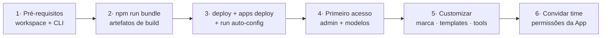

<!-- i18n: source=docs/onboarding-deployment.md source-hash=61fa140d5fe63b4d3fefb365d350bf2b0bf62270 status=current -->
# Onboarding: seu próprio "ChatGPT" no Databricks em ~20 minutos

[English](../onboarding-deployment.md) · **Português (Brasil)** · [Español](../es/onboarding-deployment.md)

> **Aviso.** O AI Prism não é um produto oficial da Databricks e não tem SLA. É
> um acelerador open-source que **você deploya no seu próprio workspace** e
> customiza como quiser. Seus dados permanecem na sua conta Databricks e não são
> usados para treinar modelos de terceiros.

Este guia leva você de "workspace vazio" a "app rodando para o time" com **um
único comando**. Toda a infra (Lakebase, SQL Warehouse, App, dashboards, UDF) é
provisionada por um **Databricks Asset Bundle** — você não cria recursos à mão.

---

## Visão do fluxo

<!-- i18n: code-translated -->


O passo 3 são três comandos (detalhados abaixo): **`bundle deploy`** provisiona a
infra — **Lakebase serverless** (produto *Autoscaling*: 0.5–16 CU, auto-stop em 30
min), **Serverless SQL Warehouse**, a **App** (com Lakebase e Warehouse anexados
como recursos, que injetam `PGHOST`/`SQL_WAREHOUSE_ID` na runtime) e os **dashboards
de custos e de operação**; **`apps deploy`** publica o código; e **`bundle run
ai_prism_auto_config`** cria o role PG do service principal, provisiona a UDF de
Python e o Volume de imagens, e semeia quem deployou como **admin bootstrap**.

---

## 1. Pré-requisitos (5 min)

- Um **workspace Databricks** (AWS, Azure ou GCP) com Unity Catalog habilitado.
- **AI Gateway / Foundation Model APIs** disponíveis na região (endpoints
  `databricks-claude-*`, `databricks-gpt-*`, etc.).
- **Databricks CLI recente (≥ ~1.x; idealmente ≥ 1.8)** autenticada num profile
  para o workspace. CLIs antigas (ex.: 0.29x) falham ao baixar o Terraform interno
  com `openpgp: key expired` no `bundle deploy`. A CLI ≥ 1.8 guarda a credencial no
  keyring do SO (se um token antigo em cache atrapalhar, rode `databricks auth login`
  de novo ou exporte `DATABRICKS_AUTH_STORAGE=plaintext`).
  ```bash
  # Azure: use o host do seu workspace (adb-<id>.<n>.azuredatabricks.net)
  databricks auth login --host https://<seu-workspace> -p <PROFILE>
  ```
- Permissão para criar **Databricks App**, **SQL Warehouse**, **Lakebase** e
  **Jobs** (o bundle cria todos). Para a UDF de Python e o Volume de imagens, você
  precisa poder criar (ou já ter) o catálogo `ai_prism` — se não tiver `CREATE
  CATALOG` no metastore, aponte para um catálogo existente com
  `--var tools_catalog=<cat> --var image_volume_catalog=<cat>`.
- **Node.js 22.18+** e **npm** (`engines` do `package.json`; os testes end-to-end pedem 22.19+), com
  `npm ci --include=dev` feito: o `deploy.sh`/`deploy.ps1` compila os artefatos antes do deploy
  e roda o smoke depois (ver o passo 3).

**Checagem:** `databricks current-user me -p <PROFILE>` retorna seu e-mail.

> **Nota (cloud-agnóstico):** o `databricks.yml` **não** fixa host de workspace —
> o alvo do deploy vem inteiramente do profile do `-p <PROFILE>`. O mesmo bundle
> deploya em AWS, Azure ou GCP sem editar arquivo nenhum. Se a sua CLI ≥ 1.8
> reclamar de credencial em cache de versão antiga, exporte
> `DATABRICKS_AUTH_STORAGE=plaintext` ou rode `databricks auth login` de novo.

---

## 2. Build dos artefatos (2 min)

A App roda os artefatos pré-compilados (`client/dist` + `server-dist/index.cjs`),
não o código-fonte. Os PRs de feature não commitam esses artefatos, então a cópia no
disco pode estar mais velha que o código. O `deploy.sh`/`deploy.ps1` (Opção A abaixo)
roda `npm run bundle` sozinho antes do deploy e para se o build falhar. Pelos comandos
manuais (Opção B), **sempre** reconstrua antes de deployar:

```bash
npm ci --include=dev   # só na 1ª vez (ver nota sobre devDeps abaixo)
npm run bundle         # client/dist + server-dist/index.cjs
```

> **Nota (devDeps):** neste projeto, `npm install <pkg>` avulso pode podar as
> devDependencies necessárias ao build. Use `npm ci --include=dev` /
> `npm install --include=dev`.

---

## 3. Deploy da stack completa (5 min)

### Opção A: um comando (recomendado)

`deploy.sh` (Linux/macOS) e `deploy.ps1` (Windows) fazem tudo abaixo na ordem certa,
recebem o perfil da CLI como argumento (nenhum host é fixado) e são idempotentes:

```bash
./deploy.sh <PROFILE> [CATALOGO]                 # CATALOGO padrão: ai_prism
./deploy.sh --tag cost_center=1234 --tag area=Finanças <PROFILE>
./deploy.sh --lakebase-suspend-minutes 30 --usage-policy-id <id> <PROFILE>
./deploy.sh --skip-build --skip-smoke <PROFILE>   # artefatos do disco, sem smoke
```

```powershell
.\deploy.ps1 <PERFIL> [CATALOGO] -Tag 'cost_center=1234','area=Finanças' -LakebaseSuspendMinutes 30 -UsagePolicyId <id>
.\deploy.ps1 <PERFIL> -SkipBuild -SkipSmoke
```

Opções: `--tag chave=valor` (repetível, até 24; ver [docs/tags.md](../tags.md)),
`--lakebase-suspend-minutes N` (minutos sem uso até o Lakebase dormir, 1 a 10080),
`--usage-policy-id ID` (serverless usage policy que um admin já criou na conta) e
`--classic-cluster-id ID` (workspace sem serverless: id de um cluster clássico Dedicado
/ Single user; o warehouse vira Pro clássico e o auto-config roda nesse cluster),
`--skip-build` (não roda `npm run bundle`: deploya `client/dist` + `server-dist` como
estão no disco, por exemplo de um zip de release ou numa máquina sem Node) e
`--skip-smoke` (não roda o smoke no fim). No PowerShell, `-SkipBuild` e `-SkipSmoke`.
Cada opção tem a variável de ambiente equivalente (`TAGS`, `LAKEBASE_SUSPEND_MINUTES`,
`SERVERLESS_USAGE_POLICY_ID`, `CLASSIC_CLUSTER_ID`, `AI_PRISM_SKIP_BUILD=1`,
`AI_PRISM_SKIP_SMOKE=1`); veja `./deploy.sh --help`. As mensagens dos scripts saem em
inglês.

O script, nesta ordem:

1. confere se o projeto Lakebase `ai-prism` não ficou **soft-deleted** de um
   `bundle destroy` anterior (ver *Resolvendo problemas comuns*) e, se ficou, para antes
   de qualquer mudança, mostrando os comandos de restaurar ou purgar. Nunca purga sozinho;
2. roda `npm run bundle` (`client/dist` + `server-dist`). Se o build falhar, para antes de
   deployar qualquer coisa;
3. grava o catálogo e as tags em `app.yaml` (`AI_PRISM_RESOURCE_TAGS`) e em
   `.databricks/bundle/<alvo>/variable-overrides.json`;
4. roda `bundle deploy` e inicia o app;
5. roda o job de auto-config (role do SP, suas tabelas do app para o role dono no
   Lakebase, UDF, volume, tags e admin bootstrap). Ver [Sobre os roles e grants do Lakebase](#sobre-os-roles-e-grants-do-lakebase);
6. abre o hand-off de dono para o SP do app (`node scripts/migrate.mjs prepare`) e
   publica o código (`apps deploy`);
7. roda `npm run smoke` contra a URL do app, com o seu token OAuth
   (`databricks auth token -p <PROFILE>`; o token vai só para o ambiente do smoke e
   nunca é impresso). O smoke abre a SPA, confere a identidade, faz um turno de chat,
   lê de volta, gera um documento e apaga o chat de teste;
8. como você (o dono do banco), roda `node scripts/migrate.mjs up --role <SP do app>`:
   migrações pendentes e depois os grants de menor privilégio do service principal do
   app, o que também fecha o hand-off de dono. A credencial do banco é gerada pela CLI
   e nunca é impressa. Com o hand-off aberto, este passo roda em qualquer saída
   (inclusive se a publicação ou o smoke falharem), e o script só termina com sucesso
   com o hand-off fechado. Sem `node` no PATH o hand-off nunca é aberto: o app continua
   no `public` e o script falha no fim.

O script sai com código diferente de zero se qualquer passo falhar, inclusive o smoke.
Um smoke que falha **não desfaz** o deploy: a versão nova já está no ar, então leia a
tabela do smoke antes de liberar o acesso aos usuários. Sem `npm` no PATH, o script para
logo no início e indica `--skip-build --skip-smoke`.

O notebook **`Instalar AI Prism.py`** (na raiz do projeto, gerado por
`scripts/build-installer-notebook.py`) faz o mesmo de dentro do workspace, sem terminal.
Os campos dele espelham as opções acima (catálogo, serverless, minutos do Lakebase,
usage policy e tags). Comece com `acao = verificar`, que não cria nada. Ele roda o
mesmo `deploy.sh` num cluster, onde em geral não há Node: lá o deploy usa os artefatos
já compilados do zip de release e precisa de `AI_PRISM_SKIP_BUILD=1` e
`AI_PRISM_SKIP_SMOKE=1` (rode o smoke depois, de uma máquina com Node, como na Opção B).

### Opção B: comandos manuais

Três comandos provisionam a infra, publicam o código da App e a configuram:

```bash
# valida a configuração do bundle (não cria nada)
databricks bundle validate -p <PROFILE> -t dev

# 0) compila os artefatos que a App roda (client/dist + server-dist)
npm run bundle

# 1) provisiona Lakebase + Warehouse + App + dashboards + job
databricks bundle deploy -p <PROFILE> -t dev

# 2) roda o job de auto-config: cria o role PG do service principal e o hand-off
#    de dono, provisiona a UDF Python + Volume de imagens (catálogo ai_prism) e
#    semeia o admin bootstrap. Rode ANTES de publicar o código.
databricks bundle run ai_prism_auto_config -p <PROFILE> -t dev

# 2b) como dono do banco: abre o hand-off de dono para o SP do app (o passo 5 fecha;
#     PGHOST/PGUSER/PGPASSWORD: ver "Sobre os roles e grants do Lakebase")
node scripts/migrate.mjs prepare --role <app SP client id>

# 3) publica o CÓDIGO da App (o bundle deploy sozinho NÃO republica o processo
#    em execução). O <SRC> é o caminho impresso pelo deploy / bundle summary,
#    tipicamente /Workspace/Users/<você>/.bundle/ai-prism/dev/files
databricks apps deploy ai-prism --source-code-path <SRC> -p <PROFILE>

# 4) smoke pós-deploy contra a URL do app (sai != 0 se algo quebrar)
APP_URL=<URL-do-app> DATABRICKS_TOKEN=<token-oauth> npm run smoke

# 5) como dono do banco: migrações pendentes + grants de menor privilégio do SP
#    (PGHOST/PGUSER/PGPASSWORD: ver "Sobre os roles e grants do Lakebase")
node scripts/migrate.mjs up --role <app SP client id>
```

O que o bundle (`databricks.yml`) gerencia:

| Recurso | Configuração |
|---|---|
| **Lakebase** (`postgres_projects` + `postgres_endpoints`) | serverless, autoscaling **0.5–16 CU**, **auto-stop 30 min** |
| **SQL Warehouse** (`sql_warehouses`) | Serverless, 2X-Small, Photon, auto-stop 10 min |
| **App** (`apps`) | Lakebase e SQL Warehouse anexados como **recursos da App** (a runtime injeta `PGHOST`/`SQL_WAREHOUSE_ID`); env estático no `app.yaml` |
| **Dashboards** (`dashboards`) | dois Lakeview sobre system tables: custos de IA por usuário (publicado pelo job de auto-config) e operação (chamadas, usuários, tokens, latência; fica como rascunho até alguém publicar). Ver [`dashboards/README.md`](dashboards/README.md) |
| **Job de auto-config** (`jobs`) | cria o **role Postgres do SP** do app no Lakebase (`databricks_create_role`) e o **hand-off de dono** (`ai_prism_owner`), a UDF `ai_prism_python_exec` e o Volume de imagens (tudo no catálogo `ai_prism`), e **semeia o admin bootstrap** (quem deployou) na tabela `app_admins` |

> **Tags de recurso e opções avançadas** (`--tag`, usage policy, minutos do Lakebase)
> só existem pelo `deploy.sh`/`deploy.ps1`/notebook. Pelos comandos manuais, as tags
> valem para os recursos do bundle, mas o app só as usa no AI Gateway e no SQL depois de
> `AI_PRISM_RESOURCE_TAGS` no `app.yaml` ser atualizado (ver [docs/tags.md](../tags.md),
> "Caminho nativo do bundle").
>
> **Alvos:** `dev` (padrão, prefixa recursos com seu usuário — bom para testar) e
> `prod` (nomes limpos, para o deploy oficial). Troque `-t dev` por `-t prod`
> quando for para valer. Nenhum dos alvos fixa host — o workspace vem do
> `-p <PROFILE>`, então não é preciso editar o `databricks.yml`.

> **Sobre a conexão com o Lakebase:** o `PGHOST` é injetado automaticamente pela
> runtime da App a partir do recurso `lakebase` (não é hardcoded em lugar nenhum —
> por isso o mesmo bundle funciona em qualquer cloud). O app conecta como o **service
> principal dele** (o job cria o role Postgres do SP); o isolamento por usuário é
> app-level (`WHERE user_email`). Os privilégios do SP no banco estão em
> [Sobre os roles e grants do Lakebase](#sobre-os-roles-e-grants-do-lakebase).

Ao final, `databricks bundle summary -p <PROFILE> -t dev` mostra a URL pública da
App (atrás do OAuth do workspace).

### Sobre a UDF de Python (`execute_python`)

O AI Prism embarca a própria UDF (`ai_prism_python_exec`) em vez de usar
`system.ai.python_exec`: a nossa respeita uma variável `result`, captura `stdout`
**e** trata exceções retornando `"ERROR: ..."` sem derrubar a query — a função de
plataforma falha a statement inteira em qualquer erro. A definição vive em
`shared/pythonUdf.js` (fonte única); o job de deploy usa a versão gerada em
`bundle/python_udf_ddl.py` (via `node scripts/gen-python-udf-ddl.mjs`), e o app a
provisiona também em runtime — as duas são idênticas byte a byte.

`TOOLS_CATALOG` / `TOOLS_SCHEMA` definem **apenas onde essa UDF é criada** — não
limitam quais UC Functions o usuário pode anexar como tool. A descoberta de UC
Functions varre todos os catálogos/schemas que o usuário enxerga (via
`system.information_schema.routines`, exceto `system`), sempre escopada pelas
permissões reais dele no Unity Catalog.

### Sobre o Volume de imagens geradas

As imagens geradas/editadas no chat têm bytes reais, então vão para um **UC Volume
dedicado** — mantido separado do catálogo de tools para não misturar com outros
assets. O caminho é configurável por `IMAGE_VOLUME_CATALOG` / `IMAGE_VOLUME_SCHEMA`
/ `IMAGE_VOLUME_NAME` (default `ai_prism.default.ai_prism_images`). O job de
auto-config cria o catálogo/schema/volume e concede `READ/WRITE VOLUME` ao
**service principal do app** — o app escreve/lê as imagens como o SP (não pelo
token OAuth do usuário), evitando depender do escopo `files` reconsentido no
browser. O isolamento por usuário continua **app-level** (`WHERE user_email` em
`chat_images`), como todo artefato. O **modelo de imagem padrão é o Nano Banana 2**.

### Sobre os roles e grants do Lakebase

As tabelas do app ficam num schema Postgres dedicado, **`ai_prism`** (migração
0002), e não no `public`. A extensão `vector` continua no `public`. O app conecta
com `search_path = ai_prism, public`, definido uma vez por conexão. Há três roles:

| Role | Quem | O que pode fazer |
|---|---|---|
| **Dono do banco** | a identidade que faz o deploy (ela cria o projeto Lakebase) | roda `prepare`, `up` e `grants` pelo deploy; é membro do role dono |
| **`ai_prism_owner`** | um role `NOLOGIN` que o job de auto-config cria | é dono de todas as tabelas do app e do schema `ai_prism` |
| **Service principal do app** | o role que `databricks_create_role('<client id>', 'SERVICE_PRINCIPAL')` cria para o SP do app | `USAGE` em `ai_prism`; `SELECT/INSERT/UPDATE/DELETE` nas tabelas do app, **filtrados por row-level security**; `USAGE/SELECT` nas sequências; `SELECT` em `schema_migrations`. Não é dono de nenhuma tabela, não tem `BYPASSRLS` nem grant explícito no `public` |

**Row-level security** (migração 0003). Toda tabela do app tem `FORCE ROW LEVEL
SECURITY`, que vale também para o dono: o SP do app só vê e grava as linhas do usuário
logado em nome de quem age (ver o FAQ de segurança, pergunta 2). Uma correção de dados
que precisa ler as linhas de todos os usuários roda como o dono do banco e desliga e
religa o `FORCE` dentro da própria transação. A que vem com o app é
`node scripts/migrate.mjs backfill-usage`: cópia única do histórico de custos gravado
antes do ledger existir. Rode uma vez depois de atualizar uma instalação anterior à 1.4
(é idempotente e mostra quantas linhas copiou).

Um deploy passa por três etapas. O `deploy.sh` e o `deploy.ps1` rodam as três:

1. **Hand-off** (antes de publicar o código). O job de auto-config passa ao
   `ai_prism_owner` as tabelas do app que são suas. Depois o script de deploy
   (`migrate.mjs prepare`) deixa o SP agir como esse role até a etapa 3. Deploys antigos têm donos misturados (o SP criou a
   maioria das tabelas, o deploy criou `app_admins`), e nenhuma das duas identidades
   consegue passar as suas tabelas para a outra. O role neutro é o que permite a mudança.
2. **Migração** (primeira requisição do app, como o SP). A migração 0002 passa as
   tabelas do SP ao `ai_prism_owner` e move todas para o `ai_prism`. Sem o hand-off,
   a 0002 é **adiada**: o app continua funcionando no `public`, registra
   `migrations: 0002 schema_ai_prism deferred` e tenta de novo um minuto depois.
3. **Grants** (depois do smoke, como você): `node scripts/migrate.mjs up --role <SP>`
   aplica os grants de menor privilégio do SP e remove a participação dele no
   `ai_prism_owner`. É idempotente: rodar duas vezes deixa o mesmo estado. Se a 0002
   ainda estiver adiada, ele só remove a participação (saída 3) e o deploy falha.

Para rodar as etapas 1 e 3 à mão, conecte como dono do banco com uma credencial de
banco:

```bash
EP=projects/ai-prism/branches/production/endpoints/primary
export PGHOST=$(databricks postgres get-endpoint $EP -p <PROFILE> -o json | python3 -c "import sys,json; print(json.load(sys.stdin)['status']['hosts']['host'])")
export PGPASSWORD=$(databricks postgres generate-database-credential $EP -p <PROFILE> -o json | python3 -c "import sys,json; print(json.load(sys.stdin)['token'])")
export PGUSER=<your e-mail> PGDATABASE=databricks_postgres PGSSLMODE=require
node scripts/migrate.mjs prepare --role <app SP client id>   # etapa 1
node scripts/migrate.mjs up --role <app SP client id>        # etapa 3 (e migrações pendentes)
node scripts/migrate.mjs backfill-usage                       # uma vez, instalações anteriores à 1.4
```

O client id do SP é o `service_principal_client_id` de
`databricks apps get ai-prism -p <PROFILE> -o json`. Nunca cole a credencial num
arquivo ou num chat; ela expira em até uma hora.

**TLS.** A conexão é sempre criptografada. A cadeia do servidor só é verificada com
`PG_SSL_VERIFY=1` (trust store do Node) ou `PG_SSL_CA` (uma CA fixada, que liga a
verificação). `PG_SSL_VERIFY=0` desliga a verificação para diagnóstico.
`PG_SSL_REJECT_UNAUTHORIZED` continua aceito como nome antigo de `PG_SSL_VERIFY`.

---

## 4. Primeiro acesso e configuração de modelos (5 min)

1. Abra a URL da App e autentique com sua conta do workspace.
2. Como o deployer, o job de auto-config já te semeou como **admin** (tabela
   `app_admins`), então você verá as abas de **admin** em *Configurações*.
3. **Modelos (LLM)**: habilite os endpoints de serving que o time deve usar e
   defina rótulos/ordem. Só os habilitados aparecem para usuários comuns.
4. **Custos e operação**: a auditoria vive em dois **dashboards AI/BI** provisionados
   pelo bundle (não em uma aba do app). O de custos já sai publicado pelo job de
   auto-config; o de operação ("AI Prism — Operations") fica como rascunho: abra-o no
   workspace e **publique** para os demais admins. Detalhes em
   [`dashboards/README.md`](dashboards/README.md).
5. **Limites de gasto (opcional)**: configure budgets e alertas nativos do Databricks
   para o workspace (veja [costs-and-positioning.md](costs-and-positioning.md)).
   Cada usuário acompanha o próprio consumo no taxímetro do header; para a virada
   do mês no fuso local, defina `USAGE_TIMEZONE` (ex.: `America/Sao_Paulo`; padrão UTC).

---

## 5. Customização (opcional, quando quiser)

- **Marca / design system**: em *Configurações → Design system*,
  importe o design system da empresa (cores, fontes, logo, ícones — de um `.pptx`
  de marca ou de um bundle). Decks e planilhas passam a sair no seu visual.
- **Ferramentas**: conecte **Genie Agents**, **UC Functions** e **Vector Search**
  como tools do chat; adicione **conexões MCP externas** se necessário.
- **UI/features**: o código é seu — ajuste textos, tema e comportamento e redeploye com
  `./deploy.sh <PROFILE>` (compila, deploya e roda o smoke; veja a seção 3).

---

## 6. Convidar o time (2 min)

- Dê à App a permissão **CAN_USE** para os usuários/grupos que devem acessá-la
  (UI de permissões da App, ou API).
- Para adicionar outros **administradores**, use *Configurações → Administradores*
  dentro do app (o autocomplete sugere quem já tem acesso).
- Cada usuário passa a operar com a **própria identidade**: conversas, permissões
  de dados e custo são atribuídos a ele.

---

## Resolvendo problemas comuns

| Sintoma | Causa provável | Ação |
|---|---|---|
| `bundle deploy` falha em Lakebase/endpoint | recurso serverless Postgres indisponível na região/conta | confirme disponibilidade do Lakebase serverless; ajuste `databricks.yml` |
| Deploy para com "The Lakebase project ... is soft-deleted" (ou o erro da API cita `delete ... purge`) | um `databricks bundle destroy` anterior apagou o projeto `ai-prism` de forma **reversível**, e ele ainda reserva o nome | o `deploy.sh`/`deploy.ps1`/o notebook mostram os dois comandos. Para **recuperar os dados**: `databricks postgres undelete-project projects/ai-prism -p <PROFILE>`. Para **apagar de vez** (destrutivo, dados perdidos): `databricks postgres delete-project projects/ai-prism -p <PROFILE> --purge`. Nenhum script purga sozinho |
| Deploy para em "npm run bundle failed" (ou "npm not found") | build quebrado, `npm ci` não feito, ou máquina sem Node | rode `npm ci --include=dev` e `npm run bundle` para ver o erro; para deployar os artefatos que já estão no disco, use `--skip-build` (`-SkipBuild`) |
| Deploy termina com "smoke FAILED" | a versão nova subiu, mas um caminho de usuário quebrou (identidade, modelos, chat, Lakebase ou artefato) | leia a tabela do smoke (a linha **FAIL** diz o passo e o erro) e veja os logs do app; "could not get an OAuth token" pede `databricks auth login -p <PROFILE>`. `--skip-smoke` deploya sem essa checagem |
| Custo sem a tag que você passou | a tag não chegou ao runtime do app, ou ela foi recusada | veja o log do auto-config (`AVISO`) e [docs/tags.md](../tags.md); confira `AI_PRISM_RESOURCE_TAGS` no `app.yaml` e rode `apps deploy` de novo |
| `migrations: 0002 schema_ai_prism deferred … ownership not normalized` no log do app | o hand-off de dono não rodou antes de publicar o código novo (deploy manual, ou um `deploy.sh` antigo) | rode o job de auto-config (ou `node scripts/migrate.mjs prepare --role <SP>` como dono do banco); o app tenta de novo em até um minuto; depois `node scripts/migrate.mjs grants --role <SP>`. Ver [Sobre os roles e grants do Lakebase](#sobre-os-roles-e-grants-do-lakebase) |
| Chat falha com **"External authorization failed"** / 0 tabelas no Lakebase | login do SP no Lakebase rejeitado (SQLSTATE 28000): role do SP não criado, ou `PGHOST` apontando pro Lakebase errado (nunca hardcode host no `app.yaml`!) | rode `databricks bundle run ai_prism_auto_config` (cria o role do SP); confirme que o recurso `lakebase` está anexado à App |
| Tool `execute_python` some | UDF não provisionada | rode `databricks bundle run ai_prism_auto_config` (ou o app a cria no 1º uso) |
| Modelos não aparecem | Nenhum endpoint habilitado no catálogo | Admin → *Modelos (LLM)* → habilite |
| Não vejo as abas de admin | admin bootstrap não semeado | rode `databricks bundle run ai_prism_auto_config` (semeia o deployer em `app_admins`) |
| Mudança no código sem efeito | `bundle deploy` não republica o código da App, ou os artefatos no disco estão velhos | rode `./deploy.sh <PROFILE>` (compila e publica); pelos comandos manuais, `npm run bundle` e depois `databricks apps deploy ai-prism --source-code-path <SRC>` |

---

*Fluxo desenhado para a empresa que deploya e opera o AI Prism no próprio
workspace. O host **nunca** é editado no `databricks.yml` — ele vem do
`-p <PROFILE>`, então o mesmo bundle roda em AWS/Azure/GCP. Ajuste apenas
targets/nomes de recurso se quiser.*
