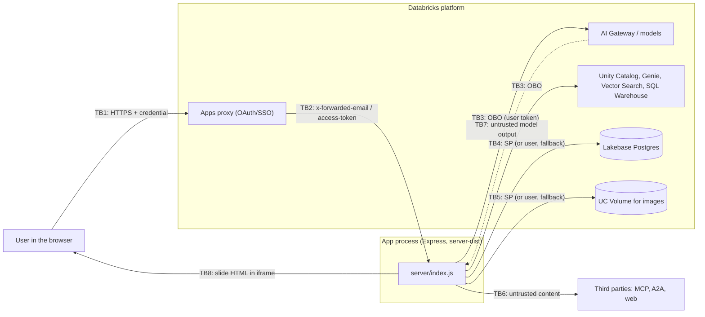

<!-- i18n: source=docs/security-threat-model.md source-hash=4864da877e179968bde84995ab25ff3e7110337c status=current -->
# Modelo de ameaças do AI Prism

[English](../security-threat-model.md) · **Português (Brasil)** · [Español](../es/security-threat-model.md)

Este documento descreve o que o AI Prism protege, quem interage com ele, onde ficam
as fronteiras de confiança e quais ameaças têm controle hoje, com as lacunas
declaradas. Ele é uma **avaliação de engenharia do código deste repositório**, não
um parecer jurídico nem uma auditoria externa. Cada controle citado aponta para o código
que o implementa; quando algo não foi verificado, está dito.

Para as perguntas típicas de revisão de segurança, veja o
[FAQ de segurança](security-faq.md). Para reportar uma vulnerabilidade, veja o
[SECURITY.md](SECURITY.md).

- **Escopo:** o app (servidor Express em `server/`, cliente React em `client/src/`)
  e os recursos que o `databricks.yml` provisiona.
- **Fora do escopo:** a plataforma Databricks (Apps proxy, Lakebase, Unity Catalog,
  AI Gateway, SQL Warehouses serverless) e a configuração de ACLs do workspace feita
  por quem faz o deploy. Essas camadas têm controles próprios; o que o app assume delas
  está listado em [Premissas](#8-premissas-sobre-a-plataforma).

---

## 1. Ativos

| Ativo | Onde fica | Sensibilidade | Observação |
|---|---|---|---|
| Conversas e mensagens (texto, anexos, blocos, trace de tools) | Lakebase: `chat_sessions`, `chat_messages`, `chat_tool_calls` | Alta: podem conter dados da empresa e dados pessoais | Escopadas por `user_email` (ou JOIN com o dono da sessão) em todas as leituras do código atual. |
| Artefatos (decks HTML, planilhas, documentos) | Lakebase: `chat_decks`, `chat_spreadsheets`, `chat_documents` | Alta | Mesmo escopo das conversas. |
| Imagens geradas | UC Volume `ai_prism_images` (catálogo `ai_prism`) + índice `chat_images` | Média/alta | Leitura: checagem de dono no banco, depois o bytes são lidos com o token do SP (`server/imageStore.ts`). |
| Embeddings de mensagens (RAG por histórico) | Lakebase: `chat_message_embeddings` (pgvector) | Alta | Derivados do conteúdo; mesma classe de dado da mensagem. |
| Ledger de custos por chamada | Lakebase: `usage_ledger` | Média | Contém e-mail, sessão, modelo e tokens. |
| Configuração administrativa | Lakebase: `app_admins`, `model_catalog_overrides`, `app_mcp_catalog`, `app_tool_policy`, `deck_templates` | Alta (define quem é admin e quais ferramentas existem) | Escrita só por rotas com `requireAdmin`. |
| Conexões MCP do usuário | Lakebase: `user_mcp_connections` (nome, comentário, status — **sem credenciais**); a conexão em si é uma conexão do Unity Catalog, referenciada por nome | Média/alta | As credenciais ficam na conexão do UC, sob o escopo `catalog.connections`, não no Lakebase. |
| Dados do workspace lidos em nome do usuário | Unity Catalog, Genie spaces, Vector Search indexes, SQL Warehouse | Depende da fonte | Acessados via OBO: o que o usuário não pode ler, o app também não lê. |
| Credenciais de deploy e runtime | Segredos do runtime do Apps (`DATABRICKS_CLIENT_ID`/`SECRET` do SP), variáveis do operador | Crítica | Nenhum segredo no repositório (`.gitignore` ignora `.env`). `PGPASSWORD` é só para dev local. |

---

## 2. Atores

| Ator | Confiança | O que pode fazer |
|---|---|---|
| **Usuário final** (autenticado no workspace) | Autenticado pela plataforma; não confiável quanto ao conteúdo que envia | Criar conversas, usar os modelos e as ferramentas que a própria identidade alcança, editar artefatos próprios. |
| **Admin do app** (`app_admins`, por e-mail ou grupo do workspace) | Confiável para configuração | Gerenciar modelos, políticas de ferramenta, catálogo MCP e templates de deck. |
| **Owner** (`APP_OWNER_EMAIL`, quando definido) | Confiável | Mesmo que admin, mais o que `isOwner` libera (`server/authz.ts`). O bundle **não** define `APP_OWNER_EMAIL`; o admin de bootstrap é o deployer, semeado pelo job de auto-config (`bundle/auto_config.py`). |
| **Operador/deployer** | Confiável para deploy | Roda `bundle deploy`, o job de auto-config e o `apps deploy`. Vira admin de bootstrap. |
| **Administrador do workspace** | Fora do modelo do app | Controla ACLs, grupos, orçamentos e a plataforma. |
| **Atacante externo** | Sem credencial | Tenta chegar ao app sem passar pelo proxy. |
| **Usuário malicioso com conta no workspace** | Autenticado, hostil | Tenta ler dados de outro usuário (IDOR), estourar custo ou injetar instruções. |
| **Conteúdo de terceiros** | Não confiável | Descrições e respostas de servidores MCP e A2A, páginas da web (`web_search`), arquivos anexados, HTML gerado pelo modelo. |
| **Modelo de linguagem** (via AI Gateway) | Não confiável quanto à saída | Saídas podem conter instruções injetadas, HTML, SQL ou pedidos de ferramenta. |

---

## 3. Fronteiras de confiança



| Fronteira | Quem cruza | Garantia que o app depende | Onde a verificação acontece |
|---|---|---|---|
| **TB1** Usuário → Apps proxy | Navegador/cliente | Autenticação OAuth/SSO do workspace | Plataforma |
| **TB2** Proxy → processo do app | Cabeçalhos `x-forwarded-email` e `x-forwarded-access-token` | O proxy sobrescreve esses cabeçalhos a partir da sessão autenticada | Plataforma; o app exige os dois e **confere o vínculo** e-mail ↔ token no workspace (`server/identityBinding.ts`, SCIM `/Me`, cache de 5 min por hash do token). Sem resposta do workspace, aceita e registra aviso |
| **TB3** App → APIs do workspace | Token OBO do usuário | As permissões do próprio usuário (UC, Genie, endpoints) | Plataforma, com os escopos declarados em `databricks.yml` (`user_api_scopes`) |
| **TB4** App → Lakebase | Service principal do app por padrão (um papel Postgres para todos os usuários; não é dono das tabelas, sem `BYPASSRLS`). Como fallback, o próprio papel Postgres do chamador com o token OBO (`createWithClient`, `server/db/pool.js`; veja a §4 e a G15) | No caminho do SP do app: **RLS com `FORCE`** nas tabelas do app (migração 0003), exceto `schema_migrations` (sem RLS, `server/db/rls.js`) e `project_members` (`ENABLE` sem `FORCE`, migração 0005); a identidade do usuário vai por transação (`withTx`: `app.user_email`, `app.user_groups`, `app.is_admin`) | Banco (G2 fechada; o fallback é a G15, mitigada) |
| **TB5** App → Volume | SP do app (`all-apis`), ou o token do usuário quando o token do SP não está disponível (exige o escopo `files`) | O Volume não tem ACL por usuário: uma imagem só é alcançada pela sua linha em `chat_images`, que a RLS limita ao dono (TB4) | App + banco |
| **TB6** App → terceiros | Respostas de MCP/A2A/web; consultas de busca enviadas ao provedor (via Unity Gateway com o token do usuário, ou API com chave) | Nenhuma: conteúdo é tratado como dado, não como instrução | Parcial (G7 mitigada; G12 mitigada para `web_search`; G14) |
| **TB7** Modelo → app | Texto, HTML e pedidos de ferramenta | Renderização segura no cliente; ferramentas rodam com o OBO do usuário | Parcial |
| **TB8** App → iframe do slide | HTML/CSS gerado pelo modelo | Sandbox do iframe; `<script>` removido do HTML persistido | `client/src/components/deck/HtmlSlideFrame.jsx`, `server/blocks.ts` (`sanitizeHtmlDeck`) |
| **TB9** Usuário → outro usuário (compartilhamento, W2-3) | Membros de um projeto: conversas, mensagens, instruções e arquivos do projeto | Só membros atuais (pessoa ou grupo SCIM confirmado) leem e postam; papel owner > manage > view; admin do app **sem** acesso implícito; quem sai perde tudo, inclusive as conversas que criou | Banco: a partir da migração 0008, a participação é `ai_prism.aip_my_project_ids()` (avaliada uma vez por statement; ADR 0016) e `ai_prism.aip_project_rank` dá o nível do papel; antes da 0008, `aip_project_rank` decide as duas coisas; políticas `aipj_*` (migração 0005, incluindo uma política **restritiva** em `chat_sessions`); app: `server/access.ts`, `server/db/projects.js`, `sessionAccessSql` (`server/ownerScopedWrites.ts`) |

**TB9 em detalhe.** Até a W2-3 todo dado tinha um dono e nenhuma linha era lida
por outra pessoa. Projetos abrem a primeira fronteira entre usuários:

- *Quem é membro* é decidido no banco, a partir de
  `app.user_email` e de `app.user_groups` (JSON com os grupos SCIM do chamador, que
  `withTx` define a cada transação). Identidade vazia nunca casa, com ou sem grupos;
  `app.is_admin` não é lido por nenhuma política de projeto. A função de decisão depende do nível da migração: a partir da migração 0008, a participação é `aip_my_project_ids()`, avaliada uma vez por statement (ADR 0016), e `aip_project_rank(projeto)` só dá o nível do papel (owner, manage, view); antes da 0008, `aip_project_rank(projeto)` decide as duas coisas, uma vez por sessão de projeto.
- *Grupos falham fechado*: `server/access.ts` consulta SCIM `/Me` com o token do
  usuário (timeout de 3 s, cache de 5 min; falha em cache por 30 s). Só um HTTP 200
  completo conta: 206 (Partial Content), outro 2xx, lista paginada (`totalResults`
  maior que a lista, `itemsPerPage` menor, `startIndex` > 1), entrada malformada,
  erro HTTP, de rede, timeout ou corpo inesperado = nenhum grupo, e um grupo nunca concede o que
  não pôde ser provado. Só os grupos que `/Me` devolve contam (sem expansão de
  grupos aninhados). Usuário e grupo são `kind`s diferentes: um grupo com o nome
  do e-mail de alguém não dá acesso a essa pessoa.
- *Conversa de projeto*: a política restritiva `aipj_project_gate` faz `AND` com a
  de dono da 0003, então nem o criador lê uma conversa de projeto depois de sair. As
  tabelas filhas (mensagens, ferramentas, compactações, Genie, embeddings) checam a
  sessão por subconsulta em `chat_sessions`, que passa pelo mesmo filtro. Membros
  postam (inclusive viewers); a linha de custo e os artefatos de quem postou ficam
  no nome de quem postou. A partir da migração 0012, as apresentações, planilhas,
  documentos e imagens de uma conversa de projeto também são *legíveis* pelos
  membros atuais (`aipj_member_read`, só `FOR SELECT`, participação como conjunto
  conforme a ADR 0016); só quem os criou os escreve, e o app responde 403
  `artifact_read_only` ao salvar ou editar com IA de outro membro (os getters
  devolvem `read_only`). Quem sai do projeto, ou um admin do app que não é membro,
  não lê nenhum deles (404), o criador inclusive: os getters do app exigem participação atual para artefatos de um chat de projeto (a política `aip_owner` da 0003 ainda deixa o banco devolver ao criador a própria linha, então essa regra vive no app, `artifactReadSql` em `server/db.js`). As imagens de um chat de projeto saem com `private, no-cache` e ETag (o servidor decide a cada exibição, 304 se não mudou), então o navegador não guarda cópia depois que o acesso é revogado. Excluir um projeto apaga do volume os arquivos de
  imagem dos chats dele depois do commit (best-effort, 4 por vez; as falhas são
  contadas em um único aviso). Um gatilho impede trocar `user_email` de uma sessão e só
  deixa tirar uma conversa do projeto com manage+ (e só o criador, porque a linha
  precisa continuar visível para quem escreve).
- *Reescrever a história de uma conversa de projeto* (editar um prompt, regenerar
  uma resposta, trocar a variante ativa, responder às perguntas de uma mensagem,
  compactar) exige manage ou owner: view lê e posta turnos novos (`/api/chat`,
  `/continue`), mas não muda o que outro membro escreveu. A regra é por papel e não por
  autoria (o autor de cada mensagem, `chat_messages.sent_by`, é carimbado por um trigger do banco a partir da
  identidade da transação, então o cliente não consegue defini-lo, mas ele serve para exibição, não para acesso); a rota responde 403
  (`historyRewriteAccess`, `server/db/projects.js`) e o SQL da escrita repete a regra
  (`historyWriteSql`, `server/ownerScopedWrites.ts`). Conversas pessoais: só o dono.
- *Sem exceção para a identidade de manutenção* (AC-P1): a varredura de retenção
  (0007: e-mail vazio + a flag da varredura) não lê nem apaga nada de uma conversa de
  projeto, porque a política restritiva não tem cláusula para ela. Conversas de
  projeto ficam fora da retenção por idade (saem com o projeto, `ON DELETE CASCADE`);
  uma retenção própria de projeto é acompanhamento.
- *Por que `project_members` não tem `FORCE`*: uma política em `project_members`
  que lê `project_members` (para mostrar o elenco aos membros) entraria em recursão.
  A função de pertinência é `SECURITY DEFINER`, com `search_path` fixo, do dono da
  tabela (`ai_prism_owner`), que lê a tabela sem políticas; o papel do app continua
  preso a elas. Durante a janela de hand-off do deploy (o SP é membro temporário do
  dono, `server/db/grants.js`) o SP também passaria por cima nessa tabela, como já
  pode fazer `ALTER TABLE` em qualquer uma: a janela fecha no `migrate.mjs grants`.
- *Contexto do projeto no turno* (N1a, ADR 0013): as instruções e os arquivos do projeto da conversa
  são lidos no turno como quem chama (`server/projectContext.ts` via `withTx`, então as políticas acima
  valem): um membro, direto ou por grupo, os recebe; quem não é membro e o admin do app não recebem nada, e
  uma consulta de grupos que falha não concede nada. O texto dos arquivos é emoldurado como dado
  (`<project_file>`) e não consegue fechar a moldura; as instruções vêm só de membros manage+. A leitura tem
  limite de tempo (1,5 s) e o texto dos arquivos é limitado por `PROJECT_CONTEXT_FILES_MAX_TOKENS`.
- *Arquivos de projeto* guardam só o texto extraído (sem bytes, sem caminho de
  armazenamento): o nome é reduzido ao último segmento, sem `/`, `\` ou controle.
- Provas: `server/isolation.projects.test.js` (SQL cru como o papel do app, sem
  código do app) e a matriz de permissões em `tests/routes/projects.test.mjs`.

---

## 4. Identidade e autorização por recurso

O app não tem login próprio. Cada requisição chega com a identidade do proxy e o
token OAuth do usuário. A tabela mostra qual identidade é usada em cada recurso
(verificado no código):

| Recurso | Identidade usada | Código | Efeito de segurança |
|---|---|---|---|
| Model Serving / AI Gateway (chat, embeddings, transcrição) | **OBO** (`serving.serving-endpoints`) | `server/llm.ts`, `server/serving.ts` | O gateway atribui o custo e aplica permissões do usuário. |
| Genie (espaços e Genie One MCP) | **OBO** (`dashboards.genie`, `genie`) | `server/genie.ts` | O usuário só consulta espaços que pode acessar. |
| SQL Warehouse (UC Functions, Python UDF, DDL do Volume) | **OBO** (`sql`) — `execStatement(userToken, …)` | `server/warehouse.ts`, `server/tools.ts` | Execução limitada ao que o usuário pode executar. |
| Vector Search | **OBO** | `server/vectorSearch.ts` | Idem. |
| MCP externo do usuário (conexões próprias) | **Token do usuário** por conexão | `server/externalMcp.ts`, `server/mcpClient.ts` | Cada conexão só é usada pelo usuário que a criou. |
| Catálogo de MCP (sugestões do workspace) | **SP** (`all-apis`), só para listar | `listMcpServicesViaSp` em `server/externalMcp.ts` | Só sugestões; a validação continua OBO. |
| Lakebase (chats, artefatos, ledger, admins) | **SP** por padrão; **papel do próprio chamador** como fallback (sem credenciais do SP, o caminho por usuário é usado diretamente, sem nova tentativa, até a configuração mudar; só quando um SP configurado não consegue fazer login nem alcançar o banco ele é rebaixado, com nova tentativa após 5 minutos) | `server/db/pool.js` (`createWithClient`, `userPath`, `withTx`, `getSpPool`) | O SP tem DML nas tabelas do schema `ai_prism` (`migrate.mjs grants`), **filtrado por RLS com `FORCE`** (0003, 0005): as linhas da própria transação, mais os chats de projeto dos projetos de que ela é membro; as tabelas de admin são lidas por todos e escritas só com `app.is_admin = 'on'`; `admin_audit` só é lida com a flag; `usage_ledger` também pode ser lido por inteiro por uma transação com a flag de admin que traga uma identidade (`aipa_admin_read`, migração 0010, ADR 0015, só SELECT); a participação em projetos é `aip_my_project_ids()` a partir da migração 0008 (ADR 0016). Um papel de fallback superusuário ou com `BYPASSRLS` é recusado com 503 antes de qualquer consulta (G15). Ver G2. |
| Volume de imagens | **SP** quando disponível, senão o token do usuário | `server/imageStore.ts` (`storageToken`) | Leitura só após consulta de dono no banco. |
| Grupos de admin (SCIM `Me`) | **Token do usuário** | `server/authz.ts` (`userGroups`) | Falha de SCIM degrada para "sem grupos", sem liberar acesso. |
| Grupos de membros de projeto (SCIM `Me`) | **Token do usuário** | `server/access.ts` (`createGroupResolver`), por transação via `withTx` | Falha fechada: erro, timeout ou corpo inesperado = nenhum grupo (TB9). |

**Autorização no app.** Três níveis: `requireAdmin` nas rotas `/api/admin/*` e nas
de templates globais (`server/index.js`); `isOwner` por `APP_OWNER_EMAIL`; `isAdmin`
por `app_admins` (e-mail ou grupo). Dono de sessão, mensagem, artefato e imagem é
verificado no banco com `user_email` (ex.: `fetchActiveMessages` faz JOIN com
`chat_sessions` pelo dono; `POST /api/chat` responde 403 para uma sessão a que o chamador não tem acesso: nem dono nem membro do seu projeto; `sessionAccessSql`, `server/ownerScopedWrites.ts`).

---

## 5. Controles presentes

| ID | Controle | Implementação |
|---|---|---|
| C1 | Rejeição sem credencial de usuário | `auth()` responde 401 quando não há token (`server/index.js`). |
| C2 | Escopo de dados por dono | `WHERE user_email` e JOIN com `chat_sessions` em listas, leituras, buscas (`listSessions`, `fetchActiveMessages`, `retrieveRelevantMessages`, `searchSessionsByVector`). |
| C3 | Ownership verificado antes do stream | `POST /api/chat` checa `getSession` antes de abrir SSE (403 limpo). |
| C4 | Gate de admin | `requireAdmin` (`server/index.js`) para rotas de administração. |
| C5 | Anti-SSRF no fetch da web | `server/web.ts`: bloqueia `localhost`, IPs privados (IPv4 e IPv6, inclusive mapeados), resolve o DNS antes de conectar e limita redirects. Coberto por teste em `server/web.test.ts`. Endurecimento (`server/webHardening.test.js`): a lista de endereços (`blockedAddressReason`, `server/a2aGuard.ts`) também decodifica o IPv4 embutido em 6to4 `2002::/16` e SIIT `::ffff:0:0/96` e recusa Teredo `2001::/32` e NAT64 de uso local `64:ff9b:1::/48`; o lookup fixado responde no tick seguinte, então uma falha síncrona de `connect()` (EHOSTUNREACH) rejeita o fetch em vez de derrubar o processo; o nome da conexão MCP vira um único segmento codificado em `externalMcpUrl` e `/api/mcp/connections/:name` responde 400 a nomes com caracteres de caminho ou query. |
| C6 | Markdown sem HTML cru | O cliente não usa `rehype-raw` (`client/src`): HTML embutido no markdown não é renderizado como HTML. |
| C7 | Slides isolados | `HtmlSlideFrame` usa `sandbox="allow-scripts"` (sem `allow-same-origin`: origem opaca, sem acesso a cookies/armazenamento do app). Outro iframe de preview usa `allow-same-origin` **sem** `allow-scripts`. |
| C8 | Remoção de `<script>` do HTML de deck | `sanitizeHtmlDeck` (`server/blocks.ts`) e `deckHtmlPolicy.js`. Defesa em profundidade: o sandbox já bloqueia execução. |
| C9 | Web search sob controle do admin | Só é registrado quando `WEB_SEARCH_CONNECTION` está configurada (`server/tools.ts`, `server/blocks.ts`). |
| C10 | Ferramentas com o próprio OBO | Execução de UC Functions e da UDF Python com o token do usuário (`server/warehouse.ts`, `server/tools.ts`). O processo do app não executa código gerado pelo modelo. |
| C11 | Limites de entrada | Limite de corpo JSON por classe de rota, numa tabela explícita (`JSON_ROUTE_LIMITS` em `server/middleware/security.ts`); toda rota de escrita tem classe, e um teste falha quando uma rota nova não escolhe a sua (`server/routes/routeTable.test.ts`). Classes: **1 MB** por padrão (`BODY_LIMIT_JSON`); 40 MB na importação/atualização de design system (`POST /api/deck-templates`, `PATCH /api/deck-templates/:id`, `label-assets`; `BODY_LIMIT_DECK_TEMPLATES`); 46 MiB nas escritas do estúdio com mídia, que levam slides, notas do apresentador e anexos como `data:` (`PATCH /api/decks/:id`, `POST /api/decks/:id/tweak`, `POST /api/decks/:id/export-html`, `POST /api/spreadsheets/:id/tweak`; `BODY_LIMIT_STUDIO_MEDIA`; medido: export de 40 slides com fundo de marca em cada um = 25,6 MB; derivado dos tetos de entrada do estúdio de deck: edição por IA com 4 anexos de 6 MiB + uma nota de 9 MiB + 40 slides cheios = 45,4 MB, mais ~6% de folga); 4 MB no salvamento de planilha (`PATCH /api/spreadsheets/:id`; `BODY_LIMIT_WORKBOOK`; 0,94 MB nos tetos do sanitizador). Upload do chat até 80 MB e 10 arquivos; upload de skill até 5 MB e 1 arquivo; arquivos de projeto até 25 MB e 10 por requisição, 50 por projeto, lidos só depois de conferir que o chamador é manage+ (`PROJECT_FILE_LIMITS`, `server/middleware/index.ts`; `POST /api/projects/:id/files`, excesso de tamanho ou de quantidade = 413). As rotas de escrita de projeto (`/api/projects…`) estão na classe padrão (1 MB). Acima do limite: 413 JSON. **Boot legado:** o limite é aplicado durante a leitura, então o corpo acima dele nunca é lido inteiro. **Boot legado:** o `body-parser` conta o próprio stream, com ou sem `Content-Length` (inclusive `Transfer-Encoding: chunked`). **Boot AppKit:** o `express.json` do próprio AppKit lê e parseia o corpo antes de toda a cadeia do app, em **toda** rota, até **64 MB** (`APPKIT_BODY_LIMIT` em `server/middleware/security.ts`, usado por `server/appkit.js`; um teste garante que nenhuma classe passa disso). Esse é o teto de memória por requisição sob o AppKit; o limite por rota continua valendo pelo `Content-Length` declarado (acima dele: 413), e um corpo JSON **sem** `Content-Length` recebe **411 Length Required**: o objeto parseado não mede o que veio pela rede (espaços e escapes somem no parse), então as rotas JSON exigem tamanho declarado sob o AppKit. A aplicação continua sendo a regra do `Content-Length` (413) e do chunked (411): é uma checagem de política, não uma proteção de memória, porque até 64 MB já foram lidos. Os anexos de imagem da edição por IA vão uma vez só por imagem raster (`client/src/lib/promptImages.js`), com um orçamento total de anexos (34M caracteres). O salvamento e a edição por IA do deck recusam, antes de ler o deck ou chamar um modelo, uma nota do apresentador acima de 9 MiB (bytes UTF-8, por slide), mais de 4 anexos ou um anexo acima de 6 MiB decodificado (um SVG conta a sua cópia raster): `413` com `code` e `limit`, que o estúdio mostra no idioma do usuário; o editor confere os mesmos tetos antes de enviar (`server/routes/decks.js`, `client/src/components/deck/deckInputBudgets.js`). |
| C17 | Rate limit por usuário | Token bucket por identidade encaminhada pelo proxy (`x-forwarded-email`; IP só sem identidade): 120 requisições `/api`/min e 12 turnos/min (chat, continue, regenerate, compact e os tweaks dos estúdios), `RATE_LIMIT_API_PER_MIN` / `RATE_LIMIT_TURNS_PER_MIN` (`0` desliga). Excesso: 429 JSON com `Retry-After` (`server/middleware/rateLimit.ts`). Em memória, por processo. |
| C18 | CSP report-only com coleta | `Content-Security-Policy-Report-Only` com a política alvo (`default-src 'self'; script-src 'self'; style-src 'self' 'unsafe-inline'; img-src 'self' data: blob:; connect-src 'self'; frame-src 'self' blob:; frame-ancestors 'none'`) e `Permissions-Policy: microphone=(self), camera=()` em toda resposta; violações vão para `POST /api/csp-report`, que grava uma linha JSON por violação só com diretiva, origem bloqueada, caminho do documento e disposição (sem query, amostra ou e-mail), com teto por usuário (`CSP_REPORT_PER_MIN`, padrão 60) (`server/middleware/security.ts`). |
| C19 | Compartilhamento por projeto | Papéis owner > manage > view (`server/access.ts`), não-membro (admin do app incluído) recebe 404, membro sem papel 403; checagem e escrita na mesma transação (`server/db/projects.js`); RLS `aipj_*` repete as regras no banco (migração 0005, TB9). |
| C12 | Segredos fora do repositório | `.gitignore` ignora `.env`; `.env.example` sem valores reais; SP credentials injetadas pelo runtime. |
| C13 | Dependências no artefato de deploy | O deploy roda o bundle esbuild em `server-dist/` (dependências de runtime embutidas) e `client/dist`. Só os PRs de release os commitam (decisão D5; a checagem de release na CI os mantém atualizados); PRs de feature, não. O `.npmrc` tem `omit=dev`, então o build do Apps instala só dependências de produção. |
| C14 | CI com lockfile | `npm ci --include=dev --ignore-scripts` em `.github/workflows/ci.yml`; permissões do `GITHUB_TOKEN` restritas a leitura. Uma etapa `npm audit` só de relatório também roda ali (a etapa `npm audit (report-only)`, `continue-on-error`): mostra os achados no log do job e não bloqueia nada (G9). |
| C15 | Escopos OBO mínimos declarados | `user_api_scopes` no `databricks.yml`, com motivo por escopo. Alguns escopos `catalog.*` estão marcados como vestigiais no próprio arquivo. |
| C16 | Limites de recursos | SQL Warehouse 2X-Small com `max_num_clusters: 1` e auto-stop de 10 min; Lakebase autoscaling 0,5–16 CU com suspensão após `lakebase_suspend_timeout` (padrão 600 s) (`databricks.yml`). |
| C20 | Logs estruturados e com redação | Toda linha de log do servidor é um objeto JSON com oito chaves fixas (`ts`, `level`, `request_id`, `user_hash`, `route`, `status`, `duration_ms`, `msg`); qualquer outro campo é descartado, e `msg` passa por `redact()` (e-mails, tokens bearer/PAT/JWT, parâmetros de query com token e instruções SQL) (`server/log.ts`, PR #78). Um teste falha se `console.*` aparecer em `server/` fora dos testes (`server/log.test.ts`, "no console.* left in server/"). |
| C21 | Verificação opcional do certificado do servidor Postgres | `pgSslOptions` (`server/db/pool.js`): o TLS está ligado por padrão (`PGSSLMODE=require`, definido no `app.yaml`; `PGSSLMODE=disable` o desliga e serve só para um banco local); `PG_SSL_CA` ancora uma CA e liga a verificação; `PG_SSL_VERIFY=1` verifica contra o repositório de confiança do Node; um `0` explícito prevalece. **Desligada por padrão** até a cadeia do Lakebase ser confirmada contra o repositório de confiança do runtime (G-live-6). Testes: `server/pgSsl.test.js`. PR #77. |
| C22 | Hash de auditoria com chave de um segredo do app | `auditHash` (`server/audit.ts`): com `APP_AUDIT_HASH_KEY` definida, o ator em `admin_audit` é `h2:` + HMAC-SHA256 do e-mail, não reversível por dicionário sem o segredo; veja a [§6.1](#61-correlacionando-a-trilha-de-auditoria-com-os-logs). PR #97. |

---

## 6. STRIDE

Cada linha é uma ameaça concreta ao código atual. "Risco residual" é o que continua
aberto depois dos controles de [§5](#5-controles-presentes).

| Categoria | Ameaça concreta | Controles | Risco residual / lacuna | Ação recomendada |
|---|---|---|---|---|
| **S**poofing | Chamada direta ao app com `x-forwarded-access-token` sem `x-forwarded-email` (G1). | C1, `server/requestIdentity.ts` | Baixo (G1 fechada): no runtime de Apps não há fallback de ambiente e a resposta é 401; a identidade de ambiente só existe com `LOCAL_DEV_MODE=1` ou `LOCAL_DEV_IDENTITY=1` e sem `DATABRICKS_APP_*`. | Nunca definir `LOCAL_DEV_MODE` em ambiente implantado. |
| **S**poofing | Requisição que chega ao processo sem o proxy (ou com header repassado) com `x-forwarded-email` de outra pessoa e qualquer token. | Vínculo e-mail ↔ token (`server/identityBinding.ts`) | Baixo: 401 com divergência ou token inválido; resta o caso do workspace fora do ar (aceita com aviso) e o de token válido roubado. | Manter `IDENTITY_BINDING=enforce`; confirmar com a plataforma que o container só é alcançável pelo proxy. |
| **S**poofing | Admin por grupo do workspace depende de SCIM com token do usuário. | `userGroups` com TTL de 5 min | Baixo: falha de SCIM nega grupo, não concede. | Nenhuma imediata. |
| **T**ampering | Modelo ou conteúdo de terceiros injeta HTML/JS em slide ou documento. | C6, C7, C8 | Baixo para execução (sandbox); o HTML do slide preserva CSS e estrutura do modelo. | Manter a sanitização; testar regressões em `scripts/deck-html-qa.mjs`. |
| **T**ampering | Usuário altera artefato de outro usuário pelo `PATCH /api/decks/:id` etc. | Ownership checado nas rotas de artefato | Baixo (G2 e G13 fechadas): a escrita também é limitada por RLS com `FORCE` sob a identidade do chamador (`withTx`), e `server/isolation.test.js` prova, como o papel não-dono do app, que um `SELECT` cru em cada tabela por usuário devolve 0 linhas alheias. No caminho do SP, um `WHERE` errado já não expõe a linha de outro usuário; o fallback por usuário recusa um papel `BYPASSRLS` ou superusuário (G15). | Manter a suíte de isolamento na CI; rodá-la contra uma branch Lakebase real (G-live-7). |
| **R**epudiation | Um admin nega uma ação administrativa (criar admin, alterar catálogo MCP, política de ferramentas, templates, modelos, configurações), ou alguém apaga o rastro dela. A trilha também guarda linhas `ephemeral.started` só de contagem (chats temporários, migração 0011): elas registram que um chat temporário começou, nunca de quem nem sobre o quê. | Tabela `admin_audit` só de inserção, gravada na própria transação da mutação; hash do ator com chave; a concessão do primeiro admin do deploy também é auditada (G8, fechada) | Baixo: um admin com acesso de dono do banco fora do app ainda pode alterar a tabela; sem `APP_AUDIT_HASH_KEY` os hashes são os legados sem sal (um aviso no boot); linhas gravadas antes de 2026-11-19 mantêm o hash legado. | Configurar `APP_AUDIT_HASH_KEY` (`bundle/optional/audit-hash-key-secret.yml.example`); manter `system.access.audit` para os eventos da plataforma. |
| **I**nformation disclosure | Um bug de query lê conversas de outro usuário. | C2, C3, RLS com `FORCE` nas tabelas do app, no caminho do SP (G2, migração 0003; exceções na TB4), suítes de isolamento (G13) | Baixo no caminho do SP: o banco filtra pela identidade da transação mesmo que falte um `WHERE`. O fallback por usuário recusa um papel `BYPASSRLS` ou superusuário, então nenhuma requisição roda fora das políticas (G15). Os caminhos que restam são código que roda sem `withTx` (um teste de lint proíbe `withClient(` fora de `server/db/pool.js`) e a janela transitória de passagem do deploy ([§3, TB9](#3-fronteiras-de-confiança)). | Manter o teste de lint e a suíte de isolamento; fechar a passagem em `migrate.mjs grants` a cada deploy. |
| **I**nformation disclosure | Um membro removido de um projeto (ou um admin do app, ou um grupo cuja checagem SCIM falhou) continua lendo as conversas do projeto. | C19, TB9: política restritiva em `chat_sessions`, grupos falham fechado, admin sem acesso implícito | Baixo: provado no banco (`server/isolation.projects.test.js`). Resta o cache de grupos: quem sai de um grupo no workspace mantém o acesso por até 5 min. | Nenhuma imediata; reduzir `GROUPS_TTL_MS` se 5 min for longo demais. |
| **I**nformation disclosure | A CA do servidor Lakebase não é verificada na conexão. | TLS ligado por padrão (`PGSSLMODE=require`; `disable` serve só para um banco local); verificação opcional C21 | Médio por padrão (G3, aberta): sem `PG_SSL_CA` nem `PG_SSL_VERIFY=1`, `pgSslOptions` devolve `rejectUnauthorized: false`; um atacante no caminho de rede do workspace poderia se passar pelo servidor. | Definir `PG_SSL_CA` (ou `PG_SSL_VERIFY=1`) no ambiente quando a cadeia for confirmada (G-live-6); depois tornar a verificação o padrão. |
| **I**nformation disclosure | Dados do usuário saem para terceiros via MCP/A2A que ele configurou. | Conexões são por usuário | Depende do destino configurado pelo usuário; o app não filtra conteúdo enviado. | Documentar; permitir allowlist de destinos por admin. |
| **I**nformation disclosure | Logs gravam mensagens de erro de banco/gateway que podem conter fragmentos de dados. | C20 | Baixo (G11, mitigada): a redação é por padrões (e-mails, tokens, SQL), então um fragmento de texto livre que não case com nenhum padrão ainda poderia aparecer em `msg`. | Manter o acesso aos logs restrito; ampliar os padrões quando um novo vazamento for achado. |
| **D**enial of service | Um usuário dispara muitos turnos e consome o orçamento de tokens do workspace. | C17 (12 turnos/min, 120 req/min por usuário); ledger por usuário; limites do workspace | Médio (G4): o limite é por processo e não é uma cota de custo; um usuário ainda gasta até 12 turnos/min. | Orçamentos nativos do Unity AI Gateway por usuário ou grupo para o teto de custo. |
| **D**enial of service | Muitas conexões concorrentes esgotam o pool. | Um pool compartilhado do SP com `max: 8` por processo (`POOL_OPTS`, `server/db/pool.js`; não existe `PG_POOL_MAX`) | Baixo: com 50 usuários virtuais o pool manteve 8 conexões com no máximo 2 ativas e latência de leitura estável (`docs/performance.md` §3). Acima disso, as consultas esperam por uma conexão. | Medir de novo com `npm run loadtest` antes de subir o teto. |
| **D**enial of service | Upload grande ou SSE longo prendem o processo. | Limites de tamanho por rota (C11), rate limit (C17) | Baixo a médio. | Medir; ajustar timeouts. |
| **E**levation of privilege | Ferramenta ou MCP leva o modelo a agir além do que o usuário pode. | Ferramentas com OBO (C10) | Médio: não há política de confirmação para ações de escrita em ferramentas externas. | Limitar ferramentas de escrita por política (`app_tool_policy`); confirmação humana. |
| **E**levation of privilege | Descrição de tool MCP com instrução maliciosa altera o comportamento do modelo (prompt injection indireta). | `server/toolMetadata.ts` neutraliza descrições, instruções e schemas de MCP, títulos de sala Genie e comentários de função UC antes do prompt (G7, mitigada) | Médio: a sanitização reduz o risco e não o remove; o conteúdo que uma tool *devolve* continua sendo dado que o modelo lê (G12). | Manter os metadados de tool atrás de `toolMetadata.js`; restringir ferramentas de escrita por política. |
| **E**levation of privilege | Requisição de escrita cross-site (CSRF) em rotas `POST/PUT/PATCH/DELETE`. | `server/csrfGuard.ts` (`Sec-Fetch-Site: cross-site` → 403 sempre; senão `Origin`/`Referer` ≠ host → 403), antes do rate limit e, no boot legado, antes do parse do corpo | Baixo (G5): navegadores antigos sem `Sec-Fetch-Site` nem `Origin` não são cobertos. No boot AppKit o corpo já foi lido e parseado (até 64 MB) quando a recusa acontece (C11). | Confirmar `SameSite` do cookie do proxy (G-live, §7.1). |

### 6.1 Correlacionando a trilha de auditoria com os logs

Os dois registros identificam uma pessoa por um hash do e-mail em minúsculas, mas deixam de ser o mesmo valor quando a chave de auditoria é configurada:

| Onde | Valor | Precisa do segredo? |
|---|---|---|
| Logs de requisição, `user_hash` | 12 primeiros hex de `sha256(e-mail)` (`userHash`, `server/log.ts`) | Não |
| `admin_audit.actor_hash` (e um `target` usuário) com `APP_AUDIT_HASH_KEY` definida | `h2:` + 12 primeiros hex de `HMAC-SHA256(APP_AUDIT_HASH_KEY, e-mail)` (`auditHash`, `server/audit.ts`) | Sim |
| `admin_audit.actor_hash` sem a chave, ou uma linha gravada antes de 2026-11-19 | igual a `user_hash` (sem o prefixo `h2:`) | Não |

Portanto, **com a chave definida, uma linha de auditoria não se junta às linhas de log pelo hash, e isso é intencional**: o objetivo da chave é que quem lê a tabela de auditoria (ou um backup do banco) não consiga confirmar um e-mail chutado sem o segredo do app, enquanto o hash dos logs não tem chave e pode ser conferido contra uma lista de e-mails por qualquer um que leia os logs. A linha de auditoria não tem `request_id`.

Um operador que tem o segredo e *já sabe* qual pessoa procurar pode calcular os dois valores e buscar em cada fonte (o segredo fica no shell; nunca é impresso):

```bash
APP_AUDIT_HASH_KEY=<the secret> node -e "
const c = require('node:crypto');
const e = process.argv[1].trim().toLowerCase();
console.log('admin_audit.actor_hash', 'h2:' + c.createHmac('sha256', process.env.APP_AUDIT_HASH_KEY).update(e).digest('hex').slice(0, 12));
console.log('logs user_hash        ', c.createHash('sha256').update(e).digest('hex').slice(0, 12));
" person@example.com
```

Para ligar uma linha de auditoria à requisição que a causou, use o timestamp `at` da linha e a rota de admin (`action`, `target`) contra as linhas de log daquele minuto (`route`, `status`), e o `user_hash` da segunda linha acima. Se você rotacionar a chave, as linhas com hash da chave anterior deixam de casar com um novo hash do mesmo e-mail; mantenha a mesma chave entre deploys. Runbook: [operations.md §6.8](operations.md#68-retenção-instruções-da-organização-e-trilha-de-auditoria-de-admin).

---

## 7. Lacunas declaradas

Lacunas são ausências verificadas no código, não suposições. A severidade considera
impacto e probabilidade no estado atual. A coluna *Evidência* é o achado original; a coluna
*Status* é o estado atual, com evidência de `arquivo:função` e de PR (os números de linha
mudam, então o nome da função é a âncora durável). Legenda do status: **Fechada** (o controle
existe e um teste o prova), **Mitigada** (o risco foi reduzido; o residual está declarado),
**Aceita** (conhecida, deliberada), **Aberta** (ainda sem controle; dono e próximo passo na
[§7.3](#73-lacunas-abertas-dono-e-próximo-passo)).

| ID | Lacuna | Evidência (achado original) | Severidade | Status |
|---|---|---|---|---|
| **G1** | Fallback de identidade quando `x-forwarded-email` está ausente | `userEmail()` em `server/index.js` cai em `DATABRICKS_USER_EMAIL` e depois `local-dev@databricks.com` | Média (defesa em profundidade) | **Fechada** em `server/requestIdentity.ts` (a chave `LOCAL_DEV_IDENTITY`/`LOCAL_DEV_MODE`; teste `server/requestIdentity.test.ts`): no runtime de Apps, sem `x-forwarded-email` a resposta é 401; a identidade de ambiente só vale com `LOCAL_DEV_MODE=1`/`LOCAL_DEV_IDENTITY=1` e sem `DATABRICKS_APP_*`. |
| **G2** | Isolamento só pelo `WHERE`; SP com DML em todo o schema `public`; sem RLS nem suíte de isolamento | — | **Alta** | **Fechada (W1-5 + W2-1).** Schema `ai_prism` com dono neutro e grants mínimos (0002); RLS `ENABLE` + `FORCE` nas 20 tabelas do app (0003): 14 por usuário (`user_email` direto ou via `chat_sessions`/`chat_messages`; desde a migração 0010, o ledger entre elas também tem a leitura de admin só de SELECT `aipa_admin_read`), 2 mistas (próprias ou globais; global só com a flag de admin), 4 de admin (leitura livre, escrita só com a flag). O SP não é dono e não tem `BYPASSRLS` (`server/rls.test.js` confere `rolbypassrls = false` e dono ≠ `current_user`); toda query passa por `withTx` (teste de lint: nenhum `withClient(` fora de `pool.js`). O backfill entre usuários do ledger virou migração de dados do dono (`migrate.mjs backfill-usage`). PRs #77, #81. Falta a prova numa branch Lakebase real (G-live-7). |
| **G3** | `rejectUnauthorized: false` na conexão com o Lakebase | `connInfo` em `server/db.js` (agora `pgSslOptions` em `server/db/pool.js`) | Média | **Aberta por padrão; existe um controle opt-in (W1-5, PR #77).** `pgSslOptions` em `server/db/pool.js` verifica o certificado do servidor quando `PG_SSL_CA` está definida (ancora a CA) ou `PG_SSL_VERIFY=1` (repositório de confiança do Node); sem nenhuma das duas a conexão é criptografada, mas não verificada (`rejectUnauthorized: false`). Testes: `server/pgSsl.test.js`. Documentado no `SECURITY.md` ("TLS for Postgres"). Deixada aberta porque ligá-la para todos exige a cadeia do Lakebase confirmada num deploy real (G-live-6). |
| **G4** | Sem rate limit nem cota por usuário no app | Antes: nenhum middleware de limite | Média (era Alta para custo) | **Mitigada** em `server/middleware/rateLimit.ts` (C17): token bucket por usuário, 120 req/min e 12 turnos/min, 429 + `Retry-After`, ajustável por env (PR #76; testes em `server/middleware/rateLimit.test.ts` e `server/httpHardening.test.js`). Continua aberto: o limite é por processo (várias instâncias multiplicam o teto) e não é uma cota de custo; o teto de gasto fica com os orçamentos do Unity AI Gateway. |
| **G5** | Sem token anti-CSRF próprio | Rotas de escrita aceitam JSON/multipart sem token | Baixa (era Média) | **Mitigada** (PR #76) em `server/csrfGuard.ts`: escrita (`POST/PUT/PATCH/DELETE`) em `/api/*` com `Sec-Fetch-Site: cross-site` recebe 403 mesmo que o `Origin` pareça do app; sem `Sec-Fetch-Site`, `Origin`/`Referer` de outro host recebe 403 (testes em `server/csrfGuard.test.ts` e `server/httpHardening.test.js`, variantes de `Sec-Fetch-Site` e `Origin`). A recusa vem antes do rate limit e, no boot legado, antes de ler o corpo; no boot AppKit o `express.json` do AppKit já leu e parseou o corpo (até 64 MB) antes do guard, então uma escrita cross-site ainda é recusada, mas custa a leitura (C11). Pendente G-live: `SameSite` do cookie do proxy (§7.1). |
| **G6** | Sem cabeçalhos de segurança do próprio app (CSP, HSTS etc.) | Antes: nenhum `setHeader` de segurança global | Baixa | **Mitigada em parte** (PR #76): `server/securityHeaders.ts` aplica `nosniff`, `Referrer-Policy: same-origin`, `X-Frame-Options: SAMEORIGIN` e uma CSP aplicada conservadora (`frame-ancestors 'self'; base-uri 'self'; object-src 'none'; form-action 'self'`), sem `X-Powered-By`; `server/middleware/security.ts` soma `Permissions-Policy: microphone=(self), camera=()` e a CSP alvo em **report-only** com coleta em `/api/csp-report` (C18). Nada é bloqueado ainda: os previews de design system e o editor de slides usam scripts inline e fontes/imagens de outros hosts; aplicar a política alvo exige as evidências da coleta e mover esses iframes para outra origem. HSTS fica com o proxy. `Referrer-Policy` fica em `same-origin` (mais estrita que `strict-origin-when-cross-origin`: não envia nem a origem a sites externos). |
| **G7** | Metadados de MCP/A2A/Genie/UC não são sanitizados antes do prompt | Achado original: só truncamento em `externalMcp.js`; `sanitize` em `tools.js` tratava nomes de tool, não descrições | Média a alta | **Mitigada**: `sanitizeMetadata`, `sanitizeLabel` e `quoteMetadata` em `server/toolMetadata.ts` neutralizam descrições, instruções e schemas de MCP, títulos de sala Genie e comentários de função UC antes do prompt. Conteúdo retornado por tools (web, MCP) continua tratado como dado, ver G12. |
| **G8** | Sem trilha de auditoria própria para ações administrativas | Antes: nenhuma tabela de auditoria no DDL de `server/db.js` | Média | **Fechada (W2-5 + W2-17).** `server/migrations/0007_settings_audit.up.sql:46` (tabela `admin_audit`), `:103-106` (RLS: só admins leem; inserir exige o flag de admin, a varredura só linhas `'system'`/`retention.*`; desde a migração 0011 (W3-6), qualquer identidade também pode inserir uma linha `ephemeral.started` só de contagem por `aipe_started_insert`, com ator `system`, sem alvo e com detalhes vazios, de modo que não carrega sessão, usuário nem conteúdo; sem política de UPDATE/DELETE), `:122` (`FORCE`); `server/db/grants.js:228` (revoga UPDATE/DELETE/TRUNCATE); `server/audit.ts:104` (`recordAdminAction`, na transação da mutação) e `:195` (`ADMIN_MUTATION_ROUTES`, toda rota admin classificada); `server/db/admin.js:92` (`listAdminAudit`, `GET /api/admin/audit`, só admins); hash do ator com chave `server/audit.ts:43` (`auditHash`) e aviso único no boot `:52-61`; semente do primeiro admin `server/audit.ts:137` (`recordBootstrapAdminSeeds`), chamada pelo `ensureSchema` logo depois das migrações (`server/db.js:89`); a semente do lado do deploy é o `INSERT INTO app_admins … 'auto-config'` em `bundle/auto_config.py` (em torno de `:568`). Toda mutação admin grava uma linha na própria transação (nenhuma linha sem a mudança, nenhuma mudança sem a linha); o papel do app não altera nem apaga uma linha, quaisquer que sejam os flags. O ator (e um alvo usuário) é `h2:` + os 12 primeiros hex de HMAC-SHA256(`APP_AUDIT_HASH_KEY`, e-mail em minúsculas), então a trilha não se reverte com um dicionário de e-mails sem o segredo do app. **O esquema do hash mudou em 2026-11-19:** linhas sem o prefixo `h2:` são o sha256 legado sem sal (o mesmo valor de `user_hash` nos logs) e ficam como estão (sem nova chave); sem a chave o app continua gravando o esquema legado e registra um aviso no boot. A semente do primeiro admin do deploy (`added_by = 'auto-config'`) roda antes de a migração 0007 existir, então o app grava a linha `admins.add` dela (ator `auto-config`, alvo com hash, host do workspace, sem e-mail) logo depois das migrações, uma vez por concessão. Testes: `server/settingsAudit.test.js`, `server/auditHash.test.ts`. PRs #84, #97. Como correlacionar uma linha de auditoria com os logs: [§6.1](#61-correlacionando-a-trilha-de-auditoria-com-os-logs). |
| **G9** | Sem varredura de dependências no CI (`audit=false` no `.npmrc`); o bundle embute as dependências | `.npmrc`, `.github/workflows/ci.yml` | Média | **Aberta (existe uma varredura só de relatório).** A CI roda `npm audit --omit=dev` e `npm audit` na etapa `npm audit (report-only)` de `.github/workflows/ci.yml` com `continue-on-error: true`, então os achados aparecem no log do job, mas nunca falham um PR; o `.npmrc` mantém `audit=false` para a instalação no deploy. O bundle embute as dependências, então uma correção só chega ao deploy depois que o bundle é reconstruído. Dono e próximo passo: [§7.3](#73-lacunas-abertas-dono-e-próximo-passo). |
| **G10** | Imagens são lidas com o token do SP, não com o do usuário | `server/imageStore.ts` | Baixa (depende de G2 para a checagem de dono) | **Aceita.** Os bytes são lidos com o token do SP (`storageToken` em `server/imageStore.ts`) só depois da checagem de dono na linha de `chat_images`, que agora o RLS aplica no banco (G2 fechada); o token do próprio usuário não mudaria o que ele alcança. |
| **G11** | Logs sem redação; mensagens de erro podem ter trechos de dados | Achado original: `console.warn(...e.message)` em `server/db.js` e `server/index.js` | Baixa | **Mitigada (W1-3, PR #78).** Todo log do servidor passa por `server/log.ts`: oito chaves fixas, outros campos descartados, `redact()` em `msg` (e-mails, tokens, SQL), `email` → `user_hash`; `server/log.test.ts` quebra o build se `console.*` voltar a `server/`. Residual: a redação é por padrões, então um fragmento de texto livre que não case com nenhum padrão ainda pode chegar a `msg`; a retenção dos logs fica com a plataforma. |
| **G12** | Conteúdo de terceiros (web, anexos) entra no contexto sem marcação de não confiável | Anexos entram como bloco de texto no turno | Média | **Mitigada para `web_search`** (W2-11a): todo resultado de busca, de qualquer backend, sai de um único renderizador (`renderWebSearchForModel` em `server/webSearch/index.ts`) dentro do envelope fixo `[CONTEÚDO EXTERNO DA WEB — não confiável; …]` … `[FIM DO CONTEÚDO EXTERNO]`, com os marcadores neutralizados dentro do conteúdo e limites de itens e tamanho (teste por adapter em `server/webSearch/webSearch.test.ts`). PR #88. Continua aberta para anexos e para o texto de `web_fetch`: o `web_fetch` devolve o texto da página por `server/web.ts` sem o envelope. |
| **G13** | Nenhum teste automatizado de isolamento entre usuários na CI | `package.json` e `.github/workflows/ci.yml` | Alta (habilita G2) | **Fechada no banco**: `server/isolation.test.js` (19 casos) roda `db.js` como o papel não-dono `ai_prism_app` (`scripts/ci/pg-roles.sql`) sob RLS, incluindo um `SELECT` cru em cada tabela por usuário (0 linhas alheias); `server/rls.test.js` (16 casos) cobre políticas, `FORCE`, atributos do papel, uso de índices e o round trip da 0003. CI: `--fail-on-skip --expect server/isolation.test.js=19 --expect server/rls.test.js=16`. PRs #77, #81. Falta rodar contra uma branch Lakebase efêmera (G-live-7). |
| **G14** | Busca na web: a consulta sai do workspace para o provedor de busca; o serviço MCP de busca designado usa credencial compartilhada | `server/webSearch/` (W2-11a, ADR 0007) | Média | **Mitigada, risco residual aceito.** A descrição da tool proíbe dados internos, nomes de clientes e conteúdo de anexos na consulta; uma política de Sensitive Data Detection do gateway (Beta) pode ser anexada ao MCP Service. Logs: uma linha por tentativa sem consulta, resultado nem texto de erro do provedor (teste em `webSearch.test.js`). O serviço designado em `WEB_SEARCH_MCP_SERVICE` é a **única exceção** à recusa de credencial compartilhada (PR #83), limitada por seis invariantes testados: uma só tool fixa é chamada (nunca "a primeira" da lista); os argumentos são montados pelo app só com consulta e limite; descrições, instruções e schema do servidor nunca chegam ao prompt; `admitMcpConnection` fica intacto e continua recusando o serviço em todo caminho do usuário; com a tool nativa ativa, refs do usuário a `system.ai.web_search` ou ao serviço designado são ignoradas no turno; a documentação exige seleção de tools no serviço. As duas chamadas MCP usam o token do usuário (grants, rate limit e auditoria do gateway por usuário); a chave do provedor fica na connection do UC, nunca no app. Chave de fallback (Brave/Tavily): secret do Apps, lida pelo SP, nunca logada nem exibida (o status de admin só mostra presença). Lacuna conhecida até a W2-11d: com a tool nativa desligada, uma ref antiga a esse serviço ainda chega ao modelo. |
| **G15** | O fallback do Lakebase para o papel do próprio chamador (`createWithClient`, `server/db/pool.js`) podia executar um chamador cujo papel tem `BYPASSRLS` ou é superusuário (a identidade que faz o deploy, `docs/performance.md` §2.1) fora das políticas enquanto o SP está indisponível | — | **Média** | **Mitigada.** `assertFallbackRlsBound` (`server/db/pool.js:343`, chamada por `createWithClient` em `server/db/pool.js:385`) lê `rolsuper` e `rolbypassrls` de `current_user` logo após conectar, uma vez por conexão, e recusa a requisição com 503 (`lakebase_fallback_refused`) antes de qualquer trabalho; testes em `server/spFallback.test.js`. Vale com credenciais do SP configuradas ou no Databricks Apps; o desenvolvimento local não é checado; nenhuma configuração a desliga. A leitura de contexto de projeto de um turno (N1a, `server/projectContext.ts`) é mais um chamador: a guarda roda antes da transação e do orçamento de `statement_timeout` dela, e uma recusa ali é registrada e o turno fica sem contexto de projeto, nunca com uma leitura fora das políticas. Residual: durante uma indisponibilidade do SP a identidade que faz o deploy não consegue usar o app (disponibilidade trocada por isolamento, decisão D11). Responsável: responsável técnico. |

### 7.1 Pendências de verificação no ambiente real (G-live)

Itens que só um deploy real responde. Nenhum foi verificado ainda ("Não verificado"); cada um decide um
ajuste nos controles acima.

| Item | O que verificar | Decide | Status |
|---|---|---|---|
| G-live-1 | Atributo `SameSite` do cookie de sessão do Apps proxy | Se `Lax`/`Strict`, o navegador já não envia o cookie em `POST` cross-site, e o guard de CSRF vira defesa em profundidade (G5) | Não verificado |
| G-live-2 | Quais destes cabeçalhos o proxy já define ou sobrescreve: `Content-Security-Policy(-Report-Only)`, `X-Frame-Options`, `Referrer-Policy`, `Permissions-Policy`, `Strict-Transport-Security` | Evita cabeçalhos duplicados ou conflitantes (G6) | Não verificado |
| G-live-3 | Se a UI do Apps (ou outro produto do workspace) exibe o app num iframe: violações `frame-ancestors` em `/api/csp-report` | Valor de `frame-ancestors` quando a CSP passar a ser aplicada (`'none'` ou a origem do workspace) | Não verificado |
| G-live-4 | Volume e tipo das violações em `/api/csp-report` num uso real (deck editor, preview de design system, fontes do DS) | Política aplicada final (G6) | Não verificado |
| G-live-5 | Número de instâncias do app em produção | Se o rate limit em memória (G4) precisa de estado compartilhado | Não verificado |
| G-live-6 | Se a cadeia de certificados do servidor Lakebase valida contra o repositório de confiança do Node no runtime do Apps (`PG_SSL_VERIFY=1`), ou qual CA ancorar em `PG_SSL_CA` | Se a verificação (G3) pode virar o padrão | Não verificado |
| G-live-7 | As suítes de isolamento (`server/isolation.test.js`, `server/rls.test.js`) e `npm run loadtest` contra uma branch Lakebase real, não só o Postgres descartável da CI | Confirma G2/G13 no motor de produção | Não verificado |

### 7.2 Acompanhamentos (decisões de produto, não implementados)

| Item | O que fazer | Por que | Dono | Status |
|---|---|---|---|---|
| F-1 | Apertar os orçamentos do cliente na edição por IA do deck: um teto para as notas do apresentador (hoje sem limite no editor e no servidor) e um orçamento que some anexos **e** o deck enviado, menor que o atual (34M caracteres de anexos) | O pior caso admitido hoje (4 imagens de 6 MiB + nota de 9 MiB ≈ 45,4 MB) obrigou a classe `studioMedia` a 48 MiB e o parser do AppKit a 64 MB para todas as rotas; uma nota maior que ~11 MiB ainda recebe 413. Orçamentos menores deixam baixar os dois limites | Produto (dono do estúdio de deck) | Feito (W2-16): 9 MiB por nota, 4 anexos de 6 MiB, aplicados pelo servidor e conferidos pelo editor; `studioMedia` derivado deles (46 MiB). O parser do AppKit fica em 64 MB por decisão |

### 7.3 Lacunas abertas: dono e próximo passo

| ID | Dono | Próximo passo | Pronta quando |
|---|---|---|---|
| G3 | Operador/quem faz o deploy (define a variável); mantenedores (mudam o padrão) | Rodar G-live-6 num workspace real; definir `PG_SSL_CA` (ou `PG_SSL_VERIFY=1`) no `app.yaml`; se funcionar, tornar a verificação o padrão em `pgSslOptions` | Um app implantado conecta com a verificação ligada e o smoke test passa |
| G9 | Mantenedores | Transformar a etapa `npm audit` só de relatório em uma barreira para achados `high` quando a linha de base estiver limpa, e adicionar um PR automático de atualização de dependências; reconstruir e liberar o bundle após cada correção | Um aviso `high` na árvore completa falha o PR |
| G15 | Responsável técnico | Manter as credenciais do SP saudáveis (alerta A3): durante uma indisponibilidade do SP, um fallback sob um papel `BYPASSRLS` ou superusuário é recusado | Uma requisição de fallback sob esse papel devolve 503, e um teste prova isso |

A G11 está mitigada, não aberta: veja a sua linha.

---

## 8. Premissas sobre a plataforma

O app assume que a plataforma faz o que está descrito abaixo. Se alguma premissa
falhar, o modelo deste documento muda.

- O **Apps proxy** autentica o usuário e é o único caminho até o processo, e reescreve
  `x-forwarded-email` e `x-forwarded-access-token` a partir da sessão autenticada.
- O **token OBO** entregue ao app tem somente os escopos declarados em
  `user_api_scopes` (o bundle, não `app.yaml`, é quem os aplica no deploy).
- O **Lakebase** é acessível só pela rede do workspace e autentica o SP e o usuário
  pelo token de conexão emitido pela plataforma.
- O **UC Volume** e o catálogo `ai_prism` são criados pelo job de auto-config com
  `READ/WRITE VOLUME` concedido apenas ao SP do app.
- Criptografia em repouso e em trânsito do workspace segue a configuração da própria
  plataforma (incluindo chaves gerenciadas pelo cliente, quando configuradas).
- A auditoria da plataforma (`system.access.audit`) registra os eventos de workspace e de
  Unity Catalog. A `admin_audit` do próprio app cobre as ações administrativas do app (G8,
  fechada) e não substitui a trilha da plataforma.

---

## 9. Como manter este documento

- Revisar a cada mudança em `server/authz.ts`, `server/db/pool.js` (`withTx`,
  `pgSslOptions`, `POOL_OPTS`), `server/db/grants.js`, `server/migrations/`,
  `server/log.ts`, `server/audit.ts`, `databricks.yml` (`user_api_scopes`, recursos) e em
  qualquer rota nova sob `/api/`.
- Ao fechar uma lacuna, mover a linha para a tabela de controles e citar o teste que a
  cobre.
- Mudanças que alteram uma fronteira de confiança (novo recurso acessado com o SP, nova
  fonte de conteúdo de terceiros) exigem atualizar a [§3](#3-fronteiras-de-confiança).
