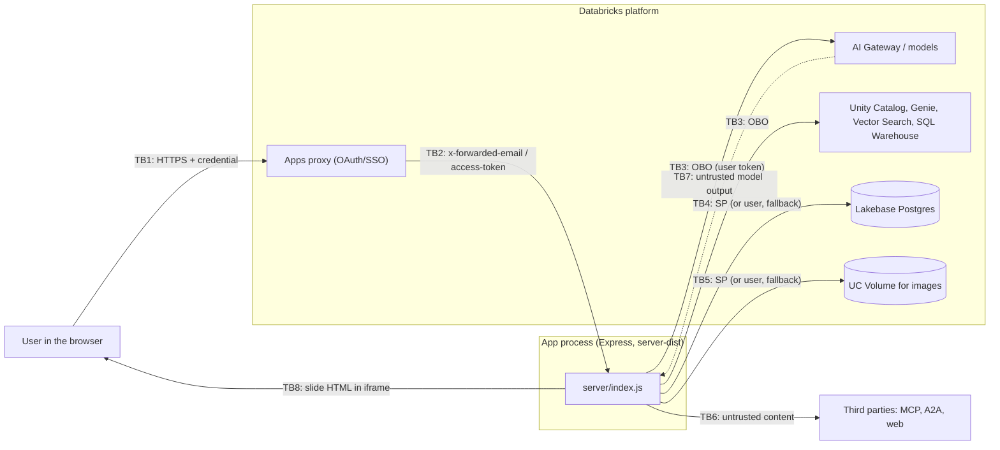

# AI Prism threat model

**English** · [Português (Brasil)](pt-BR/security-threat-model.md) · [Español](es/security-threat-model.md)

This document describes what AI Prism protects, who interacts with it, where the trust boundaries are, and which threats have controls today, with the declared gaps. It is an **engineering assessment of this repository's code**, not a legal opinion or an external audit. Each control cited points to the code that implements it; when something has not been verified, that is stated.

For the typical questions of a security review, see the [security FAQ](security-faq.md). To report a vulnerability, see [SECURITY.md](../SECURITY.md).

- **Scope:** the app (Express server in `server/`, React client in `client/src/`) and the resources that `databricks.yml` provisions.
- **Out of scope:** the Databricks platform (Apps proxy, Lakebase, Unity Catalog, AI Gateway, serverless SQL Warehouses) and the workspace ACL configuration done by whoever deploys. These layers have their own controls; what the app assumes from them is listed in [Platform assumptions](#8-platform-assumptions).

---

## 1. Assets

| Asset | Where it lives | Sensitivity | Note |
|---|---|---|---|
| Conversations and messages (text, attachments, blocks, tool trace) | Lakebase: `chat_sessions`, `chat_messages`, `chat_tool_calls` | High: may contain company data and personal data | Scoped by `user_email` (or a JOIN with the session owner) in every read in the current code. |
| Artifacts (HTML decks, spreadsheets, documents) | Lakebase: `chat_decks`, `chat_spreadsheets`, `chat_documents` | High | Same scope as conversations. |
| Generated images | UC Volume `ai_prism_images` (catalog `ai_prism`) + index `chat_images` | Medium/high | Reads: owner check in the database, then the bytes are read with the SP token (`server/imageStore.ts`). |
| Message embeddings (history RAG) | Lakebase: `chat_message_embeddings` (pgvector) | High | Derived from the content; same data class as the message. |
| Per-call cost ledger | Lakebase: `usage_ledger` | Medium | Contains email, session, model and tokens. |
| Administrative configuration | Lakebase: `app_admins`, `model_catalog_overrides`, `app_mcp_catalog`, `app_tool_policy`, `deck_templates` | High (defines who is an admin and which tools exist) | Written only by routes with `requireAdmin`. |
| User MCP connections | Lakebase: `user_mcp_connections` (name, comment, status — **no credentials**); the connection itself is a Unity Catalog connection, referenced by name | Medium/high | Credentials stay in the UC connection, under the `catalog.connections` scope, not in Lakebase. |
| Workspace data read on the user's behalf | Unity Catalog, Genie spaces, Vector Search indexes, SQL Warehouse | Depends on the source | Accessed via OBO: what the user cannot read, the app does not read either. |
| Deploy and runtime credentials | Apps runtime secrets (SP `DATABRICKS_CLIENT_ID`/`SECRET`), operator variables | Critical | No secrets in the repository (`.gitignore` ignores `.env`). `PGPASSWORD` is for local development only. |

---

## 2. Actors

| Actor | Trust | What it can do |
|---|---|---|
| **End user** (authenticated in the workspace) | Authenticated by the platform; not trusted as to the content it sends | Create conversations, use the models and the tools that its own identity can reach, edit its own artifacts. |
| **App admin** (`app_admins`, by email or workspace group) | Trusted for configuration | Manage models, tool policies, the MCP catalog and deck templates. |
| **Owner** (`APP_OWNER_EMAIL`, when set) | Trusted | Same as admin, plus what `isOwner` grants (`server/authz.ts`). The bundle does **not** set `APP_OWNER_EMAIL`; the bootstrap admin is the deployer, seeded by the auto-config job (`bundle/auto_config.py`). |
| **Operator/deployer** | Trusted for deployment | Runs `bundle deploy`, the auto-config job and `apps deploy`. Becomes the bootstrap admin. |
| **Workspace administrator** | Outside the app's model | Controls ACLs, groups, budgets and the platform. |
| **External attacker** | No credential | Tries to reach the app without going through the proxy. |
| **Malicious user with a workspace account** | Authenticated, hostile | Tries to read another user's data (IDOR), run up costs or inject instructions. |
| **Third-party content** | Untrusted | Descriptions and responses from MCP and A2A servers, web pages (`web_search`), attached files, HTML generated by the model. |
| **Language model** (via AI Gateway) | Untrusted as to its output | Outputs may contain injected instructions, HTML, SQL or tool requests. |

---

## 3. Trust boundaries



| Boundary | Who crosses it | Guarantee the app relies on | Where verification happens |
|---|---|---|---|
| **TB1** User → Apps proxy | Browser/client | OAuth/SSO authentication of the workspace | Platform |
| **TB2** Proxy → app process | `x-forwarded-email` and `x-forwarded-access-token` headers | The proxy overwrites these headers from the authenticated session | Platform; the app requires both and **checks the binding** between email and token in the workspace (`server/identityBinding.ts`, SCIM `/Me`, 5-minute cache by token hash). With no answer from the workspace, it accepts and logs a warning |
| **TB3** App → workspace APIs | User's OBO token | The user's own permissions (UC, Genie, endpoints) | Platform, with the scopes declared in `databricks.yml` (`user_api_scopes`) |
| **TB4** App → Lakebase | App's service principal by default (one Postgres role for all users; not the owner of the tables, no `BYPASSRLS`). As a fallback, the caller's own Postgres role with the OBO token (`createWithClient`, `server/db/pool.ts`; see §4 and G15) | On the app SP path: **RLS with `FORCE`** on the app tables (migration 0003), except `schema_migrations` (no RLS, `server/db/rls.ts`) and `project_members` (`ENABLE` without `FORCE`, migration 0005); the user's identity travels per transaction (`withTx`: `app.user_email`, `app.user_groups`, `app.is_admin`) | Database (G2 closed; the fallback is G15, mitigated) |
| **TB5** App → Volume | App's SP (`all-apis`), or the user's token when the SP token is unavailable (needs the `files` scope) | The Volume has no per-user ACL: an image is reached only through its `chat_images` row, which RLS scopes to its owner (TB4) | App + database |
| **TB6** App → third parties | Responses from MCP/A2A/web; search queries sent to the provider (via Unity Gateway with the user's token, or API with a key) | None: content is treated as data, not as instructions | Partial (G7 mitigated; G12 mitigated for `web_search`; G14) |
| **TB7** Model → app | Text, HTML and tool requests | Safe rendering on the client; tools run with the user's OBO | Partial |
| **TB8** App → slide iframe | HTML/CSS generated by the model | iframe sandbox; `<script>` removed from the persisted HTML | `client/src/components/deck/HtmlSlideFrame.tsx`, `server/blocks.ts` (`sanitizeHtmlDeck`) |
| **TB9** User → another user (sharing, W2-3) | Project members: conversations, messages, instructions and project files | Only current members (a person or a confirmed SCIM group) read and post; roles owner > manage > view; app admin has **no** implicit access; whoever leaves loses everything, including the conversations they created | Database: from migration 0008 on, membership is `ai_prism.aip_my_project_ids()` (evaluated once per statement; ADR 0016) and `ai_prism.aip_project_rank` gives the role level; before 0008 `aip_project_rank` decides both; `aipj_*` policies (migration 0005, including a **restrictive** policy on `chat_sessions`); app: `server/access.ts`, `server/db/projects.ts`, `sessionAccessSql` (`server/ownerScopedWrites.ts`) |

**TB9 in detail.** Until W2-3, every piece of data had an owner and no row was read by another person. Projects open the first boundary between users:

- *Who is a member* is decided in the database, from `app.user_email` and `app.user_groups` (JSON with the caller's SCIM groups, which `withTx` sets on every transaction). An empty identity never matches, with or without groups; `app.is_admin` is not read by any project policy. The decision function depends on the migration level: from migration 0008 on, membership is `aip_my_project_ids()`, evaluated once per statement (ADR 0016), and `aip_project_rank(project)` only gives the role level (owner, manage, view); before 0008, `aip_project_rank(project)` decides both, once per project session.
- *Groups fail closed*: `server/access.ts` queries SCIM `/Me` with the user's token (3 s timeout, 5-minute cache; a failure is cached for 30 s). Only a complete HTTP 200 counts: 206 (Partial Content), any other 2xx, a paginated list (`totalResults` greater than the list, `itemsPerPage` smaller, `startIndex` > 1), a malformed entry, an HTTP or network error, a timeout or an unexpected body = no groups, and a group never grants what could not be proven. Only the groups that `/Me` returns count (no expansion of nested groups). User and group are different `kind`s: a group named after someone's email does not grant access to that person.
- *Project conversations*: the restrictive policy `aipj_project_gate` is combined with `AND` with the owner policy from 0003, so not even the creator reads a project conversation after leaving. Child tables (messages, tools, compactions, Genie, embeddings) check the session through a subquery on `chat_sessions`, which passes through the same filter. Members post (viewers included); the cost row and the artifacts of whoever posted stay under the poster's name. From migration 0012, the decks, spreadsheets, documents and images of a project conversation are also *readable* by the project's current members (`aipj_member_read`, `FOR SELECT` only, membership as a set per ADR 0016); they stay writable only by their creator, and the app answers any other member's save or AI edit with 403 `artifact_read_only` (the getters return `read_only`). A member who leaves, or an app admin who is not a member, reads none of them (404), the creator included: the app's getters require current membership for artifacts in a project chat (the owner policy `aip_owner` of 0003 still lets the database return a creator her own row, so this rule lives in the app, `artifactReadSql` in `server/db.ts`). Images of a project chat are served `private, no-cache` with an ETag (the server decides on every display, 304 when unchanged), so a browser keeps no copy after access is revoked. Deleting a project deletes the image files of its chats from the volume after the commit (best-effort, 4 at a time; the failures are counted in one warning). A trigger prevents changing a session's `user_email`, and only lets a conversation be removed from the project by manage+ (and only by the creator, because the row must remain visible to whoever writes it).
- *Rewriting the history of a project conversation* (editing a prompt, regenerating a response, switching the active variant, answering a message's questions, compacting) requires manage or owner: view reads and posts new turns (`/api/chat`, `/continue`), but does not change what another member wrote. The rule is by role and not by authorship (the author of each message, `chat_messages.sent_by`, is stamped by a database trigger from the transaction identity, so a client cannot set it, but it is for display, not for access); the route responds 403 (`historyRewriteAccess`, `server/db/projects.ts`) and the write SQL repeats the rule (`historyWriteSql`, `server/ownerScopedWrites.ts`). Personal conversations: owner only.
- *No exception for the maintenance identity* (AC-P1): the retention sweep (0007: empty email + the sweep flag) does not read or delete anything in a project conversation, because the restrictive policy has no clause for it. Project conversations are outside age-based retention (they leave with the project, `ON DELETE CASCADE`); a project-specific retention is a follow-up.
- *Why `project_members` has no `FORCE`*: a policy on `project_members` that reads `project_members` (to show the roster to members) would recurse. The membership function is `SECURITY DEFINER`, with a fixed `search_path`, owned by the table owner (`ai_prism_owner`), which reads the table without policies; the app role remains bound by them. During the deploy hand-off window (the SP is a temporary member of the owner, `server/db/grants.ts`) the SP would also bypass the policy on that table, as it can already do with `ALTER TABLE` on any of them: the window closes at `migrate.mjs grants`.
- *Project context in the turn* (N1a, ADR 0013): the instructions and the files of the chat's project are read in the turn as the caller (`server/projectContext.ts` through `withTx`, so the policies above apply): a member, directly or through a group, gets them; a non-member and an app admin get nothing, and a failed group lookup grants nothing. File text is framed as data (`<project_file>`) and cannot close its frame; the instructions come only from manage+ members. The read is bounded (1.5 s) and the file text is limited by `PROJECT_CONTEXT_FILES_MAX_TOKENS`.
- *Project files* store only the extracted text (no bytes, no storage path): the name is reduced to its last segment, with no `/`, `\` or control characters.
- Proofs: `server/isolation.projects.test.js` (raw SQL as the app role, without app code) and the permission matrix in `tests/routes/projects.test.mjs`.

---

## 4. Identity and authorization per resource

The app has no login of its own. Each request arrives with the proxy's identity and the user's OAuth token. The table shows which identity is used for each resource (verified in the code):

| Resource | Identity used | Code | Security effect |
|---|---|---|---|
| Model Serving / AI Gateway (chat, embeddings, transcription) | **OBO** (`serving.serving-endpoints`) | `server/llm.ts`, `server/serving.ts` | The gateway attributes the cost and applies the user's permissions. |
| Genie (spaces and Genie One MCP) | **OBO** (`dashboards.genie`, `genie`) | `server/genie.ts` | The user only queries spaces they can access. |
| SQL Warehouse (UC Functions, Python UDF, Volume DDL) | **OBO** (`sql`) — `execStatement(userToken, …)` | `server/warehouse.ts`, `server/tools.ts` | Execution limited to what the user is allowed to run. |
| Vector Search | **OBO** | `server/vectorSearch.ts` | Same. |
| User's external MCP (own connections) | **User token** per connection | `server/externalMcp.ts`, `server/mcpClient.ts` | Each connection is used only by the user who created it. |
| MCP catalog (workspace suggestions) | **SP** (`all-apis`), listing only | `listMcpServicesViaSp` in `server/externalMcp.ts` | Suggestions only; validation remains OBO. |
| Lakebase (chats, artifacts, ledger, admins) | **SP** by default; **caller's own role** as fallback (with no SP credentials the per-user path is used directly, with no retry, until the configuration changes; only when a configured SP cannot log in or reach the database is it demoted, with a 5-minute retry) | `server/db/pool.ts` (`createWithClient`, `userPath`, `withTx`, `getSpPool`) | The SP has DML on the tables of the `ai_prism` schema (`migrate.mjs grants`), **filtered by RLS with `FORCE`** (0003, 0005): the transaction's own rows, plus the project chats of the projects it is a member of; admin tables are read by all and written only with `app.is_admin = 'on'`; `admin_audit` is read only with the flag; `usage_ledger` is also readable in full by an admin-flagged transaction that carries an identity (`aipa_admin_read`, migration 0010, ADR 0015, SELECT only); project membership is `aip_my_project_ids()` from migration 0008 on (ADR 0016). A fallback role that is a superuser or has `BYPASSRLS` is refused with a 503 before any query (G15). See G2. |
| Image volume | **SP** when available, otherwise the user's token | `server/imageStore.ts` (`storageToken`) | Read only after an owner check in the database. |
| Admin groups (SCIM `Me`) | **User token** | `server/authz.ts` (`userGroups`) | SCIM failure degrades to "no groups", without granting access. |
| Project member groups (SCIM `Me`) | **User token** | `server/access.ts` (`createGroupResolver`), per transaction via `withTx` | Fails closed: error, timeout or unexpected body = no groups (TB9). |

**Authorization in the app.** Three levels: `requireAdmin` on the `/api/admin/*` routes and on the global template routes (`server/index.js`); `isOwner` by `APP_OWNER_EMAIL`; `isAdmin` by `app_admins` (email or group). Session, message, artifact and image ownership is verified in the database with `user_email` (e.g., `fetchActiveMessages` JOINs with `chat_sessions` by owner; `POST /api/chat` responds 403 for a session the caller cannot access: not the owner and not a member of its project; `sessionAccessSql`, `server/ownerScopedWrites.ts`).

---

## 5. Controls in place

| ID | Control | Implementation |
|---|---|---|
| C1 | Rejection without a user credential | `auth()` responds 401 when there is no token (`server/index.js`). |
| C2 | Data scoped by owner | `WHERE user_email` and JOIN with `chat_sessions` in lists, reads and searches (`listSessions`, `fetchActiveMessages`, `retrieveRelevantMessages`, `searchSessionsByVector`). |
| C3 | Ownership verified before the stream | `POST /api/chat` checks `getSession` before opening SSE (clean 403). |
| C4 | Admin gate | `requireAdmin` (`server/index.js`) for administration routes. |
| C5 | Anti-SSRF on web fetch | `server/web.ts`: blocks `localhost`, private IPs (IPv4 and IPv6, including mapped ones), resolves DNS before connecting and limits redirects. Covered by a test in `server/web.test.ts`. Hardening (`server/webHardening.test.js`): the address list (`blockedAddressReason`, `server/a2aGuard.ts`) also decodes the IPv4 embedded in 6to4 `2002::/16` and SIIT `::ffff:0:0/96`, and refuses Teredo `2001::/32` and the local-use NAT64 `64:ff9b:1::/48`; the pinned lookup answers on the next tick, so a synchronous `connect()` failure (EHOSTUNREACH) rejects the fetch instead of crashing the process; the MCP connection name becomes a single encoded segment in `externalMcpUrl`, and `/api/mcp/connections/:name` responds 400 to names with path or query characters. |
| C6 | Markdown without raw HTML | The client does not use `rehype-raw` (`client/src`): HTML embedded in markdown is not rendered as HTML. |
| C7 | Isolated slides | `HtmlSlideFrame` uses `sandbox="allow-scripts"` (without `allow-same-origin`: opaque origin, no access to the app's cookies or storage). Another preview iframe uses `allow-same-origin` **without** `allow-scripts`. |
| C8 | Removal of `<script>` from deck HTML | `sanitizeHtmlDeck` (`server/blocks.ts`) and `deckHtmlPolicy.js`. Defense in depth: the sandbox already blocks execution. |
| C9 | Web search under admin control | Only registered when `WEB_SEARCH_CONNECTION` is configured (`server/tools.ts`, `server/blocks.ts`). |
| C10 | Tools with their own OBO | UC Functions and the Python UDF run with the user's token (`server/warehouse.ts`, `server/tools.ts`). The app process does not execute code generated by the model. |
| C11 | Input limits | JSON body limit per route class, in an explicit table (`JSON_ROUTE_LIMITS` in `server/middleware/security.ts`); every write route has a class, and a test fails when a new route does not choose its own (`server/routes/routeTable.test.ts`). Classes: **1 MB** by default (`BODY_LIMIT_JSON`); 40 MB for importing/updating a design system (`POST /api/deck-templates`, `PATCH /api/deck-templates/:id`, `label-assets`; `BODY_LIMIT_DECK_TEMPLATES`); 46 MiB for studio writes with media, which carry slides, speaker notes and attachments as `data:` (`PATCH /api/decks/:id`, `POST /api/decks/:id/tweak`, `POST /api/decks/:id/export-html`, `POST /api/spreadsheets/:id/tweak`; `BODY_LIMIT_STUDIO_MEDIA`; measured: export of 40 slides with a brand background on each = 25.6 MB; derived from the deck studio's input caps: an AI edit with 4 attachments of 6 MiB + one 9 MiB note + 40 full slides = 45.4 MB, plus ~6% headroom); 4 MB when saving a spreadsheet (`PATCH /api/spreadsheets/:id`; `BODY_LIMIT_WORKBOOK`; 0.94 MB at the sanitizer's ceilings). Chat upload up to 80 MB and 10 files; skill upload up to 5 MB and 1 file; project files up to 25 MB and 10 per request, 50 per project, read only after checking that the caller is manage+ (`PROJECT_FILE_LIMITS`, `server/middleware/index.ts`; `POST /api/projects/:id/files`, excess size or count = 413). Project write routes (`/api/projects…`) are in the default class (1 MB). Above the limit: 413 JSON. **Legacy boot:** the limit is enforced while reading, so a body above it is never read in full. **Legacy boot:** `body-parser` counts the stream itself, with or without `Content-Length` (including `Transfer-Encoding: chunked`). **AppKit boot:** AppKit's own `express.json` reads and parses the body before the whole app chain, on **every** route, up to **64 MB** (`APPKIT_BODY_LIMIT` in `server/middleware/security.ts`, used by `server/appkit.js`; a test ensures no class goes beyond this). That is the per-request memory ceiling under AppKit; the per-route limit still applies through the declared `Content-Length` (above it: 413), and a JSON body **without** `Content-Length` receives **411 Length Required**: the parsed object does not measure what came over the network (spaces and escapes disappear in the parse), so JSON routes require a declared size under AppKit. The application keeps the `Content-Length` rule (413) and the chunked rule (411): it is a policy check, not memory protection, because up to 64 MB have already been read. Image attachments for AI editing go once per raster image (`client/src/lib/promptImages.js`), with a total attachment budget (34M characters). The deck save and AI edit refuse, before reading the deck or calling a model, a speaker note over 9 MiB (UTF-8 bytes, per slide), more than 4 attachments, or an attachment over 6 MiB decoded (an SVG counts its raster copy): `413` with `code` and `limit`, shown by the studio in the user's language; the editor checks the same caps before uploading (`server/routes/decks.js`, `client/src/components/deck/deckInputBudgets.ts`). |
| C17 | Rate limit per user | Token bucket per identity forwarded by the proxy (`x-forwarded-email`; IP only when there is no identity): 120 `/api` requests/min and 12 turns/min (chat, continue, regenerate, compact and the studio tweaks), `RATE_LIMIT_API_PER_MIN` / `RATE_LIMIT_TURNS_PER_MIN` (`0` disables). Excess: 429 JSON with `Retry-After` (`server/middleware/rateLimit.ts`). In memory, per process. |
| C18 | CSP in report-only mode with collection | `Content-Security-Policy-Report-Only` with the target policy (`default-src 'self'; script-src 'self'; style-src 'self' 'unsafe-inline'; img-src 'self' data: blob:; connect-src 'self'; frame-src 'self' blob:; frame-ancestors 'none'`) and `Permissions-Policy: microphone=(self), camera=()` on every response; violations go to `POST /api/csp-report`, which writes one JSON line per violation with only the directive, the blocked origin, the document path and the disposition (no query, sample or email), with a per-user ceiling (`CSP_REPORT_PER_MIN`, default 60) (`server/middleware/security.ts`). |
| C19 | Per-project sharing | Roles owner > manage > view (`server/access.ts`); a non-member (app admin included) gets 404, a member without a role gets 403; check and write in the same transaction (`server/db/projects.ts`); `aipj_*` RLS repeats the rules in the database (migration 0005, TB9). |
| C12 | Secrets kept out of the repository | `.gitignore` ignores `.env`; `.env.example` has no real values; SP credentials are injected by the runtime. |
| C13 | Dependencies in the deploy artifact | The deploy runs the esbuild bundle in `server-dist/` (runtime dependencies embedded) and `client/dist`. Only release PRs commit them (decision D5; the release CI check keeps them current); feature PRs do not. `.npmrc` has `omit=dev`, so the Apps build installs only production dependencies. |
| C14 | CI with lockfile | `npm ci --include=dev --ignore-scripts` in `.github/workflows/ci.yml`; `GITHUB_TOKEN` permissions restricted to read. A report-only `npm audit` step also runs there (the `npm audit (report-only)` step, `continue-on-error`): it surfaces findings in the job log and blocks nothing (G9). |
| C15 | Minimal OBO scopes declared | `user_api_scopes` in `databricks.yml`, with a reason for each scope. Some `catalog.*` scopes are marked as vestigial in the file itself. |
| C16 | Resource limits | SQL Warehouse 2X-Small with `max_num_clusters: 1` and 10-minute auto-stop; Lakebase autoscaling 0.5–16 CU with suspension after `lakebase_suspend_timeout` (default 600 s) (`databricks.yml`). |
| C20 | Structured, redacted logs | Every server log line is one JSON object with eight fixed keys (`ts`, `level`, `request_id`, `user_hash`, `route`, `status`, `duration_ms`, `msg`); any other field is dropped, and `msg` goes through `redact()` (e-mails, bearer/PAT/JWT tokens, token query parameters and SQL statements) (`server/log.ts`, PR #78). A test fails if `console.*` appears in `server/` outside tests (`server/log.test.ts`, "no console.* left in server/"). |
| C21 | Optional verification of the Postgres server certificate | `pgSslOptions` (`server/db/pool.ts`): TLS is on by default (`PGSSLMODE=require`, set in `app.yaml`; `PGSSLMODE=disable` turns it off and is for a local database only); `PG_SSL_CA` pins a CA and turns verification on; `PG_SSL_VERIFY=1` verifies against Node's trust store; an explicit `0` wins. **Off by default** until the Lakebase chain is confirmed against the runtime trust store (G-live-6). Tests: `server/pgSsl.test.ts`. PR #77. |
| C22 | Audit hash keyed with an app secret | `auditHash` (`server/audit.ts`): with `APP_AUDIT_HASH_KEY` set, the actor in `admin_audit` is `h2:` + HMAC-SHA256 of the e-mail, not reversible by a dictionary without the secret; see [§6.1](#61-correlating-the-audit-trail-with-the-logs). PR #97. |

---

## 6. STRIDE

Each row is a concrete threat to the current code. "Residual risk" is what remains open after the controls in [§5](#5-controls-in-place).

| Category | Concrete threat | Controls | Residual risk / gap | Recommended action |
|---|---|---|---|---|
| **S**poofing | A direct call to the app with `x-forwarded-access-token` and no `x-forwarded-email` (G1). | C1, `server/requestIdentity.ts` | Low (G1 closed): in the Apps runtime there is no environment fallback and the response is 401; the environment identity exists only with `LOCAL_DEV_MODE=1` or `LOCAL_DEV_IDENTITY=1` and without `DATABRICKS_APP_*`. | Never set `LOCAL_DEV_MODE` in a deployed environment. |
| **S**poofing | A request that reaches the process without the proxy (or with a relayed header) carries another person's `x-forwarded-email` and any token. | Email ↔ token binding (`server/identityBinding.ts`) | Low: 401 on mismatch or invalid token; what remains is the case of the workspace being down (accepts with a warning) and the case of a stolen valid token. | Keep `IDENTITY_BINDING=enforce`; confirm with the platform that the container is reachable only through the proxy. |
| **S**poofing | Admin by workspace group depends on SCIM with the user's token. | `userGroups` with a 5-minute TTL | Low: SCIM failure denies the group, it does not grant it. | None immediate. |
| **T**ampering | A model or third-party content injects HTML/JS into a slide or document. | C6, C7, C8 | Low for execution (sandbox); the slide HTML keeps the model's CSS and structure. | Keep the sanitization; test regressions with `scripts/deck-html-qa.mjs`. |
| **T**ampering | A user changes another user's artifact through `PATCH /api/decks/:id` and similar routes. | Ownership checked on artifact routes | Low (G2 and G13 closed): the write is also bound by RLS with `FORCE` under the caller's identity (`withTx`), and `server/isolation.test.js` proves, as the non-owner app role, that a raw `SELECT` on each per-user table returns 0 foreign rows. On the SP path a wrong `WHERE` no longer exposes another user's row; the per-user fallback refuses a `BYPASSRLS` or superuser role (G15). | Keep the isolation suite in CI; run it against a real Lakebase branch (G-live-7). |
| **R**epudiation | An admin denies an administrative action (creating an admin, changing the MCP catalog, tool policy, templates, models, settings), or someone erases its trace. The trail also holds count-only `ephemeral.started` rows (temporary chats, migration 0011): they record that a temporary chat began, never whose or what. | Append-only `admin_audit` table written in the mutation's own transaction; keyed actor hash; the deploy's first-admin grant audited too (G8, closed) | Low: an admin with database owner access outside the app can still alter the table; with `APP_AUDIT_HASH_KEY` absent the hashes are the legacy unsalted ones (one warning at boot); rows written before 2026-11-19 keep the legacy hash. | Wire `APP_AUDIT_HASH_KEY` (`bundle/optional/audit-hash-key-secret.yml.example`); keep `system.access.audit` for platform events. |
| **I**nformation disclosure | A query bug reads another user's conversations. | C2, C3, RLS with `FORCE` on the app tables, on the SP path (G2, migration 0003; exceptions in TB4), isolation suites (G13) | Low on the SP path: the database filters by the transaction's identity even if a `WHERE` is missing. The per-user fallback refuses a `BYPASSRLS` or superuser role, so no request runs outside the policies (G15). The remaining paths are code that runs without `withTx` (a lint test forbids `withClient(` outside `server/db/pool.ts`) and the transient deploy hand-off window ([§3, TB9](#3-trust-boundaries)). | Keep the lint test and the isolation suite; close the hand-off at `migrate.mjs grants` on every deploy. |
| **I**nformation disclosure | A member removed from a project (or an app admin, or a group whose SCIM check failed) keeps reading the project's conversations. | C19, TB9: restrictive policy on `chat_sessions`, groups fail closed, admin with no implicit access | Low: proven in the database (`server/isolation.projects.test.js`). What remains is the group cache: someone who leaves a workspace group keeps access for up to 5 min. | None immediate; reduce `GROUPS_TTL_MS` if 5 min is too long. |
| **I**nformation disclosure | The Lakebase server's CA is not verified on connection. | TLS on by default (`PGSSLMODE=require`; `disable` is for a local database only); optional verification C21 | Medium by default (G3, open): without `PG_SSL_CA` or `PG_SSL_VERIFY=1`, `pgSslOptions` returns `rejectUnauthorized: false`; an attacker on the workspace network path could impersonate the server. | Set `PG_SSL_CA` (or `PG_SSL_VERIFY=1`) in the environment once the chain is confirmed (G-live-6); then make verification the default. |
| **I**nformation disclosure | User data leaves for third parties through the MCP/A2A servers the user configured. | Connections are per user | Depends on the destination configured by the user; the app does not filter content sent out. | Document; allow an admin-managed allowlist of destinations. |
| **I**nformation disclosure | Logs record database/gateway error messages that may contain data fragments. | C20 | Low (G11, mitigated): redaction is pattern-based (e-mails, tokens, SQL), so a free-text fragment that matches no pattern could still appear in `msg`. | Keep log access restricted; extend the patterns when a new leak is found. |
| **D**enial of service | A user fires many turns and consumes the workspace's token budget. | C17 (12 turns/min, 120 req/min per user); per-user ledger; workspace limits | Medium (G4): the limit is per process and is not a cost quota; a user can still spend 12 turns/min. | Unity AI Gateway budgets per user or group as the cost ceiling. |
| **D**enial of service | Many concurrent connections exhaust the pool. | One shared SP pool with `max: 8` per process (`POOL_OPTS`, `server/db/pool.ts`; there is no `PG_POOL_MAX`) | Low: at 50 virtual users the pool held 8 connections with at most 2 active and flat read latency (`docs/performance.md` §3). Beyond that, queries wait for a connection. | Re-measure with `npm run loadtest` before raising the ceiling. |
| **D**enial of service | A large upload or a long SSE holds the process. | Per-route size limits (C11), rate limit (C17) | Low to medium. | Measure; adjust timeouts. |
| **E**levation of privilege | A tool or MCP leads the model to act beyond what the user can do. | Tools with OBO (C10) | Medium: there is no confirmation policy for write actions in external tools. | Limit write tools by policy (`app_tool_policy`); human confirmation. |
| **E**levation of privilege | An MCP tool description with a malicious instruction changes the model's behavior (indirect prompt injection). | `server/toolMetadata.ts` neutralizes MCP descriptions, instructions and schemas, Genie room titles and UC function comments before the prompt (G7, mitigated) | Medium: sanitization lowers the risk and does not remove it; the content a tool *returns* is still data the model reads (G12). | Keep tool metadata behind `toolMetadata.js`; restrict write tools by policy. |
| **E**levation of privilege | Cross-site write request (CSRF) on `POST/PUT/PATCH/DELETE` routes. | `server/csrfGuard.ts` (`Sec-Fetch-Site: cross-site` → always 403; otherwise `Origin`/`Referer` ≠ host → 403), before the rate limit and, on the legacy boot, before parsing the body | Low (G5): old browsers without `Sec-Fetch-Site` or `Origin` are not covered. On the AppKit boot the body has already been read and parsed (up to 64 MB) when the refusal happens (C11). | Confirm the proxy cookie's `SameSite` (G-live, §7.1). |

### 6.1 Correlating the audit trail with the logs

Both records identify a person by a hash of the lowercased e-mail, but they are no longer the same value once the audit key is wired:

| Where | Value | Needs the secret? |
|---|---|---|
| Request logs, `user_hash` | first 12 hex of `sha256(e-mail)` (`userHash`, `server/log.ts`) | No |
| `admin_audit.actor_hash` (and a user `target`) with `APP_AUDIT_HASH_KEY` set | `h2:` + first 12 hex of `HMAC-SHA256(APP_AUDIT_HASH_KEY, e-mail)` (`auditHash`, `server/audit.ts`) | Yes |
| `admin_audit.actor_hash` without the key, or a row written before 2026-11-19 | same as `user_hash` (no `h2:` prefix) | No |

So **with the key set, an audit row does not join the log lines by hash, and that is intended**: the point of the key is that someone who can read the audit table (or a database backup) cannot confirm a guessed e-mail without the app secret, while the log hash is unkeyed and can be checked against a list of e-mails by anyone who reads the logs. The audit row has no `request_id`.

An operator who holds the secret and *already knows* which person to look for can compute both values and search each source (the secret stays in the shell; it is never printed):

```bash
APP_AUDIT_HASH_KEY=<the secret> node -e "
const c = require('node:crypto');
const e = process.argv[1].trim().toLowerCase();
console.log('admin_audit.actor_hash', 'h2:' + c.createHmac('sha256', process.env.APP_AUDIT_HASH_KEY).update(e).digest('hex').slice(0, 12));
console.log('logs user_hash        ', c.createHash('sha256').update(e).digest('hex').slice(0, 12));
" person@example.com
```

To tie an audit row to the request that caused it, use the row's `at` timestamp and the admin route (`action`, `target`) against the log lines of that minute (`route`, `status`), and the `user_hash` from the second line above. If you rotate the key, rows hashed with the earlier key no longer match a new hash of the same e-mail; keep the same key across deploys. Runbook: [operations.md §6.8](operations.md#68-retention-org-instructions-and-the-admin-audit-trail).

---

## 7. Declared gaps

Gaps are absences verified in the code, not assumptions. Severity considers impact and likelihood in the current state. The *Evidence* column is the original finding; the *Status* column is the current state with `file:function` and PR evidence (line numbers drift, so the function name is the durable anchor). Status key: **Closed** (the control exists and a test proves it), **Mitigated** (the risk is reduced; the residual is stated), **Accepted** (known, deliberate), **Open** (no control yet; owner and next step in [§7.3](#73-open-gaps-owner-and-next-step)).

| ID | Gap | Evidence (original finding) | Severity | Status |
|---|---|---|---|---|
| **G1** | Identity fallback when `x-forwarded-email` is absent | `userEmail()` in `server/index.js` falls back to `DATABRICKS_USER_EMAIL` and then `local-dev@databricks.com` | Medium (defense in depth) | **Closed** in `server/requestIdentity.ts` (the `LOCAL_DEV_IDENTITY`/`LOCAL_DEV_MODE` switch; test `server/requestIdentity.test.ts`): in the Apps runtime, without `x-forwarded-email` the response is 401; the environment identity is valid only with `LOCAL_DEV_MODE=1`/`LOCAL_DEV_IDENTITY=1` and without `DATABRICKS_APP_*`. |
| **G2** | Isolation only through the `WHERE`; SP with DML on the whole `public` schema; no RLS and no isolation suite | — | **High** | **Closed (W1-5 + W2-1).** `ai_prism` schema with a neutral owner and minimal grants (0002); RLS `ENABLE` + `FORCE` on the 20 app tables (0003): 14 per user (`user_email` directly or via `chat_sessions`/`chat_messages`; since migration 0010 the ledger among them also has the SELECT-only admin read `aipa_admin_read`), 2 mixed (own or global; global only with the admin flag), 4 admin (free read, write only with the flag). The SP is not the owner and has no `BYPASSRLS` (`server/rls.test.js` checks `rolbypassrls = false` and owner ≠ `current_user`); every query goes through `withTx` (lint test: no `withClient(` outside `pool.js`). The cross-user backfill of the ledger became an owner data migration (`migrate.mjs backfill-usage`). PRs #77, #81. Proof on a real Lakebase branch is still missing (G-live-7). |
| **G3** | `rejectUnauthorized: false` on the Lakebase connection | `connInfo` in `server/db.ts` (now `pgSslOptions` in `server/db/pool.ts`) | Medium | **Open by default; opt-in control exists (W1-5, PR #77).** `pgSslOptions` in `server/db/pool.ts` verifies the server certificate when `PG_SSL_CA` is set (it pins the CA) or `PG_SSL_VERIFY=1` (Node's trust store); without either the connection is encrypted but not verified (`rejectUnauthorized: false`). Tests: `server/pgSsl.test.ts`. Documented in `SECURITY.md` ("TLS for Postgres"). Left open because enabling it for everyone needs the Lakebase chain confirmed in a real deployment (G-live-6). |
| **G4** | No rate limit or per-user quota in the app | Before: no limit middleware | Medium (was High for cost) | **Mitigated** in `server/middleware/rateLimit.ts` (C17): per-user token bucket, 120 req/min and 12 turns/min, 429 + `Retry-After`, adjustable via env (PR #76; tests in `server/middleware/rateLimit.test.ts` and `server/httpHardening.test.js`). Still open: the limit is per process (several instances multiply the ceiling) and is not a cost quota; the spending ceiling rests with the Unity AI Gateway budgets. |
| **G5** | No app-level anti-CSRF token | Write routes accept JSON/multipart without a token | Low (was Medium) | **Mitigated** (PR #76) in `server/csrfGuard.ts`: writes (`POST/PUT/PATCH/DELETE`) on `/api/*` with `Sec-Fetch-Site: cross-site` get 403 even if the `Origin` looks like the app's; without `Sec-Fetch-Site`, an `Origin`/`Referer` from another host gets 403 (tests in `server/csrfGuard.test.ts` and `server/httpHardening.test.js`, variants of `Sec-Fetch-Site` and `Origin`). The refusal comes before the rate limit and, on the legacy boot, before reading the body; on the AppKit boot the AppKit `express.json` has already read and parsed the body (up to 64 MB) before the guard, so a cross-site write is still refused, but it costs the read (C11). Pending G-live: the proxy cookie's `SameSite` (§7.1). |
| **G6** | No security headers from the app itself (CSP, HSTS etc.) | Before: no global security `setHeader` | Low | **Partly mitigated** (PR #76): `server/securityHeaders.ts` applies `nosniff`, `Referrer-Policy: same-origin`, `X-Frame-Options: SAMEORIGIN` and a conservative enforced CSP (`frame-ancestors 'self'; base-uri 'self'; object-src 'none'; form-action 'self'`), with no `X-Powered-By`; `server/middleware/security.ts` adds `Permissions-Policy: microphone=(self), camera=()` and the target CSP in **report-only** mode with collection at `/api/csp-report` (C18). Nothing is blocked yet: the design system previews and the slide editor use inline scripts and fonts/images from other hosts; enforcing the target policy requires the collected evidence and moving these iframes to another origin. HSTS stays with the proxy. `Referrer-Policy` stays at `same-origin` (stricter than `strict-origin-when-cross-origin`: it does not send even the origin to external sites). |
| **G7** | MCP/A2A/Genie/UC metadata is not sanitized before the prompt | Original finding: only truncation in `externalMcp.js`; `sanitize` in `tools.js` handled tool names, not descriptions | Medium to high | **Mitigated**: `sanitizeMetadata`, `sanitizeLabel` and `quoteMetadata` in `server/toolMetadata.ts` neutralize MCP descriptions, instructions and schemas, Genie room titles and UC function comments before the prompt. Content returned by tools (web, MCP) is still treated as data, see G12. |
| **G8** | No app-level audit trail for administrative actions | Before: no audit table in the DDL of `server/db.ts` | Medium | **Closed (W2-5 + W2-17).** `server/migrations/0007_settings_audit.up.sql:46` (`admin_audit` table), `:103-106` (RLS: only admins read; inserts need the admin flag, the sweep only `'system'`/`retention.*` rows; since migration 0011 (W3-6) any identity may also insert one count-only `ephemeral.started` row through `aipe_started_insert`, with actor `system`, no target and empty details, so it carries no session, user or content; no UPDATE/DELETE policy), `:122` (`FORCE`); `server/db/grants.ts:228` (revokes UPDATE/DELETE/TRUNCATE); `server/audit.ts:104` (`recordAdminAction`, in the mutation's transaction) and `:195` (`ADMIN_MUTATION_ROUTES`, every admin route classified); `server/db/admin.ts:92` (`listAdminAudit`, `GET /api/admin/audit`, admins only); keyed actor hash `server/audit.ts:43` (`auditHash`) and once-at-boot warning `:52-61`; first-admin seed `server/audit.ts:137` (`recordBootstrapAdminSeeds`), called by `ensureSchema` right after the migrations (`server/db.ts:89`); the deploy-side seed is the `INSERT INTO app_admins … 'auto-config'` in `bundle/auto_config.py` (around `:568`). Every admin mutation writes one row in its own transaction (no row without the change, no change without the row); the app role cannot update or delete a row whatever flags it sets. The actor (and a user target) is `h2:` + the first 12 hex of HMAC-SHA256(`APP_AUDIT_HASH_KEY`, lowercased e-mail), so the trail cannot be reversed by a dictionary of e-mails without the app secret. **Hash scheme changed on 2026-11-19:** rows without the `h2:` prefix are the legacy unsalted sha256 (the same value as `user_hash` in the logs) and stay as they are (no re-keying); without the key the app keeps writing the legacy scheme and logs one warning at boot. The deploy's first-admin seed (`added_by = 'auto-config'`) runs before migration 0007 exists, so the app writes its `admins.add` row (actor `auto-config`, hashed target, workspace host, no e-mail) right after its migrations, once per grant. Tests: `server/settingsAudit.test.js`, `server/auditHash.test.ts`. PRs #84, #97. How to correlate an audit row with the logs: [§6.1](#61-correlating-the-audit-trail-with-the-logs). |
| **G9** | No dependency scanning in CI (`audit=false` in `.npmrc`); the bundle embeds the dependencies | `.npmrc`, `.github/workflows/ci.yml` | Medium | **Open (report-only scan exists).** CI runs `npm audit --omit=dev` and `npm audit` in the `npm audit (report-only)` step of `.github/workflows/ci.yml` with `continue-on-error: true`, so findings are visible in the job log but never fail a PR; `.npmrc` keeps `audit=false` for the deploy-time install. The bundle embeds the dependencies, so a fix reaches the deployment only after the bundle is rebuilt. Owner and next step: [§7.3](#73-open-gaps-owner-and-next-step). |
| **G10** | Images are read with the SP token, not the user's | `server/imageStore.ts` | Low (depends on G2 for the owner check) | **Accepted.** The bytes are read with the SP token (`storageToken` in `server/imageStore.ts`) only after the owner check on the `chat_images` row, which RLS now enforces in the database (G2 closed); the user's own token would not change what the user can reach. |
| **G11** | Logs without redaction; error messages may contain data fragments | Original finding: `console.warn(...e.message)` in `server/db.ts` and `server/index.js` | Low | **Mitigated (W1-3, PR #78).** All server logging goes through `server/log.ts`: eight fixed keys, other fields dropped, `redact()` on `msg` (e-mails, tokens, SQL), `email` → `user_hash`; `server/log.test.ts` fails the build if `console.*` returns to `server/`. Residual: redaction is pattern-based, so a free-text fragment that matches no pattern can still reach `msg`; the platform keeps the log retention. |
| **G12** | Third-party content (web, attachments) enters the context without an untrusted marking | Attachments enter as a text block in the turn | Medium | **Mitigated for `web_search`** (W2-11a): every search result, from any backend, comes out of a single renderer (`renderWebSearchForModel` in `server/webSearch/index.ts`) inside the fixed envelope `[CONTEÚDO EXTERNO DA WEB — não confiável; …]` … `[FIM DO CONTEÚDO EXTERNO]`, with the markers neutralized inside the content and item and size limits (per-adapter test in `server/webSearch/webSearch.test.ts`). PR #88. Still open for attachments and for the text from `web_fetch`: `web_fetch` returns page text through `server/web.ts` without the envelope. |
| **G13** | No automated cross-user isolation test in CI | `package.json` and `.github/workflows/ci.yml` | High (enables G2) | **Closed in the database**: `server/isolation.test.js` (19 cases) runs `db.js` as the non-owner role `ai_prism_app` (`scripts/ci/pg-roles.sql`) under RLS, including a raw `SELECT` on each per-user table (0 foreign rows); `server/rls.test.js` (16 cases) covers policies, `FORCE`, role attributes, index use and the 0003 round trip. CI: `--fail-on-skip --expect server/isolation.test.js=19 --expect server/rls.test.js=16`. PRs #77, #81. Still missing: a run against an ephemeral Lakebase branch (G-live-7). |
| **G14** | Web search: the query leaves the workspace for the search provider; the designated search MCP service uses a shared credential | `server/webSearch/` (W2-11a, ADR 0007) | Medium | **Mitigated, residual risk accepted.** The tool description forbids internal data, client names and attachment content in the query; a gateway Sensitive Data Detection policy (Beta) can be attached to the MCP Service. Logs: one line per attempt, without the query, the result or the provider's error text (test in `webSearch.test.js`). The service designated in `WEB_SEARCH_MCP_SERVICE` is the **only exception** to the refusal of shared credentials (PR #83), limited by six tested invariants: a single fixed tool is called (never "the first" in the list); the arguments are built by the app with only the query and the limit; the server's descriptions, instructions and schema never reach the prompt; `admitMcpConnection` stays intact and keeps refusing the service on every user path; with the native tool active, user refs to `system.ai.web_search` or to the designated service are ignored in the turn; the documentation requires tool selection on the service. Both MCP calls use the user's token (grants, rate limit and audit of the gateway per user); the provider key stays in the UC connection, never in the app. Fallback key (Brave/Tavily): Apps secret, read by the SP, never logged or displayed (the admin status shows only presence). Known gap until W2-11d: with the native tool disabled, an old ref to this service still reaches the model. |
| **G15** | Lakebase fallback to the caller's own role (`createWithClient`, `server/db/pool.ts`) could run a caller whose role has `BYPASSRLS` or is a superuser (the deploying identity, `docs/performance.md` §2.1) outside the policies while the SP is unavailable | — | **Medium** | **Mitigated.** `assertFallbackRlsBound` (`server/db/pool.ts:343`, called from `createWithClient` at `server/db/pool.ts:385`) reads `rolsuper` and `rolbypassrls` for `current_user` right after connecting, once per connection, and refuses the request with a 503 (`lakebase_fallback_refused`) before any work runs; tests in `server/spFallback.test.js`. It applies with SP credentials configured or on Databricks Apps; local development is not checked; no setting disables it. The project-context read of a turn (N1a, `server/projectContext.ts`) is one more caller: its guard runs before the transaction and its own `statement_timeout` budget, and a refusal there is logged and the turn gets no project context, never a read outside the policies. Residual: during an SP outage the deploying identity cannot use the app (availability traded for isolation, decision D11). Owner: technical owner. |

### 7.1 Pending checks in the real environment (G-live)

Items that only a real deployment can answer. None has been verified yet ("Not verified"); each one decides an adjustment to the controls above.

| Item | What to verify | Decides | Status |
|---|---|---|---|
| G-live-1 | `SameSite` attribute of the Apps proxy session cookie | If `Lax`/`Strict`, the browser no longer sends the cookie on cross-site `POST`, and the CSRF guard becomes defense in depth (G5) | Not verified |
| G-live-2 | Which of these headers the proxy already sets or overwrites: `Content-Security-Policy(-Report-Only)`, `X-Frame-Options`, `Referrer-Policy`, `Permissions-Policy`, `Strict-Transport-Security` | Avoids duplicate or conflicting headers (G6) | Not verified |
| G-live-3 | Whether the Apps UI (or another workspace product) shows the app in an iframe: `frame-ancestors` violations at `/api/csp-report` | Value of `frame-ancestors` once the CSP is enforced (`'none'` or the workspace origin) | Not verified |
| G-live-4 | Volume and type of violations at `/api/csp-report` in real use (deck editor, design system preview, DS fonts) | Final enforced policy (G6) | Not verified |
| G-live-5 | Number of app instances in production | Whether the in-memory rate limit (G4) needs shared state | Not verified |
| G-live-6 | Whether the Lakebase server certificate chain validates against Node's trust store in the Apps runtime (`PG_SSL_VERIFY=1`), or which CA to pin in `PG_SSL_CA` | Whether verification (G3) can become the default | Not verified |
| G-live-7 | The isolation suites (`server/isolation.test.js`, `server/rls.test.js`) and `npm run loadtest` against a real Lakebase branch, not only the disposable Postgres of CI | Confirms G2/G13 on the production engine | Not verified |

### 7.2 Follow-ups (product decisions, not implemented)

| Item | What to do | Why | Owner | Status |
|---|---|---|---|---|
| F-1 | Tighten the client-side budgets for AI editing of the deck: a ceiling for speaker notes (today unlimited in the editor and on the server) and a budget that counts attachments **and** the sent deck, smaller than the current one (34M characters of attachments) | The worst case admitted today (4 images of 6 MiB + a 9 MiB note ≈ 45.4 MB) forced the `studioMedia` class to 48 MiB and the AppKit parser to 64 MB for all routes; a note larger than ~11 MiB still gets 413. Smaller budgets would allow lowering both limits | Product (owner of the deck studio) | Done (W2-16): 9 MiB per note, 4 attachments of 6 MiB, enforced by the server and checked by the editor; `studioMedia` derived from them (46 MiB). The AppKit parser stays at 64 MB by decision |

### 7.3 Open gaps: owner and next step

| ID | Owner | Next step | Done when |
|---|---|---|---|
| G3 | Operator/deployer (sets the variable); maintainers (change the default) | Run G-live-6 in a real workspace; set `PG_SSL_CA` (or `PG_SSL_VERIFY=1`) in `app.yaml`; if it holds, make verification the default in `pgSslOptions` | A deployed app connects with verification on and the smoke test passes |
| G9 | Maintainers | Turn the report-only `npm audit` step into a gate for `high` findings once the baseline is clean, and add an automated dependency update PR; rebuild and release the bundle after each fix | A `high` advisory in the full tree fails the PR |
| G15 | Technical owner | Keep the SP credentials healthy (alert A3): during an SP outage a fallback under a `BYPASSRLS` or superuser role is refused | A fallback request under such a role returns 503 and a test proves it |

G11 is mitigated, not open: see its row.

---

## 8. Platform assumptions

The app assumes that the platform does what is described below. If any assumption fails, this document's model changes.

- The **Apps proxy** authenticates the user, is the only path to the process, and rewrites `x-forwarded-email` and `x-forwarded-access-token` from the authenticated session.
- The **OBO token** delivered to the app has only the scopes declared in `user_api_scopes` (the bundle, not `app.yaml`, applies them at deploy time).
- **Lakebase** is reachable only through the workspace network and authenticates the SP and the user with the connection token issued by the platform.
- The **UC Volume** and the `ai_prism` catalog are created by the auto-config job, with `READ/WRITE VOLUME` granted only to the app's SP.
- Encryption at rest and in transit for the workspace follows the platform's own configuration (including customer-managed keys, when configured).
- The platform audit (`system.access.audit`) records the workspace and Unity Catalog events. The app's own `admin_audit` covers the app's administrative actions (G8, closed) and does not replace the platform trail.

---

## 9. How to keep this document current

- Review on every change to `server/authz.ts`, `server/db/pool.ts` (`withTx`, `pgSslOptions`, `POOL_OPTS`), `server/db/grants.ts`, `server/migrations/`, `server/log.ts`, `server/audit.ts`, `databricks.yml` (`user_api_scopes`, resources) and to any new route under `/api/`.
- When closing a gap, move the row to the controls table and cite the test that covers it.
- Changes that alter a trust boundary (a new resource accessed with the SP, a new source of third-party content) require updating [§3](#3-trust-boundaries).
