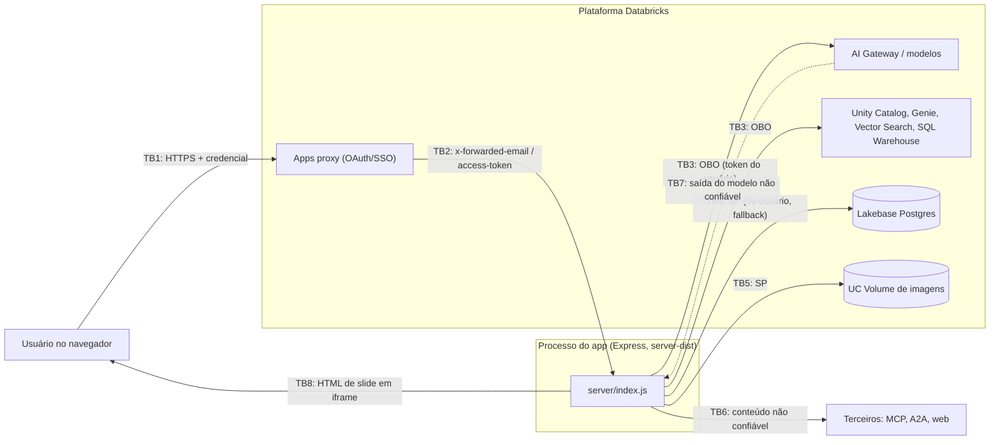

# Modelo de ameaças do AI Prism

Este documento descreve o que o AI Prism protege, quem interage com ele, onde ficam
as fronteiras de confiança e quais ameaças têm controle hoje, com as lacunas
declaradas. Ele é uma **avaliação de engenharia do código deste repositório**, não
um parecer jurídico nem uma auditoria externa. Cada controle citado aponta para o código
que o implementa; quando algo não foi verificado, está dito.

Para as perguntas típicas de revisão de segurança, veja o
[FAQ de segurança](security-faq.md). Para reportar uma vulnerabilidade, veja o
[SECURITY.md](../SECURITY.md).

- **Escopo:** o app (servidor Express em `server/`, cliente React em `client/src/`)
  e os recursos que o `databricks.yml` provisiona.
- **Fora do escopo:** a plataforma Databricks (Apps proxy, Lakebase, Unity Catalog,
  AI Gateway, SQL Warehouses serverless) e a configuração de ACLs do workspace feita
  por quem faz o deploy. Essas camadas têm controles próprios; o que o app assume delas
  está listado em [Premissas](#8-premissas-sobre-a-plataforma).

---

## 1. Ativos

| Ativo | Onde fica | Sensibilidade | Observação |
|---|---|---|---|
| Conversas e mensagens (texto, anexos, blocos, trace de tools) | Lakebase: `chat_sessions`, `chat_messages`, `chat_tool_calls` | Alta: podem conter dados da empresa e dados pessoais | Escopadas por `user_email` (ou JOIN com o dono da sessão) em todas as leituras do código atual. |
| Artefatos (decks HTML, planilhas, documentos) | Lakebase: `chat_decks`, `chat_spreadsheets`, `chat_documents` | Alta | Mesmo escopo das conversas. |
| Imagens geradas | UC Volume `ai_prism_images` (catálogo `ai_prism`) + índice `chat_images` | Média/alta | Leitura: checagem de dono no banco, depois o bytes são lidos com o token do SP (`server/imageStore.js`). |
| Embeddings de mensagens (RAG por histórico) | Lakebase: `chat_message_embeddings` (pgvector) | Alta | Derivados do conteúdo; mesma classe de dado da mensagem. |
| Ledger de custos por chamada | Lakebase: `usage_ledger` | Média | Contém e-mail, sessão, modelo e tokens. |
| Configuração administrativa | Lakebase: `app_admins`, `model_catalog_overrides`, `app_mcp_catalog`, `app_tool_policy`, `deck_templates` | Alta (define quem é admin e quais ferramentas existem) | Escrita só por rotas com `requireAdmin`. |
| Conexões MCP do usuário | Lakebase: `user_mcp_connections` (nome, comentário, status — **sem credenciais**); a conexão em si é uma conexão do Unity Catalog, referenciada por nome | Média/alta | As credenciais ficam na conexão do UC, sob o escopo `catalog.connections`, não no Lakebase. |
| Dados do workspace lidos em nome do usuário | Unity Catalog, Genie spaces, Vector Search indexes, SQL Warehouse | Depende da fonte | Acessados via OBO: o que o usuário não pode ler, o app também não lê. |
| Credenciais de deploy e runtime | Segredos do runtime do Apps (`DATABRICKS_CLIENT_ID`/`SECRET` do SP), variáveis do operador | Crítica | Nenhum segredo no repositório (`.gitignore` ignora `.env`). `PGPASSWORD` é só para dev local. |

---

## 2. Atores

| Ator | Confiança | O que pode fazer |
|---|---|---|
| **Usuário final** (autenticado no workspace) | Autenticado pela plataforma; não confiável quanto ao conteúdo que envia | Criar conversas, usar os modelos e as ferramentas que a própria identidade alcança, editar artefatos próprios. |
| **Admin do app** (`app_admins`, por e-mail ou grupo do workspace) | Confiável para configuração | Gerenciar modelos, políticas de ferramenta, catálogo MCP e templates de deck. |
| **Owner** (`APP_OWNER_EMAIL`, quando definido) | Confiável | Mesmo que admin, mais o que `isOwner` libera (`server/authz.js`). O bundle **não** define `APP_OWNER_EMAIL`; o admin de bootstrap é o deployer, semeado pelo job de auto-config (`bundle/auto_config.py`). |
| **Operador/deployer** | Confiável para deploy | Roda `bundle deploy`, o job de auto-config e o `apps deploy`. Vira admin de bootstrap. |
| **Administrador do workspace** | Fora do modelo do app | Controla ACLs, grupos, orçamentos e a plataforma. |
| **Atacante externo** | Sem credencial | Tenta chegar ao app sem passar pelo proxy. |
| **Usuário malicioso com conta no workspace** | Autenticado, hostil | Tenta ler dados de outro usuário (IDOR), estourar custo ou injetar instruções. |
| **Conteúdo de terceiros** | Não confiável | Descrições e respostas de servidores MCP e A2A, páginas da web (`web_search`), arquivos anexados, HTML gerado pelo modelo. |
| **Modelo de linguagem** (via AI Gateway) | Não confiável quanto à saída | Saídas podem conter instruções injetadas, HTML, SQL ou pedidos de ferramenta. |

---

## 3. Fronteiras de confiança

| Fronteira | Quem cruza | Garantia que o app depende | Onde a verificação acontece |
|---|---|---|---|
| **TB1** Usuário → Apps proxy | Navegador/cliente | Autenticação OAuth/SSO do workspace | Plataforma |
| **TB2** Proxy → processo do app | Cabeçalhos `x-forwarded-email` e `x-forwarded-access-token` | O proxy sobrescreve esses cabeçalhos a partir da sessão autenticada | Plataforma; o app exige os dois e **confere o vínculo** e-mail ↔ token no workspace (`server/identityBinding.js`, SCIM `/Me`, cache de 5 min por hash do token). Sem resposta do workspace, aceita e registra aviso |
| **TB3** App → APIs do workspace | Token OBO do usuário | As permissões do próprio usuário (UC, Genie, endpoints) | Plataforma, com os escopos declarados em `databricks.yml` (`user_api_scopes`) |
| **TB4** App → Lakebase | Service principal do app (padrão) ou o usuário (fallback) | **Nenhuma**: o banco não isola usuários; o isolamento é o `WHERE user_email` do código | App (ver G2) |
| **TB5** App → Volume | SP do app | Idem TB4, com escopo `files` | App |
| **TB6** App → terceiros | Respostas de MCP/A2A/web | Nenhuma: conteúdo é tratado como dado, não como instrução | Parcial (G7 mitigada; ver G12) |
| **TB7** Modelo → app | Texto, HTML e pedidos de ferramenta | Renderização segura no cliente; ferramentas rodam com o OBO do usuário | Parcial |
| **TB8** App → iframe do slide | HTML/CSS gerado pelo modelo | Sandbox do iframe; `<script>` removido do HTML persistido | `client/src/components/deck/HtmlSlideFrame.jsx`, `server/blocks.js` (`sanitizeHtmlDeck`) |

---

## 4. Identidade e autorização por recurso

O app não tem login próprio. Cada requisição chega com a identidade do proxy e o
token OAuth do usuário. A tabela mostra qual identidade é usada em cada recurso
(verificado no código):

| Recurso | Identidade usada | Código | Efeito de segurança |
|---|---|---|---|
| Model Serving / AI Gateway (chat, embeddings, transcrição) | **OBO** (`serving.serving-endpoints`) | `server/llm.js`, `server/serving.js` | O gateway atribui o custo e aplica permissões do usuário. |
| Genie (espaços e Genie One MCP) | **OBO** (`dashboards.genie`, `genie`) | `server/genie.js` | O usuário só consulta espaços que pode acessar. |
| SQL Warehouse (UC Functions, Python UDF, DDL do Volume) | **OBO** (`sql`) — `execStatement(userToken, …)` | `server/warehouse.js`, `server/tools.js` | Execução limitada ao que o usuário pode executar. |
| Vector Search | **OBO** | `server/vectorSearch.js` | Idem. |
| MCP externo do usuário (conexões próprias) | **Token do usuário** por conexão | `server/externalMcp.js`, `server/mcpClient.js` | Cada conexão só é usada pelo usuário que a criou. |
| Catálogo de MCP (sugestões do workspace) | **SP** (`all-apis`), só para listar | `listMcpServicesViaSp` em `server/externalMcp.js` | Só sugestões; a validação continua OBO. |
| Lakebase (chats, artefatos, ledger, admins) | **SP** por padrão (`withClient`, `server/db.js`); **usuário** como fallback (dev local, SP indisponível) | `server/db.js` (`withClient`, `getSpPool`) | O SP tem `SELECT/INSERT/UPDATE/DELETE` em **todas** as tabelas do schema `public` (`ensureSpGrants`). Ver G2. |
| Volume de imagens | **SP** quando disponível, senão o token do usuário | `server/imageStore.js` (`storageToken`) | Leitura só após consulta de dono no banco. |
| Grupos de admin (SCIM `Me`) | **Token do usuário** | `server/authz.js` (`userGroups`) | Falha de SCIM degrada para "sem grupos", sem liberar acesso. |

**Autorização no app.** Três níveis: `requireAdmin` nas rotas `/api/admin/*` e nas
de templates globais (`server/index.js`); `isOwner` por `APP_OWNER_EMAIL`; `isAdmin`
por `app_admins` (e-mail ou grupo). Dono de sessão, mensagem, artefato e imagem é
verificado no banco com `user_email` (ex.: `fetchActiveMessages` faz JOIN com
`chat_sessions` pelo dono; `POST /api/chat` responde 403 para `sessionId` alheio).

---

## 5. Controles presentes

| ID | Controle | Implementação |
|---|---|---|
| C1 | Rejeição sem credencial de usuário | `auth()` responde 401 quando não há token (`server/index.js`). |
| C2 | Escopo de dados por dono | `WHERE user_email` e JOIN com `chat_sessions` em listas, leituras, buscas (`listSessions`, `fetchActiveMessages`, `retrieveRelevantMessages`, `searchSessionsByVector`). |
| C3 | Ownership verificado antes do stream | `POST /api/chat` checa `getSession` antes de abrir SSE (403 limpo). |
| C4 | Gate de admin | `requireAdmin` (`server/index.js`) para rotas de administração. |
| C5 | Anti-SSRF no fetch da web | `server/web.js`: bloqueia `localhost`, IPs privados (IPv4 e IPv6, inclusive mapeados), resolve o DNS antes de conectar e limita redirects. Coberto por teste em `server/web.test.js`. Endurecimento (`server/webHardening.test.js`): a lista de endereços (`blockedAddressReason`, `server/a2aGuard.js`) também decodifica o IPv4 embutido em 6to4 `2002::/16` e SIIT `::ffff:0:0/96` e recusa Teredo `2001::/32` e NAT64 de uso local `64:ff9b:1::/48`; o lookup fixado responde no tick seguinte, então uma falha síncrona de `connect()` (EHOSTUNREACH) rejeita o fetch em vez de derrubar o processo; o nome da conexão MCP vira um único segmento codificado em `externalMcpUrl` e `/api/mcp/connections/:name` responde 400 a nomes com caracteres de caminho ou query. |
| C6 | Markdown sem HTML cru | O cliente não usa `rehype-raw` (`client/src`): HTML embutido no markdown não é renderizado como HTML. |
| C7 | Slides isolados | `HtmlSlideFrame` usa `sandbox="allow-scripts"` (sem `allow-same-origin`: origem opaca, sem acesso a cookies/armazenamento do app). Outro iframe de preview usa `allow-same-origin` **sem** `allow-scripts`. |
| C8 | Remoção de `<script>` do HTML de deck | `sanitizeHtmlDeck` (`server/blocks.js`) e `deckHtmlPolicy.js`. Defesa em profundidade: o sandbox já bloqueia execução. |
| C9 | Web search sob controle do admin | Só é registrado quando `WEB_SEARCH_CONNECTION` está configurada (`server/tools.js`, `server/blocks.js`). |
| C10 | Ferramentas com o próprio OBO | Execução de UC Functions e da UDF Python com o token do usuário (`server/warehouse.js`, `server/tools.js`). O processo do app não executa código gerado pelo modelo. |
| C11 | Limites de entrada | JSON até 40 MB, upload até 80 MB e 10 arquivos (`express.json`, `multer` em `server/index.js`). |
| C12 | Segredos fora do repositório | `.gitignore` ignora `.env`; `.env.example` sem valores reais; SP credentials injetadas pelo runtime. |
| C13 | Dependências no artefato de deploy | O deploy roda `server-dist/index.cjs` (bundle esbuild, com as dependências de runtime embutidas) e `client/dist`, ambos commitados. O `.npmrc` tem `omit=dev`, então o build do Apps instala só dependências de produção. |
| C14 | CI com lockfile | `npm ci --include=dev --ignore-scripts` em `.github/workflows/ci.yml`; permissões do `GITHUB_TOKEN` restritas a leitura. |
| C15 | Escopos OBO mínimos declarados | `user_api_scopes` no `databricks.yml`, com motivo por escopo. Alguns escopos `catalog.*` estão marcados como vestigiais no próprio arquivo. |
| C16 | Limites de recursos | SQL Warehouse 2X-Small com `max_num_clusters: 1` e auto-stop de 10 min; Lakebase autoscaling 0,5–16 CU com suspensão em 1800 s (`databricks.yml`). |

---

## 6. STRIDE

Cada linha é uma ameaça concreta ao código atual. "Risco residual" é o que continua
aberto depois dos controles de [§5](#5-controles-presentes).

| Categoria | Ameaça concreta | Controles | Risco residual / lacuna | Ação recomendada |
|---|---|---|---|---|
| **S**poofing | Chamada direta ao app com `x-forwarded-access-token` sem `x-forwarded-email` cai no fallback de identidade (G1). | C1, proxy da plataforma | Médio: se o proxy não estiver na frente, a identidade vira `DATABRICKS_USER_EMAIL` ou `local-dev@databricks.com`. | Rejeitar com 401 quando o e-mail do proxy faltar em runtime de Apps. |
| **S**poofing | Requisição que chega ao processo sem o proxy (ou com header repassado) com `x-forwarded-email` de outra pessoa e qualquer token. | Vínculo e-mail ↔ token (`server/identityBinding.js`) | Baixo: 401 com divergência ou token inválido; resta o caso do workspace fora do ar (aceita com aviso) e o de token válido roubado. | Manter `IDENTITY_BINDING=enforce`; confirmar com a plataforma que o container só é alcançável pelo proxy. |
| **S**poofing | Admin por grupo do workspace depende de SCIM com token do usuário. | `userGroups` com TTL de 5 min | Baixo: falha de SCIM nega grupo, não concede. | Nenhuma imediata. |
| **T**ampering | Modelo ou conteúdo de terceiros injeta HTML/JS em slide ou documento. | C6, C7, C8 | Baixo para execução (sandbox); o HTML do slide preserva CSS e estrutura do modelo. | Manter a sanitização; testar regressões em `scripts/deck-html-qa.mjs`. |
| **T**ampering | Usuário altera artefato de outro usuário pelo `PATCH /api/decks/:id` etc. | Ownership checado nas rotas de artefato | Médio: a escrita depende de `WHERE` correto em cada rota; não há teste automatizado de IDOR (G2). | Teste de isolamento entre dois usuários na CI. |
| **R**epudiation | Não há trilha de auditoria própria para ações administrativas (criar admin, alterar catálogo MCP, templates). | Logs em `console` (sem estrutura); `usage_ledger` cobre só custo | Médio: a trilha é a da plataforma (`system.access.audit`), não a do app (G8). | Registrar eventos admin em tabela própria ou confiar explicitamente em `system.access.audit`. |
| **I**nformation disclosure | Um bug de query lê conversas de outro usuário. O SP tem DML em todas as tabelas e não há RLS. | C2, C3 | **Alto** (impacto), probabilidade dependente de revisão de código; sem prova automatizada hoje (G2). | RLS com `FORCE` nas tabelas de dono e testes de isolamento contra o banco. |
| **I**nformation disclosure | A CA do servidor Lakebase não é verificada na conexão. | TLS (`PGSSLMODE=require`) | Médio: `rejectUnauthorized: false` em `server/db.js` (G3). | Ancorar a CA do Lakebase ou documentar a exceção com justificativa. |
| **I**nformation disclosure | Dados do usuário saem para terceiros via MCP/A2A que ele configurou. | Conexões são por usuário | Depende do destino configurado pelo usuário; o app não filtra conteúdo enviado. | Documentar; permitir allowlist de destinos por admin. |
| **I**nformation disclosure | Logs gravam mensagens de erro de banco/gateway que podem conter fragmentos de dados. | Nenhum filtro de logs | Baixo a médio (G11). | Política de redação para logs. |
| **D**enial of service | Um usuário dispara muitos turnos e consome o orçamento de tokens do workspace. | Limites do workspace/serverless; ledger por usuário | **Alto** para custo: não há rate limit por usuário no app (G4). | Orçamentos nativos do workspace por usuário ou grupo; rate limit no proxy se disponível. |
| **D**enial of service | Muitas conexões concorrentes esgotam o pool. | Pool com `max: 8` por processo e por usuário (`POOL_OPTS`, `server/db.js`) | Médio: o pool do SP é único, então a concorrência é limitada a 8 consultas simultâneas (ver `docs/performance.md`). | Medir com `npm run loadtest`; dimensionar. |
| **D**enial of service | Upload grande ou SSE longo prendem o processo. | Limites de tamanho (C11) | Baixo a médio. | Medir; ajustar timeouts. |
| **E**levation of privilege | Ferramenta ou MCP leva o modelo a agir além do que o usuário pode. | Ferramentas com OBO (C10) | Médio: não há política de confirmação para ações de escrita em ferramentas externas. | Limitar ferramentas de escrita por política (`app_tool_policy`); confirmação humana. |
| **E**levation of privilege | Descrição de tool MCP com instrução maliciosa altera o comportamento do modelo (prompt injection indireta). | Truncamento de descrição a 300 caracteres em `externalMcp.js` | Médio a alto (G7): descrições e metadados não são sanitizados antes do prompt. | Tratar metadados de tool como dado não confiável, com delimitadores e sanitização. |
| **E**levation of privilege | Requisição de escrita cross-site (CSRF) em rotas `POST/PATCH/DELETE`. | `server/csrfGuard.js` (`Sec-Fetch-Site`/`Origin`/`Referer`) | Baixo (G5): navegadores antigos sem `Sec-Fetch-Site` nem `Origin` não são cobertos. | Confirmar `SameSite` do proxy. |

---

## 7. Lacunas declaradas

Lacunas são ausências verificadas no código, não suposições. A severidade considera
impacto e probabilidade no estado atual.

| ID | Lacuna | Evidência | Severidade | Status |
|---|---|---|---|---|
| **G1** | Fallback de identidade quando `x-forwarded-email` está ausente | `userEmail()` em `server/index.js` cai em `DATABRICKS_USER_EMAIL` e depois `local-dev@databricks.com` | Média (defesa em profundidade) | **Fechada** em `server/requestIdentity.js`: no runtime de Apps, sem `x-forwarded-email` a resposta é 401; a identidade de ambiente só vale com `LOCAL_DEV_MODE=1`/`LOCAL_DEV_IDENTITY=1` e sem `DATABRICKS_APP_*`. |
| **G2** | Isolamento só pelo `WHERE`; SP com DML em todo o schema `public`; sem RLS nem suíte de isolamento | `withClient` prefere o SP; `ensureSpGrants` concede DML em `ALL TABLES IN SCHEMA public` | **Alta** | Aberta. Previsto: schema dedicado com papéis mínimos, RLS e testes de dois usuários. |
| **G3** | `rejectUnauthorized: false` na conexão com o Lakebase | `connInfo` em `server/db.js` | Média | Aberta. |
| **G4** | Sem rate limit nem cota por usuário no app | Nenhum middleware de limite em `server/index.js` | Alta para custo | Aberta. Mitigação atual: orçamento do workspace. |
| **G5** | Sem token anti-CSRF próprio | Rotas de escrita aceitam JSON/multipart sem token | Média | **Mitigada** em `server/csrfGuard.js`: escrita em `/api/*` vinda de outro site recebe 403 (teste da sonda C3 em `server/httpHardening.test.js`). Falta confirmar o `SameSite` do proxy. |
| **G6** | Sem cabeçalhos de segurança do próprio app (CSP, HSTS etc.) | Não há `helmet` nem `setHeader` de segurança global em `server/index.js` | Baixa | **Mitigada em parte** em `server/securityHeaders.js`: `nosniff`, `Referrer-Policy`, `X-Frame-Options`, CSP conservadora (sem `script-src`, por causa dos iframes `srcdoc`), sem `X-Powered-By`; ids malformados dão 404 e erros não tratados não expõem a mensagem do Postgres. HSTS fica com o proxy. |
| **G7** | Metadados de MCP/A2A/Genie/UC não são sanitizados antes do prompt | Só truncamento em `externalMcp.js:72`; `sanitize` em `tools.js` trata nomes de tool, não descrições | Média a alta | **Mitigada**: `server/toolMetadata.js` neutraliza descrições, instruções e schemas de MCP, títulos de sala Genie e comentários de função UC antes do prompt. Conteúdo retornado por tools (web, MCP) continua tratado como dado, ver G12. |
| **G8** | Sem trilha de auditoria própria para ações administrativas | Nenhuma tabela de auditoria no DDL de `server/db.js` (busca por `audit` só encontra comentários) | Média | Aberta. |
| **G9** | Sem varredura de dependências no CI (`audit=false` no `.npmrc`); o bundle embute as dependências | `.npmrc`, `.github/workflows/ci.yml` | Média | Aberta. |
| **G10** | Imagens são lidas com o token do SP, não com o do usuário | `server/imageStore.js` | Baixa (depende de G2 para a checagem de dono) | Aceita com o controle de dono no banco. |
| **G11** | Logs sem redação; mensagens de erro podem ter trechos de dados | `console.warn(...e.message)` em `server/db.js` e `server/index.js` | Baixa a média | Aberta. |
| **G12** | Conteúdo de terceiros (web, anexos) entra no contexto sem marcação de não confiável | Anexos entram como bloco de texto no turno | Média | Aberta. |
| **G13** | Nenhum teste automatizado de isolamento entre usuários na CI | `package.json` e `.github/workflows/ci.yml` | Alta (habilita G2) | **Fechada no app-level**: `server/isolation.test.js` (10 grupos, dois usuários) roda na CI contra um Postgres com pgvector (serviço do job `build-and-qa`). Falta rodá-lo contra RLS e contra uma branch Lakebase efêmera (Fase 6). |

---

## 8. Premissas sobre a plataforma

O app assume que a plataforma faz o que está descrito abaixo. Se alguma premissa
falhar, o modelo deste documento muda.

- O **Apps proxy** autentica o usuário e é o único caminho até o processo, e reescreve
  `x-forwarded-email` e `x-forwarded-access-token` a partir da sessão autenticada.
- O **token OBO** entregue ao app tem somente os escopos declarados em
  `user_api_scopes` (o bundle, não `app.yaml`, é quem os aplica no deploy).
- O **Lakebase** é acessível só pela rede do workspace e autentica o SP e o usuário
  pelo token de conexão emitido pela plataforma.
- O **UC Volume** e o catálogo `ai_prism` são criados pelo job de auto-config com
  `READ/WRITE VOLUME` concedido apenas ao SP do app.
- Criptografia em repouso e em trânsito do workspace segue a configuração da própria
  plataforma (incluindo chaves gerenciadas pelo cliente, quando configuradas).
- A auditoria da plataforma (`system.access.audit`) registra os eventos de workspace e de
  Unity Catalog. O app não substitui essa trilha (G8).

---

## 9. Como manter este documento

- Revisar a cada mudança em `server/authz.js`, `server/db.js` (`withClient`,
  `ensureSpGrants`, DDL), `databricks.yml` (`user_api_scopes`, recursos) e em qualquer
  rota nova sob `/api/`.
- Ao fechar uma lacuna, mover a linha para a tabela de controles e citar o teste que a
  cobre.
- Mudanças que alteram uma fronteira de confiança (novo recurso acessado com o SP, nova
  fonte de conteúdo de terceiros) exigem atualizar a [§3](#3-fronteiras-de-confiança).
